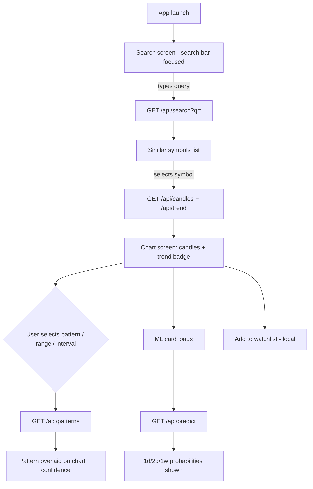
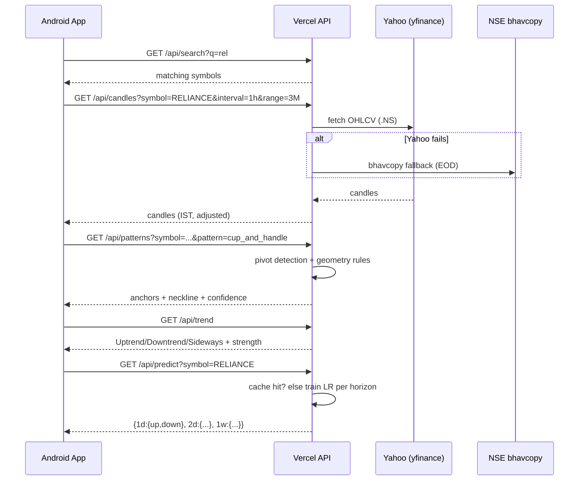

# Technical Pattern Analysis — Plan

Android app (glassmorphism) + Python backend on Vercel for Indian stock market (NSE/BSE) chart pattern analysis.

## 1. Scope (from requirements)

| # | Requirement |
|---|---|
| R1 | Search bar is the main element; search reveals similar symbols/stocks |
| R2 | Selecting a symbol loads its data from every free/open data source useful for charting |
| R3 | Chart page with pattern dropdown: Head & Shoulders (+inverse), Cup & Handle, Double/Triple Top/Bottom, Bull/Bear Flag |
| R4 | Time range dropdown |
| R5 | Interval dropdown (5m, 15m, 30m, 1h, 1d, …) |
| R6 | Selected pattern is plotted (overlaid) on the price chart |
| R7 | Show current trend |
| R8 | ML model predicts trend for next 1d / 2d / 1w with probabilities |

## 2. Research findings

### 2.1 Free/open data sources (Indian market)

| Source | Data | Limits / notes |
|---|---|---|
| **yfinance** (Yahoo) | Intraday + daily OHLCV for `SYMBOL.NS` / `SYMBOL.BO` | Primary. Intraday caps: 1m ~7d, 2m/5m/15m/30m ~60d, 1h ~730d, 1d unlimited (10+ yrs). No API key. Auto-adjusted prices available (splits/dividends) |
| **NSE bhavcopy** (official CSV) | EOD OHLCV for all NSE equities | Free, reliable, but EOD only; endpoints need cookie handling |
| **nsefeed / nselib / jugaad-data** (open source) | NSE historical CSVs, bhavcopy, deliverables | Useful as EOD fallback; index OHLC endpoints deprecated by NSE |
| **Upstox / Zerodha Kite APIs** | Live + 60-day intraday candles | Free but need user account + auth — out of scope for v1 |

**Decision:** yfinance as primary source, NSE bhavcopy as EOD fallback. "Every free source" is impractical (paid feeds excluded, broker APIs need auth); the fallback chain covers realistic free availability.

**Symbol search:** Yahoo has no official search API. Ship a bundled snapshot of the NSE equity symbol universe (symbol + company name, ~2,000 entries, refreshed daily by a CI cron job committing an updated JSON). Search = local fuzzy match server-side (fast, no external dependency, works during Yahoo outages).

### 2.2 Pattern detection libraries

- TA-Lib / pandas-ta-classic: **candlestick patterns only** — none of the 5 requested chart patterns.
- `ta-patterns` (PyPI): 194 chart patterns incl. some classics, but coverage of the exact 5 requested patterns is partial and geometry rules are not tunable.

**Decision:** custom lightweight pivot-based detector in `server/` (scipy `find_peaks` on smoothed close + rule-based geometry). ~200 lines, no heavy dependency, full control of pattern anchors returned for chart overlay. TA-Lib C dependency is a cold-start/bundle risk on Vercel — avoid it entirely.

### 2.3 Vercel constraints (Python serverless, Hobby)

- Max duration 300s, memory 2 GB, bundle ≤ 500 MB, no persistent disk.
- **Training an ML model per request is feasible only if lightweight.** A per-symbol scikit-learn logistic regression on a few hundred daily bars trains in <2s. Deep learning / large ensembles are not viable — excluded.

## 3. Gap analysis (requirements vs reality)

| Gap | Risk | Resolution |
|---|---|---|
| Intraday history depth | 5m/15m/30m only last ~60 days; 1m ~7 days | Validate interval×range combos server-side; UI disables invalid combos (matrix in §6) |
| "Train an ML model" is ambiguous | Overengineering risk | Per-symbol logistic regression trained on request from the symbol's own daily history, cached. Calibrated probabilities via `predict_proba`. Simple, fast, honest |
| ML on short intraday data | Too few samples → unreliable | Train/predict on daily bars only; intraday selection affects chart, not the model |
| Pattern detection false positives | Wrong signals drawn | Volume + neckline-break confirmation, minimum pattern size, confidence score shown in UI |
| Lookahead bias in ML | Inflated accuracy | Strict walk-forward features (indicators at t predict t+1/2/5 sessions) |
| NSE anti-bot / endpoint churn | Backend breakage | yfinance primary; bhavcopy fallback; in-memory TTL cache per warm instance |
| Timezone confusion | Charts shifted | All timestamps IST (Asia/Kolkata); session filter 09:15–15:30 IST; NSE holiday calendar bundled |
| Corporate actions create fake gaps | False patterns | Use auto-adjusted OHLC from yfinance |
| Serverless is stateless | Re-training every request is wasteful | Cache model artifacts + predictions per (symbol) with TTL until next trading day; HTTP `Cache-Control` |
| No disclaimer | Legal | "Educational use only, not investment advice" on app footer |

## 4. Enhancements (added to scope)

1. Pattern confidence score + trend direction label on every detection.
2. Trend composite: EMA(20/50) slope + ADX strength + price position → **Uptrend / Downtrend / Sideways** with strength bar.
3. Auto "Detected patterns" summary chips above chart (all 5 patterns scanned, tap to overlay).
4. Volume sub-chart (confirmation for patterns).
5. Watchlist (local, no account).
6. Recent searches.
7. RSI toggle overlay (optional, cheap since indicators already computed).

Deliberately excluded (overengineering for v1): live streaming quotes, broker login, options chain, push alerts, custom pattern drawing.

## 5. Architecture

```
technicalPatternAnalysis/
├── android/          # Kotlin + Jetpack Compose app
├── server/           # Python (FastAPI), deployed on Vercel
│   ├── api/          # /api/search, /api/candles, /api/patterns, /api/trend, /api/predict
│   ├── core/         # data fetch, pattern detector, trend, ml
│   └── data/         # symbols.json snapshot (CI-refreshed)
├── design/           # this plan + diagrams
└── .github/workflows # CI: server tests + Android release APK artifact
```

Monorepo; shared API contract defined once in `design/api.md` (server implements, Android consumes — no duplication).

### API (v1 contract)

| Endpoint | Params | Returns |
|---|---|---|
| `GET /api/search?q=` | prefix/fuzzy query | `[{symbol, name, exchange}]` max 20 |
| `GET /api/candles` | `symbol, interval, range` | `{symbol, interval, tz:"IST", candles:[{t,o,h,l,c,v}], source}` |
| `GET /api/patterns` | `symbol, interval, range, pattern?` | `{detections:[{pattern, direction, confidence, anchors:[{t,price}], neckline:[{t,price}]}]}` — anchors are the overlay points |
| `GET /api/trend` | `symbol, interval, range` | `{label, strength(0-100), ema20, ema50, adx}` |
| `GET /api/predict` | `symbol` | `{horizons:{'1d':{up:0.62,down:0.38},'2d':{...},'1w':{...}}, trainedOn, nSamples}` |

Valid interval × range matrix (enforced both ends):

| Interval ↓ / Range → | 1D | 5D | 1M | 3M | 6M | 1Y | 5Y |
|---|---|---|---|---|---|---|---|
| 5m / 15m / 30m | ✅ | ✅ | ✅ | ⚠️ 60d cap | ❌ | ❌ | ❌ |
| 1h | ✅ | ✅ | ✅ | ✅ | ✅ | ✅ | ❌ |
| 1d | — | — | ✅ | ✅ | ✅ | ✅ | ✅ |

## 6. Pattern detection approach

Common base: smooth close (SMA-5), find swing highs/lows via `scipy.signal.find_peaks` with prominence scaled to ATR. Then per pattern:

| Pattern | Rule sketch |
|---|---|
| Head & Shoulders / Inverse | 3 peaks, middle highest (lowest for inverse), shoulders within ±2.5% of each other, neckline through the 2 intervening troughs |
| Cup & Handle | Rounded U trough (≥ 5 pivots fitting a quadratic, R² ≥ 0.8), depth 12–30% of cup height, handle: shallow drift (< 1/3 cup depth) above cup rim |
| Double/Triple Top/Bottom | 2–3 peaks (troughs) within ±3% tolerance, min spacing 5 bars, confirmed by neckline break with volume ≥ 1.5× avg |
| Bull/Bear Flag | Strong impulse leg (≥ 3 ATR move), then tight counter-channel: range < 1/2 impulse, slope against impulse, breakout closes channel |

Each detection returns anchor points + neckline so Android draws exact overlay geometry. Confidence = rule-margin score (0–100). Patterns must complete within the selected range; scan window slides across the range and returns all instances (most recent first).

## 7. Trend

```
score = w1·sign(EMA20 slope) + w2·sign(EMA50 slope) + w3·(close vs EMA50) + w4·(ADX>25 bonus)
label  = Uptrend (score>0.35) / Downtrend (<-0.35) / Sideways (else)
strength = |score|·100
```

## 8. ML trend prediction

- **Model:** scikit-learn `LogisticRegression` (multinomial: UP / DOWN / FLAT, FLAT = ±0.5% band), one binary-style classifier per horizon (1d, 2d, 1w ahead) — 3 small models per symbol, trained on request, cached until next trading session.
- **Data:** symbol's own daily bars (up to 10y from yfinance, auto-adjusted).
- **Features (all point-in-time):** returns (1/3/5/10d), RSI(14), MACD histogram, EMA20/50 spread %, ADX, ATR%, volume ratio, distance from 52w high/low.
- **Validation:** walk-forward split reported as `nSamples` + honest accuracy in the response for transparency.
- **Output:** `predict_proba` → {up, down} per horizon (FLAT folded into report as "range-bound" note).
- Fallback if < 500 samples: pooled global model (pre-trained artifact committed to repo, ~100 KB joblib) covering all symbols.

## 9. Android app

- Kotlin, Jetpack Compose, min SDK 26, R8/minify + resource shrinking on, cold-start fast, INTERNET only permission.
- **Design: glassmorphism** — frosted translucent surfaces, soft blur, subtle 1dp borders, layered depth, dark-first palette.
- Screens:
  - **Search** — hero search bar on blurred gradient backdrop; live results list (glass cards); recent searches + watchlist chips below.
  - **Chart** — top: symbol header + trend badge; middle: candlestick chart (MPAndroidChart `CandleDataSet` + line DataSets for pattern anchors/neckline, volume sub-chart); pattern dropdown, range dropdown, interval dropdown (glass dropdowns); detection chips; bottom: ML prediction card (3 horizons, probability bars).
- Chart library: **MPAndroidChart** (mature candlestick support; Vico lacks native candles).

## 10. Diagrams

### 10.1 User flow



### 10.2 Sequence: symbol → chart → pattern → prediction



## 11. CI/CD

- GitHub Actions on every push/PR: server tests (pytest) + Android build → **release APK artifact**.
- Daily cron: refresh `symbols.json` snapshot, commit if changed.
- Vercel: auto-deploy on merge to main (zero manual steps).
- GitHub Release (with APK) on major milestones.

## 12. Milestones

| M | Deliverable |
|---|---|
| M0 | Scaffolding, CI green, Vercel deployed skeleton |
| M1 | `/api/search` + `/api/candles` with fallback; Android search screen |
| M2 | Chart screen with range/interval dropdowns, volume, glass UI |
| M3 | Pattern detection (all 5) + chart overlay + confidence chips |
| M4 | Trend calculation + badge |
| M5 | ML prediction card (3 horizons, probabilities, cached training) |
| M6 | Watchlist, polish, release APK + GitHub Release |

## 13. Risks

- Yahoo rate-limits / schema changes → bhavcopy fallback + aggressive caching + `source` field shown in UI.
- Logistic regression accuracy will be modest (~52–58% directional) → shown honestly with sample counts; this is educational tooling, not a trading signal.
- NSE symbol universe churn → daily CI refresh of symbols.json.
