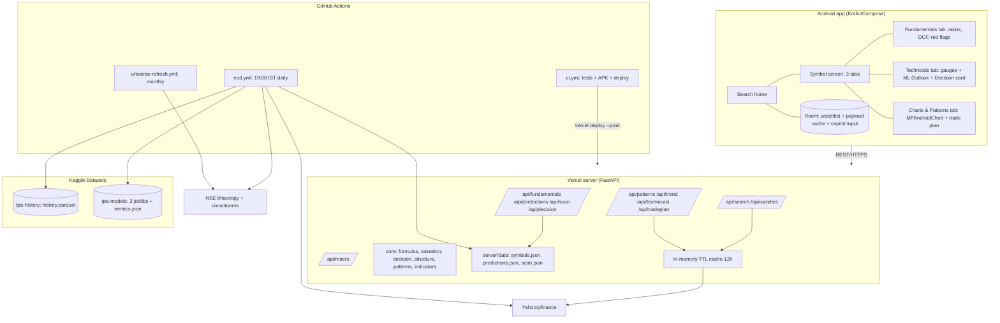
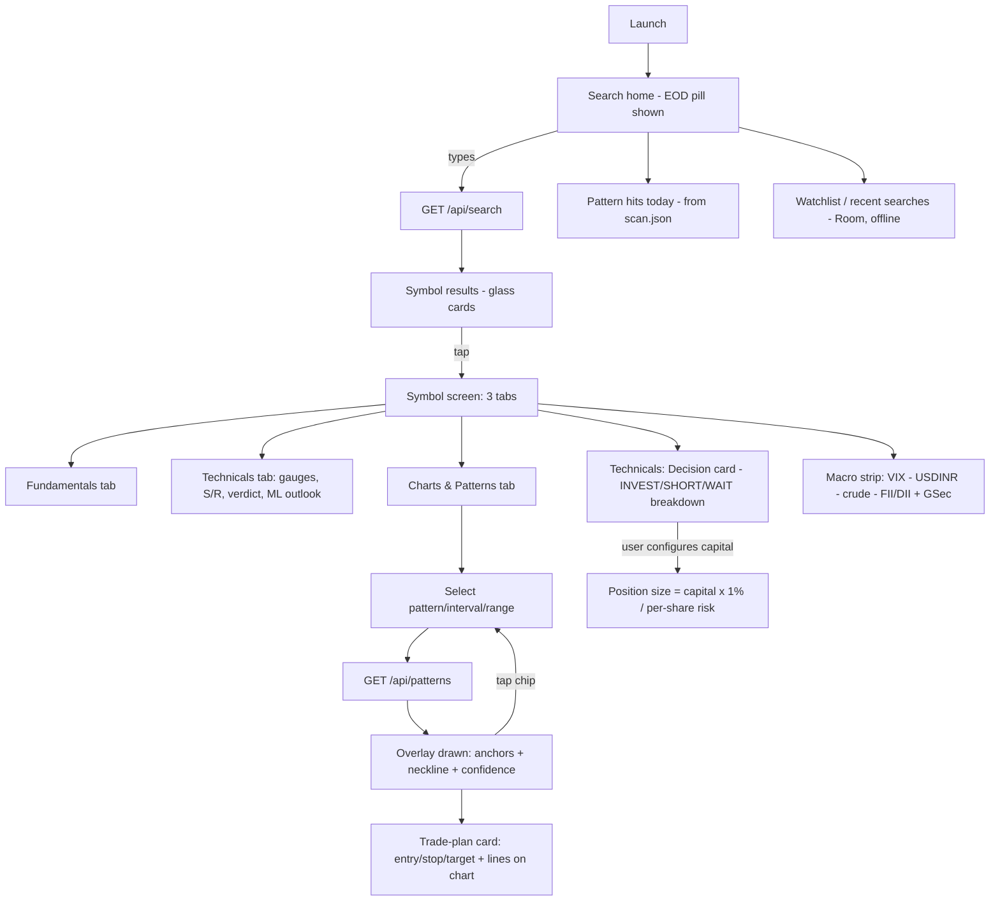
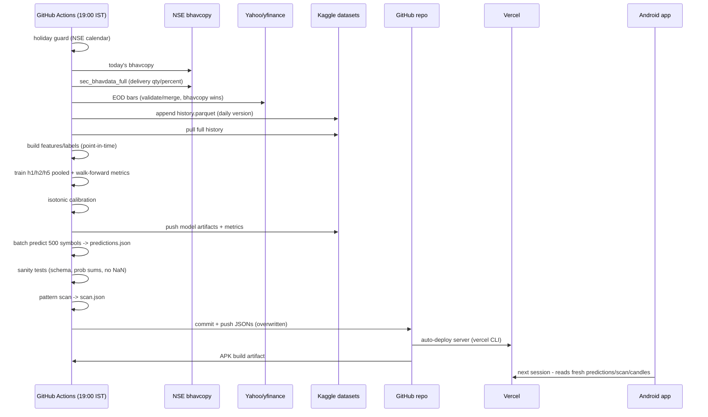
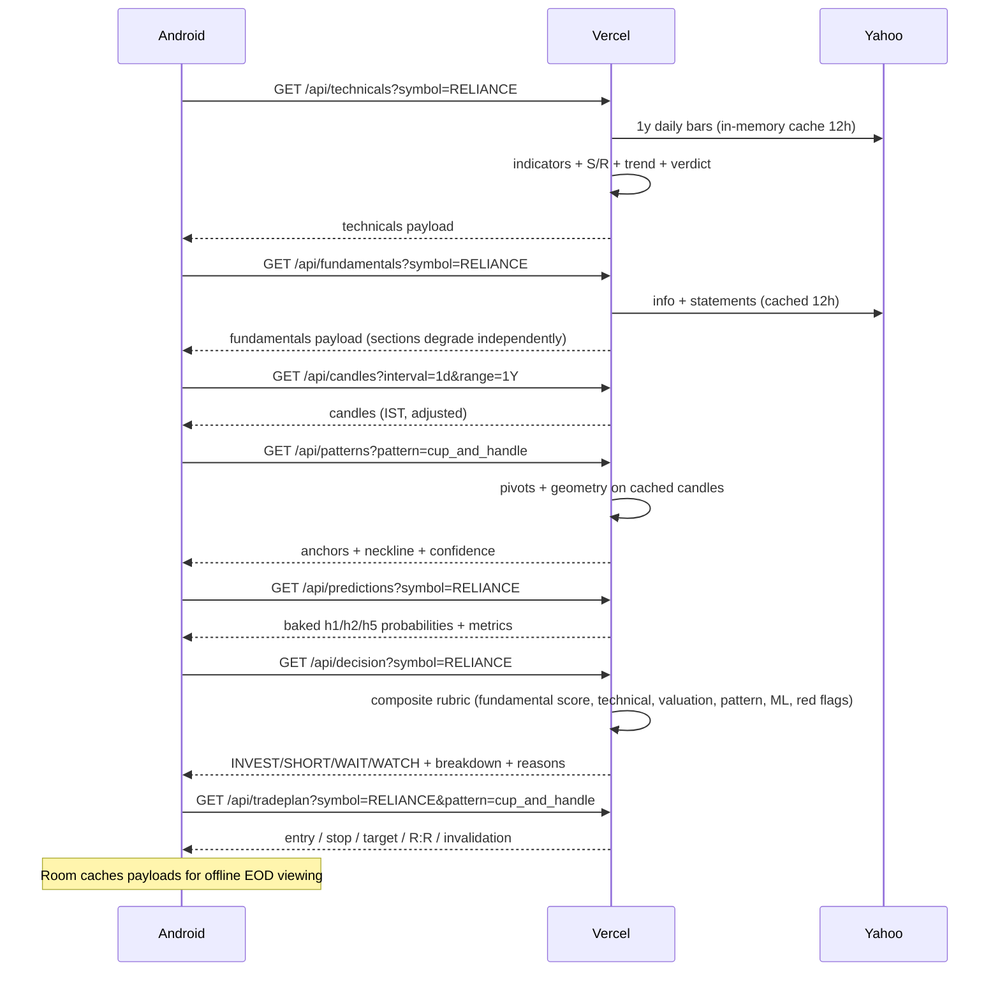
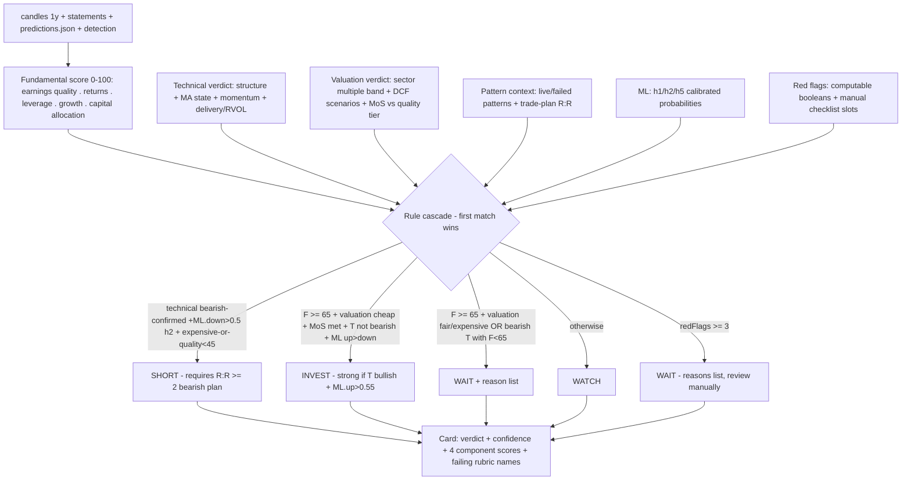
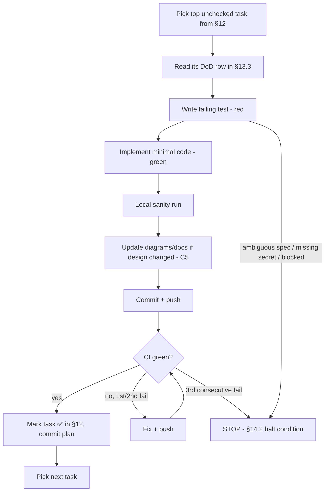

# Technical Pattern Analysis — Agent Execution Guide

Android app (glassmorphism) + Python backend (Vercel) + daily EOD ML pipeline (GitHub Actions + Kaggle) for Indian stock market (NSE), Nifty 500 universe.

This document is the **single source of truth**. Any agent picking up work: read §2 (Constitution) and §3 (Non-Goals) first, find your task in §12 (Checklist), follow §13 (TDD) until §13.4 (DoD) is met, and obey §14 (Halt Conditions). Diagrams are in §11 — never delete them; extend them when a feature changes behavior.

---

## 1. High-Level Core Strategy

### 1.1 Problem Statement & Objective

Indian retail investors have no free, offline-friendly tool that (a) scans Nifty 500 stocks for classic chart patterns at end-of-day, (b) explains the technical state of a stock, and (c) gives a calibrated probability view of the next 1d/2d/1w direction — all in one clean mobile app.

**Expected final state (definition of the finished product):**
1. User searches a stock, opens it, and sees three tabs: **Fundamentals, Technicals, Charts & Patterns**.
2. Charts tab renders a candlestick chart with dropdowns for pattern (5 families), interval (5m…1M), and range (1D…10Y); selecting a pattern draws its exact geometry (anchors + neckline) over the price action, with a confidence score.
3. Technicals tab shows indicator gauges, support/resistance levels, candlestick summary, a trend verdict, and an ML Outlook card with UP/DOWN/SIDEWAYS probabilities for 1d/2d/1w plus each model's honest walk-forward accuracy.
4. Every evening (19:00 IST, Mon–Fri), a GitHub Actions pipeline ingests the day's EOD data, retrains 3 generalized models, precomputes predictions and a universe-wide pattern scan, commits results, and redeploys the server automatically.
5. The app is EOD-only: no live quotes, no streaming, no auth, no accounts. Data as-of date is visible on every screen.
6. All infrastructure runs on free tiers: GitHub Actions, Vercel Hobby, Kaggle Datasets. Cost ceiling: **₹0 / $0**.
7. Every symbol screen ends in a transparent **Decision card — INVEST / SHORT / WAIT** with a visible breakdown (fundamental score, technical verdict, valuation verdict, ML probabilities, pattern context, red flags); each active pattern additionally carries a **trade-plan card** (entry, stop, measured-move target, R:R, position size). All rubrics derive from the user's curated investment book, distilled into `design/book-spec.md` — agents implement it; they never re-derive rules from the book source.

### 1.2 Project Constitution (survives all context clears)

**Process rules**
- C1. CI (GitHub Actions) is the only build/test/verify gate. Local runs are sanity checks only. Every push/PR must run CI.
- C2. Use the installed `gh` CLI for all repo operations (workflow triggers, variable/secret fetch, releases). Never scrape GitHub HTML.
- C3. Commit and push after each completed subtask (§12). Never force-push `main`. Conventional short commit messages.
- C4. TDD is mandatory (§13.1). No core logic (patterns, indicators, features, labels) is merged without a previously-failing test.
- C5. Design changes must update the Mermaid diagrams (§11) in the same commit. No exceptions.
- C6. When anything is ambiguous or blocked → §14.2 Halt Conditions. Interview the human; do not guess.
- C7. Never store real secrets in code, files, or logs. Secrets exist only as GitHub secrets (`KAGGLE_API_KEY`, `VERCEL_API_KEY`, `VERCEL_ORG_ID`, `VERCEL_PROJECT_ID`) and Vercel env vars.

**Server & pipeline (Python 3.12)**
- C8. Server framework: **FastAPI only**, pure functions in `core/` (no classes unless stateful), full type hints, pydantic response models matching `design/api.md`.
- C9. Forbidden packages anywhere: `TA-Lib` (C dependency, cold-start killer), `tensorflow`, `torch`, `keras`, Django/Flask, any ORM/DB driver, `xgboost`/`lightgbm` (sklearn's HistGradientBoosting suffices), any paid-API SDK.
- C10. ML is **scikit-learn only**, generalized pooled models (§10), trained exclusively in CI — never on Vercel.
- C11. Vercel request path must never call Kaggle and never train models. It reads baked JSONs (`server/data/*.json`) and fetches candles from Yahoo on demand.
- C12. All requirements pinned (`requirements.txt`, exact versions). Pipeline and server share one pin file each.
- C13. All timestamps ISO 8601 with `+05:30` offset (IST). India has no DST — never apply DST logic. Trading session = 09:15–15:30 IST. NSE holiday calendar is a bundled JSON in `core/constants.py`.
- C14. JSON keys are camelCase everywhere (API + baked files).

**Android (Kotlin 2.x, single module)**
- C15. Jetpack Compose only, single activity, MVVM + `StateFlow`. Forbidden: XML layouts, RxJava, `LiveData`, Fragments, WebView-based charts, Firebase, Hilt (manual DI is enough at this size).
- C16. Chart library: **MPAndroidChart** (candlestick support). Do not swap without human approval.
- C17. min SDK 26, R8/minify + resource shrinking always on. Permissions: INTERNET only.
- C18. Glassmorphism spec in §10.3 is fixed: 8% white-alpha surfaces, 24dp blur, 1dp 12%-white border, 20dp radius, dark backdrop; bullish `#34D399`, bearish `#F87171`, neutral `#FBBF24`.

**Data rules**
- C19. Use auto-adjusted OHLC (splits/dividends) from Yahoo for everything. Raw prices appear only in Fundamentals display fields.
- C20. Features/labels are strictly point-in-time (§10.1). Any lookahead bug is a release blocker.
- C21. Baked daily files are **overwritten, never appended** (repo-growth control). Kaggle holds all accumulated history.
- C22. **Missing values are computed via formulas** in `core/formulas.py` per `design/book-spec.md` §2–§3 (ratios, returns, quality, multiples, WACC/DCF inputs). If source inputs are absent, show "insufficient history" — never fabricate or interpolate away a gap. Every derived cell carries a provenance tag (computed vs reported).
- C23. Every quantitative rubric lives in `design/book-spec.md` and nowhere else. Changing any threshold, band, or weight = halt for human sign-off (§13.2 #6).
- C24. Valuation assumptions (Rf 7% G-Sec, ERP 6%, tax 25%, terminal-g bands, MoS quality tiers) are named config constants with provenance comments — single place (`core/constants.py`). Macro strip data drives nothing numerically.

### 1.3 Non-Goals (do NOT build or fix)

- No live/realtime quotes, streaming, WebSockets, auto-refresh polling.
- No user accounts, auth, cloud sync, or backend persistence (no database anywhere).
- No broker integrations (Zerodha/Upstox), no options/F&O data, no order placement — anything touching money movement.
- No per-symbol ML models, no deep learning, no model serving beyond static JSON.
- No push notifications, alerts, or background work in the app.
- No backtesting engine, no strategy builder, no news feed, no portfolio tracking.
- No BSE coverage, no non-Nifty-500 symbols, no crypto/forex.
- No custom pattern drawing, no user-defined indicators, no plugin system.
- No premature optimization: no Redis, no CDN, no multi-region, no horizontal scaling, no microservices split.
- No style screener in v1 (quality/value/GARP/momentum screens are post-v1 per `design/book-spec.md` §10 — the decision engine re-uses the same formulas).
- Do not "fix" Yahoo/NSE upstream breakage by adding paid sources or scraping that violates ToS — halt instead (§14.2).
- Do not refactor working code beyond the scope of the current checklist task.

---

## 2. Domain & Guardrails

### 2.1 Business logic & decision rubrics

**Universe:** Nifty 500 constituents. `server/data/symbols.json` is the registry: `[{symbol, name, sector}]`. Refreshed monthly by `universe-refresh.yml`; symbols removed from the index keep their history in Kaggle but get no new predictions.

**Pattern rubric** (shared `patterns.py`; thresholds are the spec — changing any requires human sign-off, see §14.2):

Base engine: SMA(5)-smoothed close → swing pivots via `scipy.signal.find_peaks`, prominence = 1.5 × ATR(14) → sliding window per pattern → confidence 0–100 from rule margins.

| Pattern | Direction | Rules |
|---|---|---|
| Head & Shoulders | bearish | 3 swing highs; middle peak highest by ≥ 1 ATR; shoulders within ±2.5% of each other; neckline through the 2 intervening troughs, slope < 30% of pattern height |
| Inverse H&S | bullish | mirror on swing lows |
| Cup & Handle | bullish | ≥ 5 pivots on lows fitting a quadratic (R² ≥ 0.8, U-shape); depth 12–30% of cup height; handle drift ≤ 1/3 cup depth below rim, duration 5–25 bars |
| Double Top/Bottom | bearish/bullish | 2 extremes within ±3% tolerance; spacing ≥ 5 bars; confirmed on close beyond neckline |
| Triple Top/Bottom | bearish/bullish | 3 extremes within ±3% of their mean |
| Bull Flag | bullish | impulse ≥ 3 ATR in ≤ 15 bars; flag range ≤ 1/2 impulse; flag slope opposes impulse; breakout close exits channel |
| Bear Flag | bearish | mirror of bull flag |

Global constraints: minimum pattern width 15 bars (intraday) / 20 bars (daily); neckline/channel break with volume ≥ 1.5 × 20-bar average boosts confidence; every detection returns anchors + neckline for exact chart overlay.

**Pattern upgrades from the book (mandatory; `design/book-spec.md` §7, §5):**
1. Every detector enforces its **prior-trend precondition** (H&S needs an uptrend, H&Si a downtrend, double top an uptrend, flags a strong impulse leg) — no prior trend, no detection.
2. The **volume sequence** (declining volume across sub-peaks, expansion on neckline/rim/channel break) is a validity rule, not a confidence modifier (relaxed only when the view has < 20 bars).
3. Each detection additionally computes: **measured-move target** (H&S: neckline ± (head−neckline); double/triple: projection of extreme-to-breakout gap; cup&handle: rim + cup depth; flag: pole from breakout), **stop** (beyond neckline/structure − 0.5 ATR, fallback 2×ATR), **R:R** (red < 2, amber 2–3, green ≥ 3), and a **failure/invalidation state** (neckline recapture + fresh extreme → pattern-failed, which itself is a reversal signal per the book).
4. **Structure module** (`core/structure.py`): swing-based trend state (HH/HL vs LH/LL), BOS (continuation break), ChoCH (counter-trend break warning), MSS (ChoCH + displacement candle ≥ 1.5×ATR). Structure state feeds the technical verdict, decision engine, and ML features.
5. Breakout-quality index (close in top 25% of candle range, RVOL ≥ 3 = significant, delivery-% alignment) modulates confidence for every family.

**Trend rubric (book-updated, uses DI direction):** `score = 0.35·sign(EMA20 slope) + 0.25·sign(EMA50 slope) + 0.25·sign(close−EMA50) + 0.15·sign(+DI − −DI)·f(ADX14 band: 0/0.5/1/1.5 for <20/20–25/25–50/>50)` → Uptrend > 0.35, Downtrend < −0.35, else Sideways; `strength = |score|·100`.

**ML label rubric (per horizon h ∈ {1, 2, 5} trading sessions ahead):** forward return > +0.5% → UP; < −0.5% → DOWN; else SIDEWAYS.

**Technicals rubrics:** RSI(14) zones <30/30–50/50–70/>70; MACD(12,26,9) histogram sign; EMA20/50/200 with golden/death-cross events; ADX(14) trend strength; ATR(14)% of close; Bollinger(20,2) width + position; S/R = swing-pivot clusters (merge levels within 0.75 × ATR; rank by touches × recency × volume) + classic floor pivots from last session; candlestick set (last 5 sessions): bullish/bearish engulfing, hammer, shooting star, doji, morning/evening star.

### 2.2 Inputs & Formats

**API parameters**

| Param | Allowed values |
|---|---|
| `interval` | `5m, 15m, 30m, 1h, 1d, 1w, 1M` (1w/1M resampled server-side from 1d) |
| `range` | `1D, 5D, 1M, 3M, 6M, 1Y, 2Y, 5Y, 10Y` |
| `symbol` | exact NSE symbol from `symbols.json` (e.g. `RELIANCE`, no `.NS` suffix — server adds it) |
| `pattern` | `head_and_shoulders, cup_and_handle, double_triple, flag` (omit = all) |

**Validity matrix** (enforce server-side; app greys out invalid combos):

| Interval ↓ / Range → | 1D | 5D | 1M | 3M | 6M | 1Y | 2Y | 5Y | 10Y |
|---|---|---|---|---|---|---|---|---|---|
| 5m / 15m / 30m | ✅ | ✅ | ✅ | ❌ | ❌ | ❌ | ❌ | ❌ | ❌ |
| 1h | ✅ | ✅ | ✅ | ✅ | ✅ | ✅ | ❌ | ❌ | ❌ |
| 1d | — | ✅ | ✅ | ✅ | ✅ | ✅ | ✅ | ✅ | ✅ |
| 1w / 1M | — | — | — | — | — | ✅ | ✅ | ✅ | ✅ |

(Yahoo caps: 5m–30m ≈ 60 days, 1h ≈ 730 days.)

**Core data formats**

Candle (API + internal): `{t: "2026-10-16T15:30:00+05:30", o, h, l, c, v}` — floats rounded to 2dp, v integer.

`history.parquet` (Kaggle `tpa-history`): columns `symbol(str), date(date32), open, high, low, close, volume, adjOpen, adjHigh, adjLow, adjClose (float64)`; sorted by (symbol, date); one row per symbol per trading day.

`predictions.json` (§10.2 full schema), `scan.json`: `{asOf, hits: [{symbol, pattern, direction, confidence, anchors, neckline}]}` — hits limited to patterns completing in the last 5 sessions.

`symbols.json`: `[{symbol, name, sector}]`, alphabetical.

CSV fixture format (§13.2): header `date,open,high,low,close,volume`, IST dates, one synthetic series per file.

### 2.3 System Boundaries

**File access (agents)**
- May create/edit: `android/**`, `server/**`, `pipeline/**`, `design/**`, `.github/workflows/**`, root config.
- `server/data/*.json`: writable **only** by the EOD pipeline workflow (or an agent explicitly implementing that pipeline step). Never hand-edit to make tests pass.
- Never touch: `.git/**`, GitHub secret values, `LICENSE`, `AGENTS.md`.

**API & rate limits**
- Yahoo (yfinance, no key): unofficial — max ~1 request/sec effective; server caches 12h; retries ×2 with 30s backoff; never loop over the universe from Vercel.
- NSE bhavcopy: public CSV endpoint requiring cookie handshake; fetched only in CI, once daily.
- Kaggle: dataset create/version/push only from CI with `KAGGLE_API_KEY`; ≤ 2 dataset versions/day by design; never in request path (C11).
- Vercel Hobby: 300s max duration, 2 GB RAM, 500 MB bundle; target cold start < 2s; FastAPI + pandas + numpy + scipy only.
- GitHub Actions: pipeline must finish < 30 min on standard runners; APK build < 15 min.

**Cost constraints**
- Total spend $0. Free tiers only. Any proposal requiring a paid tier (Redis, Upstash beyond free, Algolia, paid market data, larger runners, GPU) is automatically out of scope → halt (§14.2).
- Repo growth guard: baked JSONs overwritten daily (C21); expected steady-state daily delta < 1 MB.

---

## 3. Architecture

### 3.1 Locked decisions (from interviews)

| Decision | Choice |
|---|---|
| Data freshness | EOD only; one daily pipeline; no live anything |
| Pipeline runner | GitHub Actions daily cron (Kaggle = storage + optional overflow compute) |
| ML predictions | Daily batch precompute for all Nifty 500; app reads JSON, never trains |
| Storage | Kaggle Datasets (`tpa-history`, `tpa-models`); small daily JSONs committed to repo |
| ML training | **Generalized only** — 1 pooled model per horizon; no per-symbol models |
| ML output | 3-class UP/DOWN/SIDEWAYS (±0.5%), isotonic-calibrated probabilities |
| Fundamentals | Full financials (statements + actions; shareholding best-effort) |
| Technicals | Indicators + S/R levels + candlestick summary |
| Universe | Nifty 500 |
| Intervals | Intraday kept (delayed Yahoo) + daily/weekly/monthly |
| App structure | Search home → symbol screen with 3 tabs: Fundamentals, Technicals, Charts & Patterns |
| Verdict | **Rule-based composite Decision Engine** — INVEST / SHORT / WAIT with visible breakdown (no ML verdict) |
| Valuation | Multiples vs own 5-yr band + peer medians **+ 3-scenario DCF + margin of safety**, sector-aware |
| Trade plan | Entry / structure-or-ATR stop / measured-move target / R:R / 1% position size per pattern |
| Pattern families | 5 in v1 (with book rules: prior trend, volume sequence, targets, failure rules); triangles/wedges/pennants/rectangles/rounding-bottom in v2 |
| Macro | Minimal 5-strip (India VIX, USD/INR, crude, FII/DII net, G-Sec constant) — context only, drives nothing numerically |
| Screener | Post-v1 (book screens re-use decision-engine formulas) |

### 3.2 Component diagram



### 3.3 Repository structure

```
technicalPatternAnalysis/
├── android/                      # Kotlin + Jetpack Compose (single module)
├── server/                       # Python (FastAPI), deployed to Vercel
│   ├── api/                      # routers: search, candles, patterns, trend, technicals, fundamentals, predictions, scan, decision, tradeplan, macro
│   ├── core/                     # data.py, patterns.py, indicators.py, trend.py, structure.py, formulas.py, valuation.py, decision.py, constants.py
│   ├── data/                     # baked daily by pipeline (committed)
│   │   ├── symbols.json
│   │   ├── predictions.json
│   │   └── scan.json
│   ├── tests/                    # pytest + fixtures/
│   ├── requirements.txt
│   └── vercel.json
├── pipeline/                     # runs in GitHub Actions only
│   ├── eod.py, features.py, train.py, predict.py, scan.py, kaggle.py, backfill.py
│   └── tests/
├── design/
│   ├── plan.md                   # this guide
│   └── api.md                    # full request/response schemas (contract source of truth)
└── .github/workflows/            # eod.yml, ci.yml, universe-refresh.yml
```

### 3.4 Secrets (configured; values are placeholders until M0 exit)

| Secret | Consumer |
|---|---|
| `KAGGLE_API_KEY` | EOD pipeline dataset push/pull |
| `VERCEL_API_KEY`, `VERCEL_ORG_ID`, `VERCEL_PROJECT_ID` | CI deploy step: `vercel deploy --prod` for `server/` |

---

## 4. Daily EOD Pipeline (`.github/workflows/eod.yml`)

**Schedule:** `cron: "30 13 * * 1-5"` = 19:00 IST Mon–Fri + `workflow_dispatch`.

1. **Holiday guard** — exit cleanly (no commit) if NSE holiday or no bhavcopy published.
2. **Fetch EOD bars** — bhavcopy (primary) + Yahoo daily for all 500; cross-validate closes (0.5% tolerance), prefer bhavcopy, log discrepancies.
3. **Accumulate** — append to Kaggle `tpa-history` (`history.parquet`); one version/day.
4. **Features/labels** (`pipeline/features.py`) — pull full history from Kaggle; build §10.1 features + h1/h2/h5 labels.
5. **Train** (`pipeline/train.py`) — per horizon: `HistGradientBoostingClassifier` pooled over all symbols (generalized-only, locked); walk-forward (train ≤ year T, validate T+1, 3 rolling folds) → accuracy/log-loss/Brier; isotonic calibration (prefit). Push `model_h{1,2,5}.joblib` + `metrics.json` + `features.json` to Kaggle `tpa-models`.
6. **Batch predict** (`pipeline/predict.py`) — latest features per symbol → `server/data/predictions.json` (schema §10.2).
7. **Pattern scan** (`pipeline/scan.py`) — all 5 detectors, 1y daily bars per symbol → `server/data/scan.json`.
8. **Sanity tests** — schema validation; exactly `len(symbols.json)` predictions; probabilities sum to 1 ± 0.001; no NaNs; ≥ 250 bars history required per symbol (else symbol excluded and listed in `predictions.skipped`).
9. **Commit + push** JSONs (overwritten, C21) → push triggers `ci.yml` (tests → deploy → APK artifact).

Backfill: one-time manual `backfill.py` loads 10y adjusted daily bars into `tpa-history` before first cron run.

---

## 5. Vercel Server API

Full schemas live in `design/api.md` (agents must create it in M0 and keep it synced). Summary:

| Endpoint | Params | Returns | Source |
|---|---|---|---|
| `GET /api/health` | — | `{status, dataAsOf}` | local |
| `GET /api/search?q=` | prefix/fuzzy | `[{symbol, name, sector}]` max 20 | baked `symbols.json` |
| `GET /api/candles` | symbol, interval, range | `{symbol, interval, tz:"Asia/Kolkata", source, candles:[…]}` | yfinance on demand; daily fallback: Kaggle `history.parquet` single-file pull |
| `GET /api/patterns` | symbol, interval, range, pattern? | `{detections:[{pattern, direction, confidence, anchors, neckline}]}` | computed (§2.1) |
| `GET /api/trend` | symbol, interval, range | `{label, strength, ema20, ema50, adx}` | computed (§2.1) |
| `GET /api/technicals` | symbol | indicators, S/R, candle summary, verdict | computed from 1y daily bars |
| `GET /api/fundamentals` | symbol | §9 sections | yfinance, cached 12h |
| `GET /api/predictions` | symbol | `{asOf, close, h1/h2/h5:{up,down,sideways}, metrics}` | baked `predictions.json` |
| `GET /api/scan` | page? | today's pattern hits, grouped by pattern | baked `scan.json` |
| `GET /api/decision` | symbol | `{verdict:"INVEST\|SHORT\|WAIT\|WATCH", confidence, components:{fundamental, technical, valuation, pattern, ml, redFlags}, reasons:[…]}` | composite rule engine (book-spec §6) |
| `GET /api/tradeplan` | symbol, pattern? | `[{entry, stop, target, rr, direction, invalidation, retestVariant}]` | from live detections (book-spec §7) |
| `GET /api/macro` | — | `{vix, usdinr, crude, fiiDiiNet, gsec10y, asOf}` | Yahoo quotes (cached) + NSE daily FII/DII CSV best-effort + config constant; display-only |

Caching: in-memory TTL 12h (data changes only at EOD) + `Cache-Control: public, max-age=3600` on candles/patterns. Errors: `404 unknownSymbol`, `400 invalidCombo`, `503 upstreamUnavailable` ("Data unavailable, try after today's EOD sync").

---

## 6. Pattern Detection, Technicals, Fundamentals (tab logic)

- **Patterns:** §2.1 rubric is the implementation spec. Dropdown families: H&S (incl. inverse), Cup & Handle, Double/Triple (top+bottom), Flag (bull+bear) — the "5 patterns" render as these 4 family entries + direction variants inside results. Each active detection carries its trade-plan block (entry/stop/target/R:R/invalidation per book-spec §7); triangles, wedges, pennants, rectangles, rounding bottom are v2 (book-spec §10).
- **Technicals tab:** gauge grid (RSI with divergence + 55–65 momentum-regime marker, MACD, EMA set with alignment state, ADX + +DI/−DI, ATR%, Bollinger + squeeze flag, RVOL, OBV slope, delivery-% 5-day avg) with bullish/bearish/neutral coloring; **structure chip** (UP/DOWN/RANGE/ChoCH pending); S/R price ladder with confluence badges (touches × volume × round-number × role-reversal, book-spec §5.3); candlestick chips (full book set: engulfing, piercing, dark cloud, tweezer, hammer, shooting star, doji family, morning/evening star, three soldiers/crows, rising/falling three methods — location-qualified, never mid-range); trend badge; verdict card ("n bullish / n bearish / n neutral"); overextension flag (> 30% above 200-DMA); **ML Outlook card** (3 horizons × probability bars + per-horizon accuracy + asOf); **Decision card** directly beneath — INVEST / SHORT / WAIT / WATCH with confidence, the four component scores, red-flag list, and the failing rubric names (nothing opaque).
- **Fundamentals tab sections** (each independently sourced — one failing source never blanks the tab): Header (name, sector, mcap, 52w, beta) ← `Ticker.info`; **Computed ratios grid** (~25 values from `core/formulas.py` per book-spec §2: liquidity, efficiency incl. CCC, profitability, ROE/ROCE/ROA/ROIC + DuPont decomposition, incremental ROIC, leverage, growth CAGRs + SGR comparison, FCF/FCF yield, CFO÷PAT quality fuse); Valuation section (sector-appropriate multiple vs own 5-yr band + peer median, PEG, earnings yield vs G-Sec); **Intrinsic value card** (3-scenario DCF bull/base/bear upside %, WACC composition, margin-of-safety verdict vs quality tier; bank/NBFC path = P/B vs ROE table per book-spec §4.5); Quarterly results (last 8 quarters: revenue, PAT, EPS, margin, YoY) ← `quarterly_income_stmt`; Annual statements (P&L, balance sheet, cash flow, last 4y); **Red flags list** (book-spec §6.1 — computable booleans auto-scored; auditor churn/RPTs/pledging render as manual checklist checkboxes with "needs filing data" tag, never auto-scored); Corporate actions (dividends, splits/bonuses); Shareholding (promoter/FII/DII/public) ← NSE, **best-effort, hidden on failure**.

---

## 7. ML Specification

### 7.1 Features (all point-in-time, scale-free; computed per symbol per day t)

`ret1, ret5, ret10, ret21` (% returns); `rsi14` (+RSI divergence flags); `macdHistNorm` (MACD hist ÷ close); `emaSpread2050` (EMA20−EMA50, % of close); `emaSpread50200` (%); `adx14`; `atr14pct`; `bbWidthPct`; `bbPosition` (0–1); `volRatio520` (5d ÷ 20d avg volume); `dist52wHighPct`; `dist52wLowPct`; `ema20Slope`; **book-added:** `dist200dmaPct` (overextension), `maAlignment` (+1 bull / −1 bear / 0 mixed), `structureState` (one-hot: UP/DOWN/RANGE/ChoCH/MSS), `relStrength20` (20d return − Nifty 20d return), `rvol20` (avg RVOL), `deliveryPct5` (avg of NSE delivery %, 0 when unavailable). Labels per §2.1 rubric.

### 7.2 Model & artifacts

3 × `HistGradientBoostingClassifier` (sklearn only, C10), class-weighted, isotonic-calibrated. Kaggle `tpa-models`: `model_h1/h2/h5.joblib`, `metrics.json` (accuracy, log loss, Brier per horizon), `features.json` (feature order — load-time contract).

### 7.3 `predictions.json` schema

```json
{
  "asOf": "2026-10-16",
  "modelTrainedOn": "2026-10-16",
  "metrics": {"h1": {"accuracy": 0.54, "logLoss": 1.02, "brier": 0.61},
               "h2": {"accuracy": 0.52, "logLoss": 1.05, "brier": 0.62},
               "h5": {"accuracy": 0.53, "logLoss": 1.03, "brier": 0.60}},
  "skipped": [{"symbol": "NEWCO", "reason": "insufficient_history"}],
  "predictions": [
    {"symbol": "RELIANCE", "close": 1437.90,
     "h1": {"up": 0.42, "down": 0.31, "sideways": 0.27},
     "h2": {"up": 0.38, "down": 0.35, "sideways": 0.27},
     "h5": {"up": 0.45, "down": 0.30, "sideways": 0.25}}
  ]
}
```

UI must always show the horizon's accuracy next to probabilities (never let 0.60 read as certainty).

---

## 8. Android App

Stack per Constitution (C15–C18). Navigation: **Home = Search** (hero search bar autofocus; glass result cards; recent searches; watchlist chips; "Pattern hits today" horizontal scroll ← `/api/scan`) → **Symbol screen: 3 glass tabs — Fundamentals | Technicals | Charts & Patterns**.

- Charts tab: candlestick + volume sub-chart; glass dropdowns (pattern/interval/range, validity matrix enforced); overlay = line through anchors + dashed neckline + shaded zone; detection chips (tappable, confidence badge); **trade-plan card** under the overlay (entry / stop / measured-move target lines drawn on the chart + R:R badge + invalidation note; position size from local user-entered capital × 1% risk).
- EOD behavior: no auto-refresh; "Data as of {date} · EOD" pill on every screen; manual pull-to-refresh optional and labeled. Room caches watchlist + last-viewed payloads (correct because data changes once daily).
- **Macro strip** pinned under the symbol header: India VIX · USD/INR · crude · FII/DII net · G-Sec 10y — display-only, EOD.
- Fixed footer: "Educational use only. Not investment advice."

---

## 9. Glossary

- **Session / bar (1d):** one NSE trading day (09:15–15:30 IST). "h5" = 5 sessions ahead, not calendar days.
- **EOD sync:** the daily pipeline run; the only moment app data changes.
- **Baked files:** `server/data/*.json` committed by the pipeline and bundled into the Vercel deployment.
- **Anchor:** a `{t, price}` point tracing the pattern's geometry on the chart.
- **BOS / ChoCH / MSS:** book market-structure terms — break of structure (continuation), change of character (counter-trend warning), market structure shift (confirmed reversal).
- **MoS:** margin of safety = how far below intrinsic value the price must sit before the verdict may say INVEST (`design/book-spec.md` §4.4).
- **Delivery %:** delivered shares ÷ traded shares (NSE `sec_bhavdata_full`) — conviction signal.
- **RVOL:** relative volume = current day ÷ 20-day average volume.

---

## 10. Diagrams

### 10.1 User flow



### 10.2 EOD pipeline sequence



### 10.3 Symbol screen request sequence



### 10.4 Decision engine flow (rule-based verdict, book-spec §6)



### 10.5 Agent task lifecycle (how an agent works a checklist item)



---

## 11. Decomposed Execution Checklist (state tracker)

Rules: work top-down within a milestone; one task ≈ one file/component; mark `[x]` only after CI green; update this section in the same commit that completes the task. Tags: `[CI]` workflows, `[BE]` server, `[PIPE]` pipeline, `[ML]` ML logic, `[UI]` Android, `[TEST]` tests/fixtures, `[DATA]` baked/symbol data, `[DOCS]` design docs.

### ✅ Completed
- [x] Requirements research; data-source feasibility (yfinance caps, bhavcopy, Kaggle, Vercel limits) — plan v1.
- [x] Architecture interviews: EOD-only, GH Actions pipeline, batch precompute, Kaggle storage, full fundamentals, indicators+S/R, Nifty 500, keep intraday, 3-class ML.
- [x] ML approach locked: generalized pooled models only (no per-symbol).
- [x] **Book integrated**: curated investment book (`/home/srinidhi/Documents/AI-Invest`) reviewed (Parts 1–11); authoritative distillation in `design/book-spec.md`; scope interviews resolved: rule-based composite verdict, multiples+DCF+MoS valuation, trade-plan card, minimal-5 macro strip, 5 pattern families (5 more → v2), screener post-v1.
- [x] Secrets created in GitHub (placeholder values — replaced in M0-T5).

### 🔄 Current — M0: Foundation
- [ ] **[CI]** `ci.yml`: server pytest job + `android` assembleRelease (R8) → APK artifact upload.
- [ ] **[BE]** Server skeleton: FastAPI app factory, `/api/health` (reads baked `dataAsOf`), `vercel.json`, pinned `requirements.txt`, pydantic error models.
- [ ] **[DOCS]** `design/api.md`: full request/response schemas for all §5 endpoints (camelCase, IST timestamps).
- [ ] **[UI]** Android skeleton: single-activity Compose app, glass theme tokens (§1.2 C18), empty Search screen, Retrofit+kotlinx-serialization client, MPAndroidChart dependency.
- [ ] **[CI]** Deploy job (main only, after tests): `vercel deploy --prod` using the 3 Vercel secrets.
- [ ] **[DATA]** Replace placeholder secret values with real Vercel/Kaggle credentials; verify deploy + a Kaggle test push.

### ⏳ Pending queue (priority order)

**M1 — Universe & EOD ingestion**
- [ ] [PIPE] `kaggle.py`: dataset create/version/push/pull wrappers (uses `KAGGLE_API_KEY`).
- [ ] [PIPE] Universe fetch: Nifty 500 constituents → `server/data/symbols.json` (symbol, name, sector).
- [ ] [PIPE] `eod.py` step 1: holiday guard (bundled NSE calendar JSON).
- [ ] [PIPE] `eod.py` step 2: bhavcopy fetch (cookie handshake) + NSE `sec_bhavdata_full` (delivery qty/%) + Yahoo EOD bars + 0.5% cross-validation.
- [ ] [PIPE] `backfill.py`: one-time 10y adjusted daily bars → Kaggle `tpa-history`.
- [ ] [PIPE] `eod.yml` workflow wiring steps 1–3 + 9 (commit/push JSONs) — steps 5–7 stubbed until M5/M7.
- [ ] [TEST] Pipeline dry-run mode on 20 checked-in symbols against sample parquet.
- [ ] [BE] `/api/search` (fuzzy over symbols.json, prefix-boosted, max 20).
- [ ] [BE] `/api/candles` (yfinance, validity matrix, 12h cache, IST session filter).
- [ ] [BE] Kaggle fallback for daily candles when Yahoo fails.
- [ ] [UI] Search screen: debounce 300ms, glass result cards, recent searches (Room).
- [ ] [TEST] Search + candles contract tests against `design/api.md` fixtures.

**M2 — Chart shell**
- [ ] [BE] Server-side resampling 1d → 1w/1M.
- [ ] [UI] Symbol screen scaffold: header + 3 glass tabs (empty bodies).
- [ ] [UI] Candlestick chart + volume sub-chart from `/api/candles`.
- [ ] [UI] Interval + range dropdowns (glass bottom sheets, validity matrix grey-out).
- [ ] [UI] EOD pill + pull-to-refresh.

**M3 — Pattern engine & overlay**
- [ ] [TEST] 14 synthetic fixtures (§12.2): positive + near-miss negative for H&S, inverse H&S, cup&handle, double top, double bottom, triple, bull flag, plus shared negatives.
- [ ] [BE] Pivot engine (SMA5 + find_peaks, prominence 1.5×ATR) — red tests first.
- [ ] [BE] `structure.py`: trend state (HH/HL vs LH/LL), BOS / ChoCH / MSS (book-spec §5.1) — red tests first.
- [ ] [BE] Trend-precondition + volume-sequence validity layers (shared detector mixins).
- [ ] [BE] H&S + inverse H&S detector.
- [ ] [BE] Cup & Handle detector.
- [ ] [BE] Double/Triple top/bottom detector.
- [ ] [BE] Bull/Bear flag detector.
- [ ] [BE] Measured-move target + structure-stop + R:R + invalidation per detection (book-spec §7).
- [ ] [BE] Breakout-quality index (close position, RVOL, delivery-% alignment).
- [ ] [BE] `/api/patterns`, `/api/tradeplan` (windowing over requested range, most-recent-first).
- [ ] [UI] Overlay renderer: anchor polyline + dashed neckline + shaded zone + target/stop lines.
- [ ] [UI] Detection chips + trade-plan card (R:R badge, position size from local capital × 1%).

**M4 — Technicals**
- [ ] [TEST] Golden-value fixtures: 30-bar series with hand-verified RSI/MACD/EMA/ADX/ATR/Bollinger/±DI outputs.
- [ ] [BE] `indicators.py`: rsi, macd, emaSet, adx+DI, atr, bollinger, volRatio, obvSlope (one PR each).
- [ ] [BE] RSI divergence detector (last 40 bars pivots, book-spec §5.2).
- [ ] [BE] S/R: pivot clustering + floor pivots + confluence badge (touches × volume × round-number × role-reversal).
- [ ] [BE] Candlestick summary, full book set (location-qualified).
- [ ] [BE] Overextension flag (dist from 200-DMA), Bollinger squeeze flag, delivery-% + RVOL chips.
- [ ] [BE] Trend + verdict aggregation; `/api/technicals`, `/api/trend`.
- [ ] [UI] Technicals tab: gauge grid, structure chip, S/R ladder, candle chips, verdict card.
- [ ] [UI] Tab renders fully offline from Room cache.

**M5 — ML**
- [ ] [ML] `features.py` + label builder (§7.1, incl. structureState, relStrength20, dist200dmaPct, maAlignment, rvol20, deliveryPct5) with lookahead-bias test (shuffled future bars must not change features).
- [ ] [ML] `train.py`: pooled HistGradientBoosting per horizon + walk-forward metrics + isotonic calibration.
- [ ] [ML] `predict.py`: batch → `predictions.json` (incl. `skipped` for <250-bar symbols).
- [ ] [PIPE] Wire steps 5–6 into `eod.yml`; push artifacts to `tpa-models`.
- [ ] [TEST] Sanity suite in pipeline (schema, prob sums, counts vs symbols.json).
- [ ] [BE] `/api/predictions`.
- [ ] [UI] ML Outlook card: 3 horizons, probability bars, accuracy footnotes, asOf date.

**M6 — Fundamentals**
- [ ] [TEST] Formula golden fixtures: hand-verified statement set (~5 real sample statements incl. one bank, one loss-maker) → every ratio per book-spec §2, tolerance ≤ 0.2%.
- [ ] [BE] `formulas.py`: liquidity, efficiency (CCC), profitability, ROE/ROCE/ROA/ROIC + DuPont, incremental ROIC, leverage, growth CAGRs + SGR, FCF, CFO÷PAT, multiples incl. EV build (red tests first; C22 provenance tags).
- [ ] [BE] `/api/fundamentals`: header + valuation + computed-ratio grid + profitability sections.
- [ ] [BE] Quarterly results + annual statements sections.
- [ ] [BE] Corporate actions section.
- [ ] [BE] Shareholding section (NSE, best-effort, hidden on failure).
- [ ] [BE] Red-flags engine: computable booleans (CFO/PAT divergence, receivables/inventory vs revenue, OCF-negative-with-PAT, dilution via share-CAGR vs EPS-CAGR, IntCov<2, D/E>2, ROCE 3-yr decline) + manual checklist slots (auditor/RPT/pledge).
- [ ] [BE] Bank/NBFC path: ratio fallback set (RoA/RoE/P-B anchor; skip D-E/EV-EBITDA/CCC).
- [ ] [UI] Fundamentals tab: section cards, computed-ratio grid, quarterly mini bar charts, expandable statement tables, red-flag card.
- [ ] [TEST] One-failing-source test: tab still renders remaining sections.

**M7 — Decision & valuation engine (the core goal)**
- [ ] [TEST] Decision fixtures: 4 hand-built profiles → INVEST-strong (tier-1 quality + cheap band + bullish structure), SHORT (bearish structure + ML.down>0.5 h2 + expensive/value-trap quality), WAIT (quality but fair/expensive), WATCH (scattered signals); target-profile rules locked in book-spec §6.
- [ ] [BE] `valuation.py`: multiple matrix by sector + own 5-yr band + peer medians, PEG/earnings-yield-vs-GSec, 3-scenario DCF (FCFF, CAPM WACC from C24 constants, terminal-g bands) + MoS vs quality tier; cyclicals normalized-earnings path; bank/NBFC P/B-vs-ROE anchor path.
- [ ] [BE] `decision.py`: component scorers (fundamental, technical, valuation, pattern, ml) + rule cascade + reasons list (book-spec §6; red-test each fixture).
- [ ] [BE] `/api/decision` (component breakdown + reasons).
- [ ] [UI] Decision card: verdict, confidence, 4 component scores with failing rubric names, red-flag list.
- [ ] [UI] Macro strip (VIX / USDINR / crude / FII-DII / G-Sec) — display-only.

**M8 — Scan, watchlist, release**
- [ ] [PIPE] `scan.py` (universe-wide, last 1y daily bars) → `scan.json`; wire into `eod.yml`.
- [ ] [BE] `/api/scan` (paged, grouped by pattern).
- [ ] [UI] "Pattern hits today" horizontal scroll on search home.
- [ ] [UI] Watchlist add/remove (Room).
- [ ] [UI] Glass polish pass (blur, borders, transitions) + offline verification.
- [ ] [CI] Release workflow: tag → GitHub Release with CI-built APK.

---

## 12. Verification & Testing Protocol

### 12.1 TDD mandate

For every core-logic task (patterns, indicators, features, labels, trend, S/R, resampling):
1. **Red:** write the failing pytest first, committed with the task. Use only §12.2 fixtures.
2. **Green:** minimal implementation. No extra abstractions.
3. **Refactor** only within the task's file.
4. UI tasks: red = ViewModel unit test with recorded API fixtures (no emulator required); CI runs JVM tests only.
5. CI is the gate (C1). A task is done only when CI is green AND its §12.3 DoD row is satisfied.

### 12.2 Test data definitions (fixtures are part of the spec)

**Pattern fixtures** (`server/tests/fixtures/patterns/*.csv`, format `date,open,high,low,close,volume`): synthetic series generated from anchor scripts (checked into `tests/fixtures/generators/`) so they're reproducible:
- Positive: `hs_pos.csv` (3 peaks, middle 1.5 ATR above equal shoulders), `ihs_pos.csv`, `cup_pos.csv` (quadratic U, R²≈0.95, 12–30% depth, valid handle), `double_top_pos.csv`, `double_bottom_pos.csv`, `triple_top_pos.csv`, `bull_flag_pos.csv`, `bear_flag_pos.csv`.
- Negative near-misses: `hs_neg.csv` (shoulders differ 5%), `cup_neg.csv` (handle deeper than 1/3 cup), `double_neg.csv` (peaks 4% apart), `flag_neg.csv` (flag range > 1/2 impulse), `noisy_flat.csv` (random walk — zero detections allowed).
- DoD: every positive fixture yields exactly 1 detection with confidence ≥ 70; every negative yields 0.

**Golden indicators** (`tests/fixtures/golden/`): `bars30.csv` + `golden30.json` containing hand-verified values for RSI14, MACD(12,26,9), EMA20/50/200, ADX14, ATR14, Bollinger(20,2) at the final bar — tolerance 0.1% relative.

**API fixtures:** recorded JSON responses per endpoint (`tests/fixtures/api/*.json`) mirroring `design/api.md`; contract tests assert schema equality.

**Pipeline sample:** `pipeline/tests/sample_history.parquet` — 20 real symbols × 10y (checked in once, read-only), used by dry-run mode; look-ahead test shuffles bars t+1..t+5 and asserts features at t are unchanged.

**Formula fixtures (M6):** `tests/fixtures/statements/{normal.csv, bank.csv, loss_maker.csv}` — hand-verified annual statement sets; expected ratio outputs in `golden_ratios.json` (tolerance 0.2%); statement dates fixed so fixtures don't drift.

**Decision fixtures (M7):** `tests/fixtures/decision/{invest_strong.json, short_case.json, wait_case.json, watch_case.json}` — full input profiles (statements + bars + baked predictions + detections); expected verdict + component scores + ≥ 3 specific reasons; these encode the rule cascade as executable spec.

**Sample baked files:** valid `predictions.json` (5 symbols), `scan.json` (3 hits), `symbols.json` (20 symbols) for BE/UI tests — never used to overwrite the real `server/data/`.

### 12.3 Definitions of Done (quantitative)

| Area | DoD |
|---|---|
| Server core (patterns, indicators, features) | pytest green; coverage ≥ 85% on `core/`; all fixture positives/negatives behave per §12.2 |
| API contract | Every endpoint round-trips its `design/api.md` schema; invalid combos → 400; unknown symbol → 404 |
| Pipeline | Dry-run passes on 20 symbols; full run < 30 min; sanity tests enforce prob sums 1±0.001, zero NaNs, prediction count = symbols count minus `skipped` |
| ML | Lookahead test green; walk-forward metrics logged to `metrics.json`; calibration: Brier ≤ 0.65 on h1 (else flag in metrics, don't ship silently) |
| Decision engine | All 4 decision-fixture profiles classified exactly per rubric; every verdict response includes ≥ 3 reasons + all component scores; red-flag booleans each covered by a unit test (true-case + false-case) |
| Formula coverage (C22) | For every display field sourced from statements: either computed from available inputs or explicitly "insufficient history" — audit test asserts zero silent N/A cells |
| Android | assembleRelease (R8) succeeds; APK < 20 MB; ViewModel tests green; cold launch < 3s on mid-range device spec |
| Vercel | `/api/health` cold start < 2s; bundle < 50 MB (limit 500) |
| Docs | Any behavioral change updates §2 rubric + affected diagram in the same commit |
| Repo hygiene | `server/data/*.json` changed only via pipeline commits; daily delta < 1 MB |

---

## 13. Error Handling & Human-in-the-Loop

### 13.1 Known failure modes → playbook

| Failure mode | Automatic handling | Escalation |
|---|---|---|
| Yahoo 429/rate limit or schema drift | Serve 12h cache; retry ×2 (30s backoff); then daily-bar Kaggle fallback; `503 upstreamUnavailable` with EOD message | Schema drift that breaks candles entirely → halt (§13.2) |
| Bhavcopy late/missing at 19:00 IST | Retry ×3, 30-min backoff; holiday guard exits cleanly | Missing on a trading day after retries → pipeline fails, no commit; human investigates |
| Kaggle auth/version failure | Pipeline step fails before commit — no partial data ships | `KAGGLE_API_KEY` invalid → halt at M0-T6 |
| New symbol (IPO) with < 250 bars | Excluded to `predictions.skipped`; UI shows "Not enough history for ML outlook" | — |
| NSE blocks shareholding fetch | Fundamentals section hidden, rest of tab renders | If blocked > 5 consecutive days, propose removing section (human decision) |
| NaNs from yfinance `info` (thinly covered fields) | Omit field; UI hides missing cells | — |
| Class imbalance (sideways dominant) | Class weights + calibration (already in spec) | If UP/DOWN classes < 15% of labels → flag in metrics.json for review |
| Weekend/holiday cron trigger | Holiday guard exits 0, no commit | — |
| Pattern detector produces zero hits universe-wide | Sanity test fails pipeline | Human reviews thresholds (rubric change requires sign-off) |
| Vercel deploy fails | CI job red; previous deployment stays live | 2 consecutive deploy failures → halt |
| Repo daily delta > 1 MB | Pipeline warning | > 5 MB → halt; investigate accidental append (C21 breach) |

### 13.2 Halt conditions — STOP and wait for human review

An agent (or pipeline) must halt when:
1. **3 consecutive CI failures** on the same test/step — do not keep patching; report the test, the error, and the attempted fixes.
2. **Missing/invalid secrets** — any `KAGGLE_*`/`VERCEL_*` check fails.
3. **Ambiguous or conflicting requirements** — spec vs code disagree, or two rubric values conflict (C6: interview, don't guess).
4. **External schema change** — Yahoo renames/removes fields or bhavcopy format changes; verify with a single probe call, then halt. Never add paid sources or ToS-violating scraping as a "fix" (§1.3).
5. **Cost trigger** — a solution would leave any free tier or introduce a paid dependency.
6. **Rubric change** — any §2.1 threshold or §7 ML design change needs human sign-off before implementation.
7. **Data integrity failure** — pipeline sanity tests fail; never force-commit or hand-edit `server/data/*` to make CI green.
8. **Destructive operations** — anything requiring force-push, history rewrite, or deletion of user data/artifacts.
9. **Repetitive loop** — the same fix attempted 2× without progress counts as halted (see 1).

On halt: open a GitHub issue (via `gh`) titled `HALT: <condition> — <task>`, body = failure evidence + attempted fixes + proposed options + the exact question for the human. Do not proceed to the next task.

---

## 14. Risks & long-term notes

| Risk | Mitigation |
|---|---|
| Yahoo intraday caps/outages | Validity matrix caps; Kaggle daily fallback; graceful 503 with EOD messaging |
| Kaggle dataset growth | Single compact parquet; monthly version pruning; never in hot path |
| ML accuracy modest (~52–58%) | Metrics shown in UI; educational framing; never a trading signal |
| Repo growth from daily commits | Overwrite-not-append (C21); delta guard in sanity tests |
| NSE anti-bot | Shareholding/corporate-actions best-effort; sections degrade independently |
| DCF assumption sensitivity | Bear/base/bull always presented together (never a single-number answer); assumptions (Rf/ERP/g/tax) are C24 config constants with provenance comments; changing them = halt |
| Fundamental data reporting lags / splits between quarters | Ratios computed from latest available statements; as-of date shown on every computed value |
| Vercel cold start | No Kaggle/model loading on request path; small pinned deps; baked JSONs |

**Deliberately excluded from v1** (§1.3 is authoritative): live data, broker logins, F&O, alerts, backtesting, per-symbol models, BSE, portfolio tracking.

**Open items:** none blocking. Shareholding source robustness is the only best-effort surface (M6 ships it hidden if unreliable). Placeholder secrets resolved in M0-T6.
