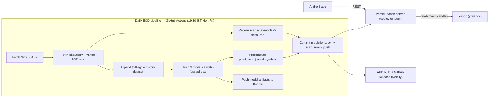
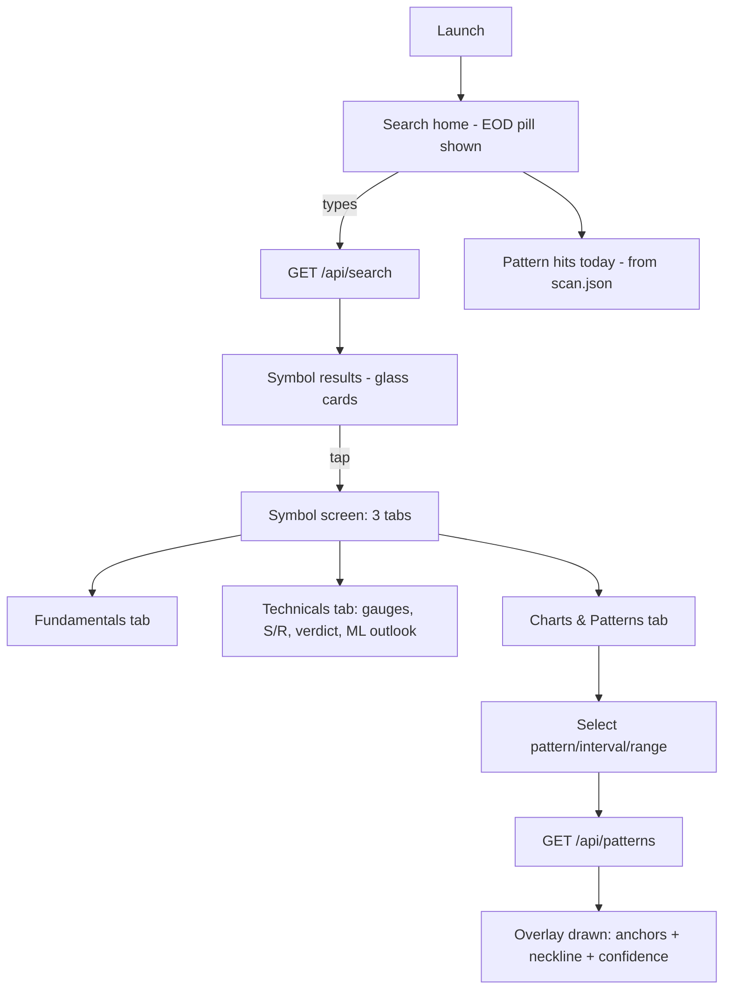
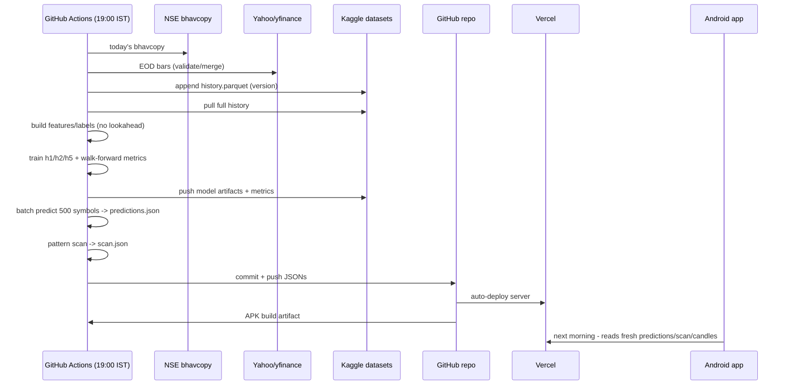
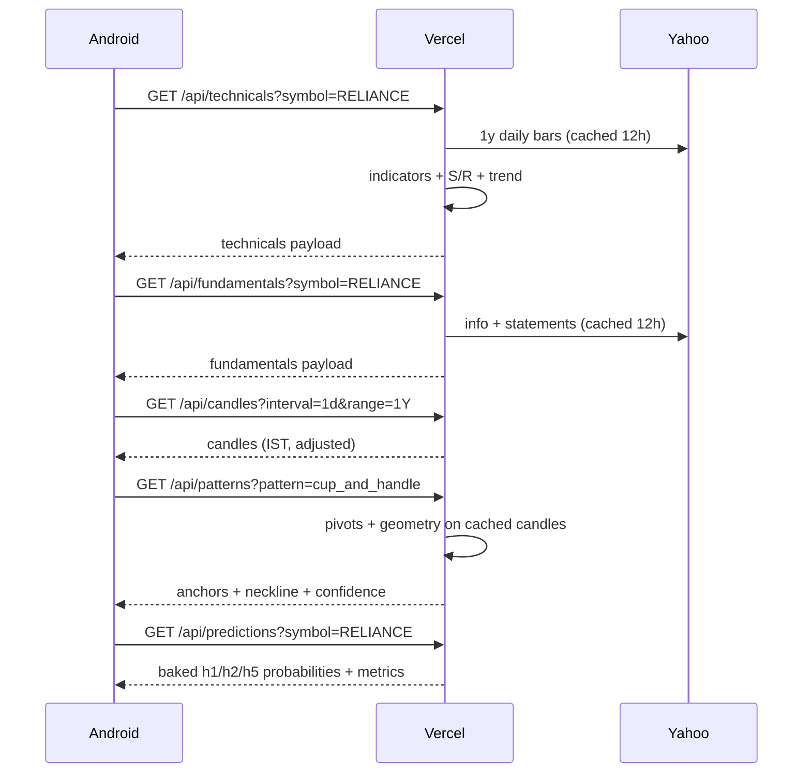

# Technical Pattern Analysis — Detailed Plan

Android app (glassmorphism) + Python backend (Vercel) + daily EOD ML pipeline (GitHub Actions + Kaggle) for Indian stock market (NSE), Nifty 500 universe.

## 1. Product decisions (locked from interviews)

| Decision | Choice |
|---|---|
| Data freshness | **EOD only.** No live quotes, no auto-refresh. One daily pipeline run after market close. |
| Pipeline runner | **GitHub Actions** daily cron (Kaggle = storage only, plus optional heavy-compute overflow) |
| ML predictions | **Daily batch precompute** for all Nifty 500 symbols; app reads results, never trains |
| Storage | **Kaggle Datasets** for EOD history + model artifacts; small daily JSONs committed to repo |
| Fundamentals tab | **Full financials** (ratios + statements + corporate actions; shareholding best-effort) |
| Technicals tab | **Indicators + S/R levels** + candlestick summary |
| Symbol universe | **Nifty 500** (constituent list refreshed monthly by pipeline) |
| Chart intervals | **Keep intraday** (5m/15m/30m/1h, Yahoo delayed, 60d cap) **plus** 1d/1w/1M |
| ML output | **3-class**: UP / DOWN / SIDEWAYS (±0.5% band), probabilities per horizon 1d/2d/1w |
| App structure | Search home → symbol screen with **3 tabs: Fundamentals, Technicals, Charts & Patterns** |

## 2. Architecture overview



**Data flow principles**
- Heavy work (history accumulation, training, batch scan) happens **once daily in CI**, not on Vercel.
- Vercel functions stay cold-start fast: they read small baked-in JSONs, fetch candles on demand from Yahoo, compute patterns/indicators on demand (cheap), and never call Kaggle in the hot path.
- The app is a read-only EOD viewer: everything it shows is either baked into the daily commit or computed from EOD candles.

## 3. Repository structure

```
technicalPatternAnalysis/
├── android/                      # Kotlin + Jetpack Compose
│   ├── app/
│   └── (gradle files, CI builds release APK)
├── server/                       # Python, deployed to Vercel
│   ├── api/                      # FastAPI routers: search, candles, patterns, trend, technicals, fundamentals, predictions, scan
│   ├── core/
│   │   ├── data.py               # yfinance fetch + validation + cache
│   │   ├── patterns.py           # pivot engine + 5 pattern detectors
│   │   ├── indicators.py         # RSI, MACD, EMA, ADX, ATR, Bollinger, S/R
│   │   ├── trend.py
│   │   └── constants.py          # interval/range matrix, holidays
│   ├── data/                     # baked daily by pipeline (committed)
│   │   ├── symbols.json          # Nifty 500 universe (symbol, name, sector)
│   │   ├── predictions.json      # daily ML batch output (~500 symbols)
│   │   └── scan.json             # daily pattern hits across universe
│   ├── tests/
│   ├── requirements.txt          # pinned; no TA-Lib C dependency
│   └── vercel.json
├── pipeline/                     # runs in GitHub Actions, not on Vercel
│   ├── eod.py                   # fetch + merge + validate daily bars
│   ├── features.py              # feature/label construction
│   ├── train.py                 # 3 models, walk-forward eval
│   ├── predict.py               # batch predictions.json
│   ├── scan.py                  # pattern scan -> scan.json
│   └── kaggle.py                # dataset push/pull helpers
├── design/
│   ├── plan.md                   # this document
│   └── api.md                    # request/response schemas (single source of truth)
├── .github/workflows/
│   ├── eod.yml                  # daily pipeline + deploy + APK
│   ├── ci.yml                   # PR/push: server tests + APK build
│   └── universe-refresh.yml     # monthly Nifty 500 constituent refresh
└── AGENTS.md
```

## 4. Secrets (already configured in repo)

| Secret | Used by |
|---|---|
| `KAGGLE_API_KEY` | EOD pipeline: push history + model artifacts to Kaggle datasets |
| `VERCEL_API_KEY` | CI: `vercel deploy --prod` for `server/` after tests pass |
| `VERCEL_ORG_ID`, `VERCEL_PROJECT_ID` | Same deploy step |

> Note: current values are placeholders (`hi`). Real values required before M1. No other secrets needed — yfinance and NSE bhavcopy need no keys.

## 5. Daily EOD pipeline (`.github/workflows/eod.yml`)

**Schedule:** `cron: "30 13 * * 1-5"` = 19:00 IST Mon–Fri, after NSE bhavcopy publication and Yahoo EOD settlement. Also `workflow_dispatch` for manual runs.

**Steps (in order):**

1. **Holiday guard** — if today is an NSE holiday (bundled calendar) or no bhavcopy published, exit cleanly without committing.
2. **Universe** — load `server/data/symbols.json`. (Constituent refresh is a separate monthly job.)
3. **Fetch today's EOD bars** — NSE bhavcopy (primary, official EOD) + Yahoo daily bars for all 500 symbols. Cross-validate closes (tolerance 0.5%); prefer bhavcopy; flag discrepancies to the job log.
4. **Accumulate history** — append today's bars to the Kaggle dataset `tpa-history` (`history.parquet`: symbol, date, o/h/l/c/v, adjusted o/h/l/c). One dataset version per day. Backfill script (one-time, manual) loads 10 years from Yahoo adjusted data.
5. **Build features + labels** (`pipeline/features.py`) — from full history (Kaggle pull), all point-in-time (no lookahead): returns 1/5/10/21d, RSI(14), MACD histogram (÷close), EMA20−EMA50 spread %, EMA50−EMA200 spread %, ADX(14), ATR(14)%, Bollinger width % + position, volume ratio (5d/20d), distance from 52w high/low %, EMA20 slope. Labels per horizon h ∈ {1, 2, 5 sessions}: UP if fwd return > +0.5%, DOWN if < −0.5%, else SIDEWAYS.
6. **Train** (`pipeline/train.py`) — one `HistGradientBoostingClassifier` (sklearn, no extra deps) per horizon on all pooled symbols (features are scale-free, so pooling works; ~1M rows). Walk-forward evaluation: train on years ≤ T, validate on T+1, rolling 3 folds → report accuracy, log loss, Brier score per class. Wrap in `CalibratedClassifierCV (isotonic, prefit)` for honest probabilities. Push artifacts + `metrics.json` to Kaggle dataset `tpa-models`.
7. **Batch predict** (`pipeline/predict.py`) — latest bar's features per symbol → probabilities for h1/h2/h5 → `server/data/predictions.json` (schema §9).
8. **Pattern scan** (`pipeline/scan.py`) — run all 5 detectors over the last 1 year of daily bars per symbol → `server/data/scan.json` (schema §9). This powers "Pattern hits today" on the app.
9. **Sanity tests** — JSON schema validation, 500 symbols present, probabilities sum to 1.0 ± ε, no NaNs. Fail the job otherwise.
10. **Commit + push** — `predictions.json`, `scan.json` (single files, overwritten daily — controlled repo growth). Push triggers `ci.yml` which deploys the server and builds the APK.

**Kaggle datasets**
- `tpa-history`: `history.parquet` (+ `meta.json` with last date). Versioned daily.
- `tpa-models`: `model_h1.joblib`, `model_h2.joblib`, `model_h5.joblib`, `metrics.json`, `features.json`. Versioned daily.
- Kaggle is **not** in the request path — only CI reads/writes it.

## 6. Vercel server (FastAPI, `server/`)

Lightweight: FastAPI + yfinance + pandas + numpy + scipy only. Cold start budget < 2s.

| Endpoint | Params | Returns | Source |
|---|---|---|---|
| `GET /api/health` | — | `{status, data_as_of}` | local |
| `GET /api/search?q=` | prefix/fuzzy | `[{symbol, name, sector}]` max 20 | baked `symbols.json` |
| `GET /api/candles` | `symbol, interval, range` | `{symbol, interval, tz:"Asia/Kolkata", source, candles:[{t,o,h,l,c,v}]}` | yfinance on demand; daily fallback: Kaggle `history.parquet` |
| `GET /api/patterns` | `symbol, interval, range, pattern?` | `{detections:[{pattern, direction, confidence, anchors:[{t,price}], neckline:[{t,price}]}]}` | computed from candles (§7) |
| `GET /api/trend` | `symbol, interval, range` | `{label, strength(0–100), ema20, ema50, adx}` | computed (§8.4) |
| `GET /api/technicals` | `symbol` | indicators, S/R levels, candlestick summary, verdict (§8) | computed from 1y daily bars |
| `GET /api/fundamentals` | `symbol` | full financials (§10) | yfinance on demand (stable, slow-changing → cache 12h) |
| `GET /api/predictions` | `symbol` | `{as_of, close, h1/h2/h5:{up,down,sideways}, metrics}` | baked `predictions.json` |
| `GET /api/scan` | `page?` | today's pattern hits across Nifty 500, grouped by pattern | baked `scan.json` |

**Caching:** per-instance in-memory TTL dict (candles 12h — data only changes at EOD), plus `Cache-Control: public, max-age=3600` on candle/pattern responses. Fundamentals cached 12h. Baked JSONs are read once at module import.

**Interval × range validity matrix** (enforced server-side; app disables invalid combos):

| Interval ↓ / Range → | 1D | 5D | 1M | 3M | 6M | 1Y | 2Y | 5Y | 10Y |
|---|---|---|---|---|---|---|---|---|---|
| 5m / 15m / 30m | ✅ | ✅ | ✅ | ❌ | ❌ | ❌ | ❌ | ❌ | ❌ |
| 1h | ✅ | ✅ | ✅ | ✅ | ✅ | ✅ | ❌ | ❌ | ❌ |
| 1d | — | ✅ | ✅ | ✅ | ✅ | ✅ | ✅ | ✅ | ✅ |
| 1w / 1M | — | — | — | — | — | ✅ | ✅ | ✅ | ✅ |

(1w/1M derived by server-side resampling of daily bars.) Yahoo caps: intraday 5m–30m ≈ 60 days, 1h ≈ 730 days.

**Errors:** `404 unknown_symbol`, `400 invalid_combo`, `503 upstream_unavailable` (Yahoo down + fallback exhausted → app shows "Data unavailable, try after today's EOD sync"). All timestamps IST; trading-session filter 09:15–15:30 IST; bundled NSE holiday calendar.

## 7. Pattern detection (server + pipeline share `patterns.py`)

**Base engine:** smooth close with SMA(5) → swing pivots via `scipy.signal.find_peaks` (prominence = 1.5 × ATR(14)) → candidate segments → per-pattern geometry rules → confidence score 0–100 from rule margins → output anchors + neckline for exact chart overlay. Scan window slides across the requested range; all instances returned, most recent first.

| Pattern | Direction | Rules (sketch — final thresholds tuned in M3 against hand-labelled fixtures) |
|---|---|---|
| Head & Shoulders | bearish | 3 swing highs; middle peak highest by ≥ 1 ATR; shoulders within ±2.5% of each other; neckline through 2 intervening troughs (slope < 30% of pattern height); optional volume decline L→R |
| Inverse H&S | bullish | mirror image on swing lows |
| Cup & Handle | bullish | ≥ 5 pivots on lows fitting quadratic (R² ≥ 0.8, U-shape); depth 12–30% of cup height; handle drifts ≤ 1/3 cup depth below rim; handle duration 5–25 bars |
| Double Top / Bottom | bearish / bullish | 2 peaks (troughs) within ±3% tolerance; spacing ≥ 5 bars; neckline = intervening trough (peak); confirmed on close beyond neckline |
| Triple Top / Bottom | bearish / bullish | 3 extremes within ±3% of their mean |
| Bull Flag | bullish | impulse leg ≥ 3 ATR in ≤ 15 bars; flag channel range ≤ 1/2 impulse, slope opposing impulse; breakout close exits channel |
| Bear Flag | bearish | mirror of bull flag |

Dropdown shows the 5 families (H&S includes inverse; D/T includes top+bottom; Flag includes bull+bear). Confirmations: neckline/channel break with close + volume ≥ 1.5 × 20-bar average boosts confidence. Minimum pattern width: 15 bars (intraday) / 20 bars (daily). Every detection carries `{pattern, direction, confidence, anchors, neckline}` so the overlay is drawn precisely, not approximated.

## 8. Technicals tab (server-computed, `/api/technicals`)

**8.1 Indicator gauges** (from 1y daily bars): RSI(14) with overbought/oversold zones; MACD(12,26,9) line/signal/histogram; EMA 20/50/200 with golden/death-cross status; ADX(14) + DI+/DI−; ATR(14) as % of close; Bollinger(20,2) width + price position; volume: 5d vs 20d ratio + OBV slope.

**8.2 Support/Resistance:** (a) swing-pivot clustering over 6 months — levels within 0.75 × ATR merged, ranked by touch count + recency + volume at touches, top 5 each side; (b) classic floor pivots (PP, R1–R3, S1–S3) from last session OHLC.

**8.3 Candlestick summary** (last 5 sessions, native pandas-ta-classic CDL or equivalent hand-rolled set): bullish/bearish engulfing, hammer, shooting star, doji, morning/evening star — shown as dated chips.

**8.4 Trend:** `score = 0.35·sign(EMA20 slope) + 0.25·sign(EMA50 slope) + 0.25·sign(close−EMA50) + 0.15·(ADX>25)` → Uptrend (> 0.35) / Downtrend (< −0.35) / Sideways; strength = |score|·100.

**8.5 Verdict card:** "12 indicators → n bullish / n bearish / n neutral" aggregate with the ML Outlook card (§9 predictions) directly beneath it.

## 9. ML predictions (spec + baked JSON)

**Model:** 3 × `HistGradientBoostingClassifier` (h1, h2, h5 sessions ahead), pooled across all Nifty 500 symbols, class-weighted, isotonic-calibrated. Trained daily in CI (§5 step 6). Retraining cost ~minutes on standard runners.

**`server/data/predictions.json` schema:**
```json
{
  "as_of": "2026-10-16",
  "model_trained_on": "2026-10-16",
  "metrics": {"h1": {"accuracy": 0.54, "log_loss": 1.02, "brier": 0.61},
              "h2": {...}, "h5": {...}},
  "predictions": [
    {"symbol": "RELIANCE", "close": 1437.90,
     "h1": {"up": 0.42, "down": 0.31, "sideways": 0.27},
     "h2": {"up": 0.38, "down": 0.35, "sideways": 0.27},
     "h5": {"up": 0.45, "down": 0.30, "sideways": 0.25}}
  ]
}
```

**`server/data/scan.json` schema:** `{as_of, hits: [{symbol, pattern, direction, confidence, anchors, neckline}]}` — only detections completing within the last 5 sessions, newest first.

**Honesty in UI:** each prediction card shows the horizon's walk-forward accuracy from `metrics` (e.g. "1d accuracy 54%") so users never read 60% UP as certainty.

## 10. Fundamentals tab (server, `/api/fundamentals`, yfinance)

| Section | Fields | Source |
|---|---|---|
| Header | name, sector, industry, mcap, price, 52w range, beta | `Ticker.info` |
| Valuation | P/E TTM, forward P/E, P/B, dividend yield, EPS TM, book value/share | `info` |
| Profitability | ROE, ROA, gross/operating/net margins | `info` + derived from statements |
| Quarterly results | revenue, PAT, EPS, margin per quarter (last 8) + YoY growth | `quarterly_income_stmt` |
| Annual financials | income statement, balance sheet, cash flow (last 4 yrs), rendered as compact tables | `income_stmt`, `balance_sheet`, `cashflow_stmt` |
| Corporate actions | dividend history, splits/bonuses | `Ticker.dividends/splits` + NSE corporate actions |
| Shareholding | promoter / FII / DII / public %, latest quarter | NSE (via nselib-style fetch) — **best-effort**; tab section degrades gracefully if NSE blocks |

All sections are independently sourced — one failing source never blanks the tab.

## 11. Android app (Kotlin, Jetpack Compose)

**Stack:** min SDK 26, Compose, MPAndroidChart (candlestick), Room (watchlist + last-viewed payload cache — EOD data makes caching trivially correct), Retrofit + kotlinx.serialization, R8/minify + resource shrinking, INTERNET-only permission, dark-first.

**Navigation:**
- **Home = Search**: hero search bar (autofocus), glass result cards (symbol, name, sector); below: recent searches, watchlist chips, "Pattern hits today" horizontal scroll (from `/api/scan`).
- **Symbol screen = 3 tabs** (glass tab bar): **Fundamentals | Technicals | Charts & Patterns**.

**Tab content:**
- *Fundamentals:* scrollable glass sections per §10; quarterly results as mini bar charts; statements as expandable tables.
- *Technicals:* gauge grid (RSI/MACD/ADX/ATR/Bollinger/EMA cards with value + bullish/bearish/neutral coloring), S/R level list (price ladder against last close), candlestick chips, trend badge, **verdict card**, **ML Outlook card** (3 horizons × probability bars UP/DOWN/SIDEWAYS + per-horizon accuracy footnote + "as of" date + disclaimer).
- *Charts & Patterns:* candlestick chart + volume sub-chart; glass dropdowns: pattern family (5), interval (5m/15m/30m/1h/1d/1w/1M), range (validated matrix); selected pattern drawn as overlay line through anchors + dashed neckline + shaded pattern zone; detection chips (all 5 scanned for current view, tappable); confidence badge on each chip.

**Glassmorphism spec (consistent everywhere):** dark gradient backdrop with soft color blobs; surfaces = 8% white alpha + 24dp backdrop blur + 1dp 12% white border + 20dp corner radius; depth via layering; accent green `#34D399` (bullish), red `#F87171` (bearish), amber `#FBBF24` (neutral/sideways); no opaque panels.

**EOD behavior:** no refresh spinners/auto-poll; every screen shows a subtle "Data as of {date} · EOD" pill; a manual pull-to-refresh exists but is clearly labeled optional. Watchlist and last-viewed tabs render offline from Room.

**Disclaimer:** fixed footer on symbol screen: "Educational use only. Not investment advice."

## 12. Diagrams

### 12.1 User flow



### 12.2 EOD pipeline sequence



### 12.3 Symbol screen request sequence



## 13. CI/CD

| Workflow | Trigger | Jobs |
|---|---|---|
| `ci.yml` | push, PR | server pytest; Android assembleRelease (R8) → **APK artifact**; optional `vercel deploy --prod` (main only, after tests) using the 3 Vercel secrets |
| `eod.yml` | cron 13:30 UTC Mon–Fri + manual | full §5 pipeline; ends by pushing JSONs (which re-triggers `ci.yml` deploy) |
| `universe-refresh.yml` | monthly | re-fetch Nifty 500 constituents → update `symbols.json`, PR for review |

Releases: GitHub Release with CI-built APK at M7 and any major feature milestone.

## 14. Testing strategy

- **Server (pytest):** pattern detectors against synthetic OHLC fixtures (one hand-crafted positive + near-miss negative per pattern); indicator golden values; interval/range matrix enforcement; API contract tests mirroring `design/api.md`; predictions.json/scan.json schema validation.
- **Pipeline:** dry-run mode running on 20 symbols against a checked-in sample parquet; lookahead-bias test (shuffle future bars must not change features at t).
- **Android:** ViewModel unit tests (search debounce, dropdown state, Room cache); contract tests against recorded API fixtures.
- CI is the only gate; local runs are sanity checks.

## 15. Milestones

| M | Deliverable | Acceptance |
|---|---|---|
| M0 | Repo scaffolding, `ci.yml` green, server skeleton on Vercel (real secrets) | health endpoint live; APK artifact builds |
| M1 | Universe + EOD ingestion: `symbols.json`, bhavcopy+Yahoo fetch, Kaggle `tpa-history` daily versioning; `/api/search`, `/api/candles` | 500 symbols searchable; parquet grows daily |
| M2 | Android: search home + symbol screen shell (3 tabs) + candlestick chart with interval/range dropdowns | chart renders 1d/1Y from live API |
| M3 | Pattern engine + `/api/patterns` + chart overlay + detection chips; pytest fixtures pass | all 5 families detect on known synthetic cases |
| M4 | `/api/technicals` + `/api/trend` + Technicals tab (gauges, S/R, candle chips, verdict) | tab fully renders for any Nifty 500 symbol |
| M5 | ML: features, training, calibration, `predictions.json`, `/api/predictions` + ML Outlook card | daily cron produces probabilities + metrics; walk-forward metrics logged |
| M6 | `/api/fundamentals` + Fundamentals tab (all §10 sections) | full financials render; sections degrade independently |
| M7 | `scan.json` + "Pattern hits today" + watchlist + polish (glass pass, Room cache, offline tabs) | release APK + GitHub Release |

## 16. Risks & mitigations

| Risk | Mitigation |
|---|---|
| Yahoo intraday caps / outages | validity matrix caps requests; daily-bar fallback from Kaggle `history.parquet`; graceful `503` with EOD messaging |
| Kaggle API limits / dataset growth | single parquet (compact, ~500×2500 rows/yr); version pruning monthly; Kaggle never in hot path |
| Repo growth from daily JSON commits | files overwritten (not appended); predictions ~300KB, scan ~200KB, git delta-friendly; acceptable |
| Bhavcopy publication delay > 19:00 IST | pipeline retries 3× (30-min backoff); holiday guard prevents empty commits |
| Class imbalance (sideways dominant) | class weights + 3-class probabilities; isotonic calibration |
| ML accuracy will be modest (~52–58%) | metrics shown in UI; framed as educational, never as signal |
| NSE anti-bot for shareholding/corporate actions | best-effort sections; independent sourcing — tab never blanks |
| Vercel cold start | no Kaggle/model loading on request path; small deps; baked JSONs |
| Secrets are placeholders | M0 blocker — real Vercel/Kaggle creds needed before M1 |

## 17. Deliberately excluded (v1)

Live streaming, broker logins (Zerodha/Upstox), options/F&O data, push alerts, backtesting, custom pattern drawing, news feed, portfolio tracking, per-symbol bespoke models. All revisit post-v1.

## 18. Open item

None blocking. Shareholding-pattern source (NSE scraping robustness) is the only best-effort surface; if it proves unreliable in M6, the section ships hidden rather than broken.
