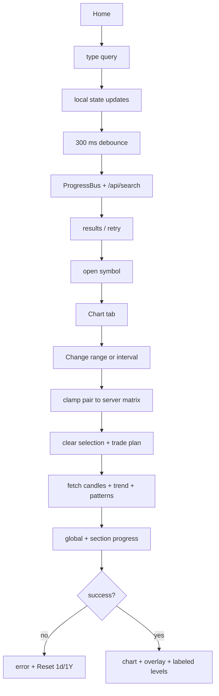
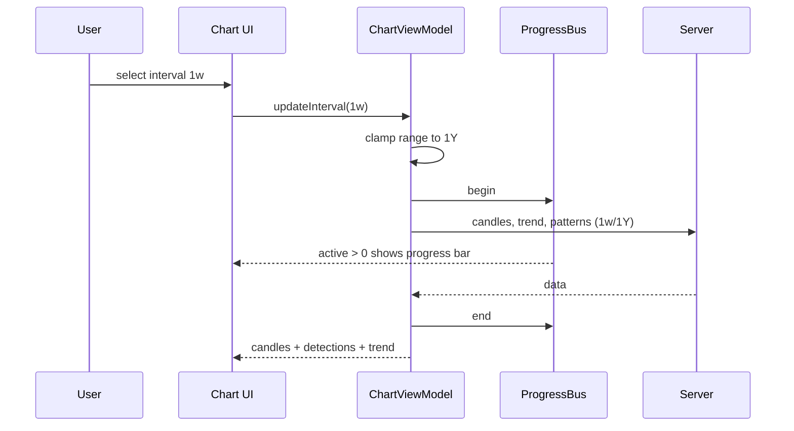

# v1.2.0 — search, chart reliability, education and progress

**Scope:** Android app; server untouched.
**Trigger:** v1.1.0 review — search typing, 404 intervals, no reset, no
explanations, no progress feedback, flat chart overlay, release asset name.

## 1. Findings (verified)

| # | Finding | Evidence |
|---|---------|----------|
| 1 | Intraday intervals cannot work: server serves baked EOD data; intraday falls through to yfinance, which is rate-limited on Vercel | live `5m/5D` → 404 `Candle data not found`; `core/bars.py` only bakes `1d/1w/1M` |
| 2 | Picking `5m` while range is `1Y` sends an invalid pair → 400, then the chart shows an error with no way back | `ChartViewModel.updateInterval` never fixes the range; `validIntervalsFor` is the inverse matrix |
| 3 | Selecting a detection writes its synthetic id into `selectedPattern`; a later range change forwards that id as the server `pattern` filter → bad request | `ChartViewModel.loadPatterns` reads `selectedPattern` |
| 4 | Filter widgets render a `DropdownMenu` **and** an inline 200 dppanel; three 56 dp bars consume the chart area | `PatternDropdown.kt`, `RangeDropdown.kt` |
| 5 | Search text is owned by the VM; no local input state, no retry; failure is a one-line message | `HomeScreen`, `SearchField` |
| 6 | No education layer anywhere | no info icons/dialogs |
| 7 | Fetches have no shared progress; pattern/trade-plan loads use tiny spinners | `ChartScreen` |
| 8 | Chart overlay draws a single-point neckline (invisible), a fill to zero, and unlabeled levels | `toOverlay` / `PatternOverlayRenderer` |
| 9 | Release asset is named `app-release.apk` | `release.yml` uploads `artifacts/*.apk` |

## 2. Changes

### Search
- `HomeScreen` owns `query` in `rememberSaveable`; `SearchField(value = query)`.
- Every change updates local state first, then debounces the API call.
- Error state gains a Retry button; clear button resets both.
- Search requests are tracked by the global progress bar.

### Intervals and ranges (server truth)
Supported intervals: `1d`, `1w`, `1M` (EOD source).
Matrix: `1d` → 5D..10Y; `1w`/`1M` → 1Y..10Y. `1D` range removed (intraday only).
- One signed pair at all times: changing interval clamps range; changing range
  clamps interval.
- `ChartViewModel.resetToDefault()` → `1d` + `1Y`, clears errors/selection,
  refetches candles, trend and patterns.
- Error surface exposes **Reset to 1d · 1Y** and explains the failure.
- Pattern filter is explicit (`patternFilter`), never a detection id.
- Range/interval changes clear selection + trade plan and re-run detection.

### Progress
- `ProgressBus` (StateFlow counter) + `AppProgressBar` at the top of `TpaApp`.
- Every API call in every VM wrapped in `ProgressBus.track { }`.
- Section bars: candles, patterns ("Scanning 1d · 1Y"), trade plan, technicals,
  fundamentals, decision, search.
- Captions state what is loading so the bar is meaningful.

### Education
- `ui/components/Info.kt`: glossary + `InfoButton` + scrollable `InfoDialog`.
- Guide buttons on Home, Wishlist, symbol detail/chart filters, pattern
  detections, trade plan, technicals, decision card, fundamentals.
- Each dialog explains every identifier on that surface in plain language.

### Chart overlay
- Anchor polyline colored by direction, visible anchor dots.
- Neckline extended horizontally from its anchor to the latest candle.
- Labeled limit lines for Neckline / Target / Stop (price included).
- Compose legend for the overlay; hint when no detection is selected.
- Chart text/candle colors follow the theme instead of fixed dark values.

### Release
- `release.yml` uploads the APK as `TPA.apk`.
- Rename the existing `v1.1.0` asset to `TPA.apk`.

## 3. Flow

## 4. Sequence

## 5. Verification
- CI: compile + unit tests + `assembleRelease`, APK artifact.
- Unit tests: navigation reducers, interval/range matrix.
- Release `v1.2.0` asset must be `TPA.apk`.
