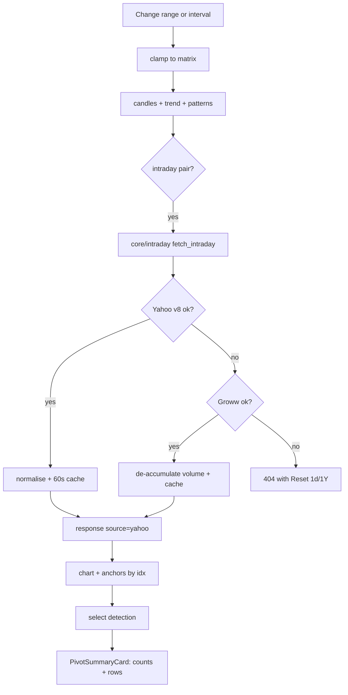
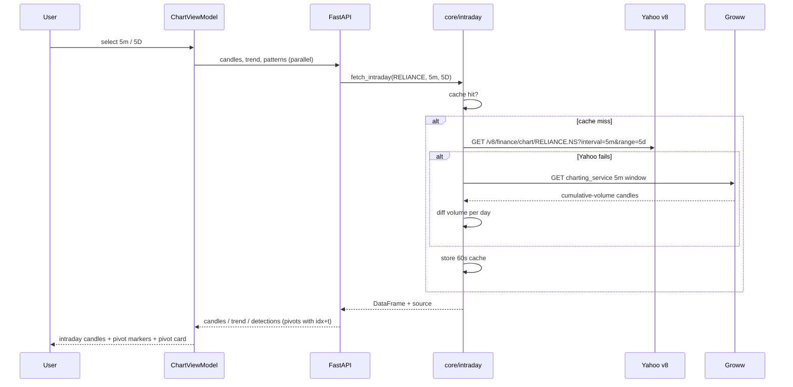

# v1.3.0 — intraday charts from keyless sources + pivot-point detail

**Scope:** server (data providers) + Android chart UI.
**Trigger:** intraday intervals were removed because yfinance is rate-limited on
Vercel; users need them back. Pivot dots were never drawn (client ignored the
server `idx`) and there was no pivot detail.

## 1. Research (verified live, 2026-10-29)

| Source | Auth | Intraday | Verified result |
|--------|------|----------|-----------------|
| Yahoo chart v8 (`query1.finance.yahoo.com/v8/finance/chart`) | none | 5m/15m/30m/60m | 200; 5m/5d, 30m/1mo, 60m/1y all return bars |
| Groww charting (`groww.in/v1/api/charting_service/v2/...`) | none | 1m/5m/15m/30m/60m | 200; 5m/30d 1481 bars, OHLC matches Yahoo, volume is **cumulative per day** |
| NSE `chart-databyindex` | cookies | 1m | 200 but empty payload from this IP |
| yfinance (current path) | none | 5m+ | 404 on Vercel (`Candle data not found`); needs crumb/cookie handshake |
| Stooq | none | none | bot-check page, unusable |
| Tickertape | none | unknown | endpoint 404/500, unusable |

Yahoo direct needs only a browser User-Agent (no cookie/crumb), so it avoids the
yfinance failure mode. Groww is the second provider for ranges up to ~30 days.

## 2. Server changes

- New `server/core/intraday.py`:
  - `fetch_intraday(symbol, interval, range) -> (DataFrame, source)`.
  - Yahoo v8 first (all intraday intervals, respects `range`).
  - Groww second (same intervals; window capped at 30 days).
  - Groww volume → per-bar by differencing the daily cumulative series.
  - Normalises columns to `t,o,h,l,c,v`, timestamps UTC-aware.
  - 60 s in-process cache per (symbol, interval, range); 30 s negative cache.
- `server/core/bars.py`: intraday branch calls `fetch_intraday` before yfinance,
  so `/patterns`, `/trend` and `/decision` accept intraday pairs too.
- `server/api/candles.py`: intraday branch calls `fetch_intraday`; `source`
  reflects the provider; cache TTL 60 s for intraday (12 h for daily); file
  cache not used for intraday.
- `server/api/patterns.py`:
  - anchors/neckline gain `idx` (bar index) in addition to `t`.
  - pivots gain `t`; keep `idx`, `price`, `kind`.
- Matrix unchanged (already declares intraday combos).

## 3. Android changes

- `ChartFilters.kt`: reintroduce intraday matrix.
  - `5m/15m/30m` → `1D,5D,1M`
  - `1h` → `1D,5D,1M,3M,6M,1Y`
  - `1d` → `5D..10Y`; `1w/1M` → `1Y..10Y`
  - `1D` range returns.
  - Clamping picks the first supported value, so `1D` range falls back to `5m`.
- Labels: intraday x-axis shows `HH:mm` for `1D` and `dd MMM HH:mm` otherwise.
- Chart overlay uses server `idx` for anchors/neckline, so intraday points land
  on the correct bar (timezone-safe).
- Pivots:
  - client `Pivot` gains `idx` + `t`; scatter uses `idx`.
  - HIGH and LOW are separate scatter series with distinct colors.
  - New `PivotSummaryCard` under the chart for the selected detection:
    total count, HIGH/LOW counts, and rows with date/time, kind, price.
  - Legend gains HIGH/LOW entries.
- `Info.kt`: interval/range glossary updated; new pivot entries.
- Tests: matrix tests updated for intraday; new clamp cases.
- Version 1.3.0 / 130; release notes; `TPA.apk` workflow unchanged.

## 4. Failure handling

- If both providers fail: 404 `Candle data not found`; chart shows Reset 1d · 1Y.
- If only a long intraday range fails on Groww, Yahoo still serves it; the app
  keeps the selected pair and shows Retry/Reset rather than crashing.

## 5. Flow

## 6. Sequence

