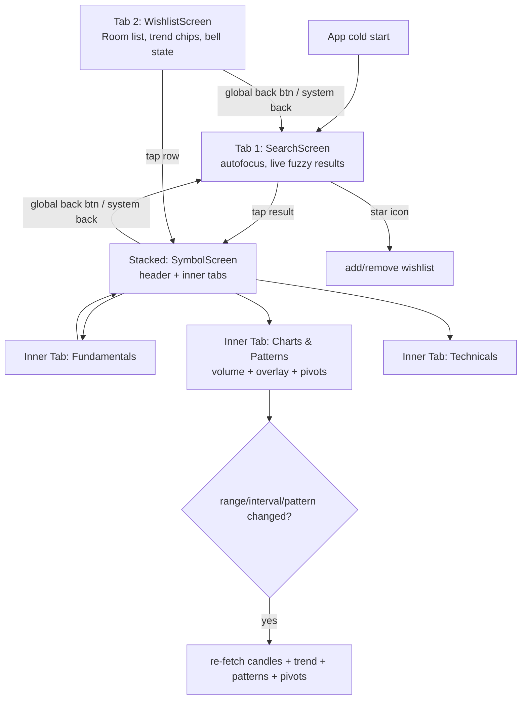
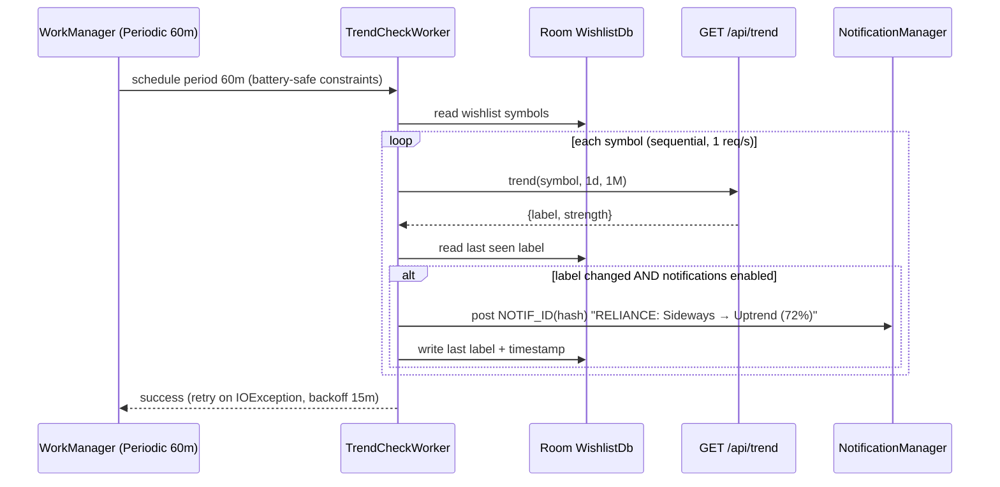

# Technical Pattern Analysis — v1.0.3 Plan (ML Truth · Wishlist · Light Theme · Chart Patterns)

**Purpose of this document:** execution-grade manual for v1.0.3. Every task states exact files, exact edits, exact verify command, exact pass condition. A small coding agent must be able to pick up any task ID and complete it without asking questions.

**Precedence:** `design/plan.md` (constitution) → `design/book-spec.md` (rubrics) → `design/planv1_0_2.md` (v1.0.2 mechanics) → **this document**. This doc wins for v1.0.3 build mechanics; rubric values still require human sign-off (plan.md §13.2 #6).

**Baseline:** commit `85fe95f` (2026-10-24), branch `main`, CI green (run 40127483539), release-apk artifact = signed APK 3,190,217 B.

**User decisions locked (interview 2026-10-25):**
1. Notifications = **local WorkManager polls** (no FCM).
2. Navigation = **3-tab bottom bar (Search | Wishlist | Charts) + stacked detail**; Fundamentals & Technicals become inner tabs inside the Symbol stack.
3. App icon = **generated adaptive vector icon** (glass candle motif; mipmap PNGs sliced for API < 26).

**Definition of v1.0.3 done:**
- `pipeline.eod run` writes OHLCV+delivery for **all 501 universe symbols** (+ `^NSEI` benchmark) into `history.parquet`; `pipeline.train` produces **leakage-free, honestly-metriced** models; `pipeline.predict` + `pipeline.scan` run on schedule; `/api/predictions` serves them fresh (no hand-written placeholder).
- `/api/patterns` returns real detections with **ISO-timestamp anchors + pivot points**; `/api/trend` returns correct `ema50`/`adx`; `/api/search` is fuzzy with a `limit` param.
- App: bottom nav (Search/Wishlist/Charts) + stacked Symbol detail with inner Fundamentals/Charts/Technicals tabs; global back always returns to Search; system-follow light/dark theme with in-app override; high-DPI adaptive launcher icon; wishlist screen backed by Room; trend-change notifications fire.
- Chart: candlestick **with volume**, real pattern overlay drawn over price action, pivot markers for the selected pattern, range/interval change re-triggers trend + patterns + pivots.
- Fundamentals & Technicals tabs: no flicker, no state reset, no silent error swallowing.
- CI green on every push; release APK artifact; GitHub Release `v1.0.3`.

---

## 1. Verified current state (audit 2026-10-25)

### 1.1 ML / training pipeline defects

| # | File:line | Defect | Impact |
|---|---|---|---|
| M1 | `pipeline/eod.py:247` | EOD acquires bars for **hard-coded 2 indices only** (`["^BSESN","^NSEI"]`), ignores `server/data/symbols.json` (501 NSE tickers) | Universe of 499 baked symbols has no training history → model trains on nothing |
| M2 | `pipeline/eod.py:230-238` | `fetch_sec_delivery_pct` returns an **empty DataFrame** ("stub implementation") | `deliveryPct5` feature can never be computed |
| M3 | root `history.parquet` | 2 rows, 2 index symbols, no delivery column | The "DB" is empty in effect |
| M4 | `pipeline/backfill.py:20` | `yf.download(..., adjusted=True)` — kwarg does not exist (`auto_adjust`) → TypeError swallowed at `:25` → **downloads nothing**; `symbols = ["^BSESN","NIFTY50"]` (`:13`) contains an invalid ticker; fixed 10y only | No historical training data can ever exist |
| M5 | `pipeline/features.py:59-61` | "adx" = `100*avg(TR)/c` — not ADX | Fake feature |
| M6 | `pipeline/features.py:94-95,96-98` | `deliveryPct5` and both RSI-divergence flags are constants `0.0` | 3 of 24 features are dead |
| M7 | `pipeline/features.py:129` | `fillna(0)` hides warm-up NaNs as zeros | Model learns from fake zeros |
| M8 | `pipeline/train.py:72` | `build_features(df)` on the **pooled multi-symbol frame** — returns/rolling chains cross symbol boundaries | Cross-symbol leakage |
| M9 | `pipeline/train.py:26,33` | Labels via `np.roll(close,-h)` on pooled array; per-symbol tail rows labelled with the **next symbol's** future return | Label leakage |
| M10 | `pipeline/train.py:28-32` | NaN future-return rows default to class 0 (up) | Corrupt labels |
| M11 | `pipeline/train.py:37-50,113-114,118-119,133-134` | Stub metrics (accuracy 0.50-0.52 hard-coded) when history is thin; isotonic fit **in-sample** | Metrics.json lies |
| M12 | `pipeline/predict.py` | **Never scheduled by any workflow**; `server/data/predictions.json` is a hand-written 4-line placeholder (asOf 2026-10-19, RELIANCE 2500.0) | ML Outlook card shows fiction |
| M13 | `pipeline/kaggle.py:39` | Unmatched `)` — module fails `py_compile` (dead code, never imported) | Latent breakage |
| M14 | `server/core/ml_predict.py:34` + `api/predictions.py:33-34` | Stale-flag **cached in module state never re-evaluated**; placeholder is already >24 h old → `/api/predictions` **503 in prod right now** | Live 503 |
| M15 | `server/data/scan.json` | Does not exist; `/api/scan` always returns `hits: []` | Scan dead |

### 1.2 Server API defects

| # | File:line | Defect | Impact |
|---|---|---|---|
| S1 | `server/api/patterns.py:68-69` | **Stub: returns `detections=[]` unconditionally** — `core/patterns.py` (working, fixture-proven) never wired | No pattern ever returned |
| S2 | `core/detectors/_build_*` (e.g. `double_triple.py:114`) | Anchor `t` = **bar index string** (`str(p1.idx)`), not ISO timestamp | Overlay anchors can never be matched to candles |
| S3 | `api/patterns.py` | No pivot array; no volume context per pivot | Pivot markers impossible |
| S4 | `api/trend.py:59,64` | Passes `ema20_arr` as **both** ema20 and ema50; `adx14=28.0` hard-coded so band factor is always 1.0; real ADX computed then discarded | Trend badge partially fake |
| S5 | `api/trend.py:31-36,63` | `TrendResponse` drops echoed `symbol/interval/range` | Harder client debugging |
| S6 | `api/index.py:71` + `api/resample.py:30` | resample router double-prefixes → `/api/api/resample`; the router also ignores `core/resample.py` | 1w/1M/5m requests **never resampled anywhere** (`core/bars.py` returns daily for any interval) |
| S7 | `api/search.py:47-57` | No typo tolerance (prefix/substring only); no `limit` param (hard 20); `symbols.json` read from disk per request | Search misses obvious matches |
| S8 | `api/fundamentals.py:229-230` | `roce` mapped from `returnOnEquity` (wrong field); `roic` from `returnOnInvestedCapital` (often absent) | Wrong ratio displayed |
| S9 | `api/fundamentals.py:199-205` | `rev_growth` expects `dict`, yfinance returns float → always None → growth red-flag always False | Red flag dead |
| S10 | `api/fundamentals.py` | **No 12 h cache** (plan.md §5 mandates it) | yfinance rate-limits in prod |
| S11 | `api/index.py:27-29` | `_data_as_of()` expects dict `symbols.json` but file is a **list** → `dataAsOf` always null | Health shows no as-of |

### 1.3 Android defects

| # | File:line | Defect | Impact |
|---|---|---|---|
| A1 | `MainActivity.kt:46-70` | No NavHost/NavController/BackHandler anywhere; `selectedTab` manual `when`; tabs rendered as a **top Row of TextButtons** (`:48-59`) | Legibility / navigation complaints |
| A2 | `MainActivity.kt:65` + `ChartScreen.kt:128` | "Back" button calls `onBack = {}` → **no-op** | No way back to search |
| A3 | `ui/theme/Theme.kt:53` | `colorScheme = DarkColorScheme // Force dark` — LightColorScheme (`:33-46`) is dead and identical-black; `darkTheme` param unused (`:50`) | No light mode, no system-follow |
| A4 | 10 files, 89 sites | Hard-coded `Color(0x…)`/`parseColor` (SearchScreen.kt:64,78-79; TechnicalScreen.kt:34,68,76-78,92,119,128-130,145-147,162-166,174,192-195,202,204; ChartScreen.kt:49-51,256,429,433,471-473; PatternOverlayRenderer.kt:51-54; DecisionCard.kt:38,41-44,69,77,82,95,105,118,127-129,140,145; TradePlanCard.kt:32-36,58,76,94,112; DetectionChip.kt:24-46,53,56,83; MainActivity.kt:98; WatchlistScreen.kt:23) | Unreadable on a light background |
| A5 | `MainActivity.kt:61-70,81,110` | `when(selectedTab)` destroys composition → `remember`-scoped VMs rebuilt on every tab switch → full refetch + spinner = **flicker** | Fundamentals/Technicals flicker |
| A6 | `MainActivity.kt:64` | `ChartScreen(viewModel = ChartViewModel(NetworkModule.provideApi()))` constructs a new VM **every recomposition** (init refires `fetchCandles()`, ChartViewModel.kt:23-25) | Chart refetch storms |
| A7 | `FundamentalsViewModel.kt:31` | `load()` resets `data = null` on every call → spinner flash | Flicker |
| A8 | `TechnicalViewModel.kt:22-31` | `catch (_: Exception) { }` — all errors silently → permanent "Technicals unavailable." with `loading` StateFlow never collected (`MainActivity.kt:110-114`) | Data never shows / no error UI |
| A9 | `database/WatchlistDb.kt` | `@Database` defined but **`Room.databaseBuilder` is called nowhere** in the repo; WatchlistScreen/ViewModel have zero call sites | Wishlist is dead code |
| A10 | `ui/search/SearchScreen.kt` | Full-screen search **never reachable from MainActivity**; button-driven (no per-keystroke search, no debounce, `:41-60`) | Global symbol search requirement unmet |
| A11 | Notifications | Grep `Notification|WorkManager|FCM|POST_NOTIFICATIONS` = **0 matches** | Feature absent |
| A12 | `res/mipmap/ic_launcher.png` (396 B, 48×48, 4-bit colormap) | Placeholder glyph; density dirs **empty**; **no adaptive icon XML** (`mipmap-anydpi-v26/` empty) | Blurry, low-quality icon |
| A13 | `ui/symbol/ChartScreen.kt:456-464` | `CandleEntry(h,l,o,c)` only — volume `v` exists in DTO but is **never plotted**; no CombinedChart, right axis disabled (`:428`) | No volume chart |
| A14 | `ui/chart/PatternOverlayRenderer.kt:79-80` | Overlay builds a `LineData` that is **never attached to the chart's CandleData** → overlay never renders | Pattern overlay invisible |
| A15 | `ChartScreen.kt:492-504` | `indexForTime` matches ISO timestamps; server sends index strings (S2) → `mapNotNull` drops all anchors | Overlay dead even if rendered |

### 1.4 What already works (do not break)
- `/api/candles` real OHLCV with `v`; baked 499-symbol parquet fallback (source=`eod`); validity matrix; error envelopes (`core/constants.py:17-25`, `core/baked.py`).
- Core pattern engine + detectors fire on the 9 positive / 5 negative fixtures (`server/tests/test_patterns.py`).
- `/api/technicals` computes real indicators; `/api/fundamentals` serves real yfinance data with graceful nulls.
- Android DTO contract aligned (`network/TpaApi.kt`), tests + CI + APK artifact pipeline, R8 + shrink.

---

## 2. Strategy

### 2.1 Approach
1. **Server first (W1):** make the training-data chain real (capture → features → train → predict → serve) and fix the five API lies (patterns/trend/resample/search/fundamentals). Every fix lands with a previously-failing test (plan.md §13.1, C4).
2. **Android second (W2):** navigation restructure (NavHost + bottom bar), theme tokens + light mode, wishlist + notifications, chart volume + overlay + pivots, flicker elimination. All recompute flows explicit and single-shot (no parallel refetch races).
3. **Release last (W3):** docs truth pass, version bump, release.

### 2.2 Constitution additions (layered on C1-C30)
- **C31 (no silent catch).** `catch (_: Exception) { }` is forbidden in app code; errors surface as state (`error: String?`) with a retry affordance.
- **C32 (single source of bar data).** All bar-dependent endpoints (`/api/candles`, `/api/patterns`, `/api/trend`) must share `core/bars.load_bars()` + `core/resample` so interval/range semantics are identical everywhere.
- **C33 (honest ML).** Removing the stub-metrics branches is mandatory (M11 check-lists them). If training data is insufficient → write `metrics.json` with `"status": "insufficient_data"` and **fail the workflow step** (no fake 0.52s). `predictions.json` must be written by `pipeline.predict` in CI only.
- **C34 (timestamps are ISO).** Any `t` crossing an API boundary is an ISO-8601 string with IST offset; bar **indices** never cross.
- **C35 (flicker ban).** ViewModels for the 3 symbol tabs are scoped to the NavBackStackEntry on Android; loading states never reset data to `null` when previous data exists.

### 2.3 Non-goals
Live intraday data, FCM/push, new pattern families, screener UI changes beyond bottom nav, accounts/auth, kaggle datasets (obsolete since T-25 bake path — dead `pipeline/kaggle.py` gets deleted), multi-region.

---

## 3. Contracts (delta)

### 3.1 `GET /api/search?q=&limit=20`
`[{symbol, name, sector}]` — fuzzy: exact symbol prefix (100) → name prefix (95) → substring (60) → typo-tolerant match via `difflib.SequenceMatcher` ratio ≥ 0.8 on symbol **and** uppercase(name) words (40). `limit` 1..50 default 20. **Same key set as before** (no client DTO change).

### 3.2 `GET /api/patterns?symbol&interval&range&pattern?`
```
{ "symbol","interval","range","asOf",
  "detections": [ { "pattern","direction","confidence",
    "anchors": [{"t": ISO-8601, "price"}],      // ≥ 3, ISO timestamps (fixes S2)
    "neckline": {"t","price"} | null,            // nullable now (flag patterns)
    "pivots":  [ {"t","price","kind":"HIGH"|"LOW"} ],   // NEW: engine pivots incl. non-anchors
    "target","stop","rr","invalidation" } ] }
```
Client keeps `Detection` DTO and adds `pivots: List<Anchor?>` (back-compat: absent → empty).

### 3.3 `GET /api/trend?symbol&interval&range`
Adds echo fields; resp `{symbol, interval, range, label, strength(0..100 float), ema20, ema50, adx}` — `ema50` = real EMA50, `adx` = real ADX14 (fixes S4). Client DTO unchanged except optional echo fields.

### 3.4 `predictions.json` (CI-written, schema per plan.md §7.3 + `metrics.{h1,h2,h5}.accuracy/logLoss/brier`; top-level `source: "pipeline"`).

### 3.5 Client-only (no server contract): wishlist (Room), trend notifications (WorkManager + `GET /api/trend`), theme override (SharedPreferences).

---

## 4. Navigation & UX design

### 4.1 Flow (user-facing)


### 4.2 Structure
```
MainActivity (NavHost, bottom NavigationBar)
 ├─ "search"    SearchScreen        (start destination)
 ├─ "wishlist"  WishlistScreen
 └─ "symbol/{symbol}" SymbolScreenHost
       └─ inner SegmentedTabs: Fundamentals | Charts | Technicals
```
- **Global back:** a persistent leading "←" in the Symbol screen's top app bar + `BackHandler` on `symbol/{symbol}` destination → `popBackStack("search", false)` (fixes A2).
- **Selected symbol command:** `SymbolViewModel` (activity-scoped) holds `currentSymbol: StateFlow<String>`, `select(symbol)`, last-symbol pref via SharedPreferences.
- Inner-tab separator: simple glass segmented tabs (no extra deps).

### 4.3 Theme
- `TPATheme` wraps MaterialTheme 3 (system-follow) + user override: `SharedPreferences "tpa_settings" "theme_mode"` ∈ {`system`,`light`,`dark`}, default `system`, toggle via the top app bar overflow button on every screen (three explicit chips).
- **LightColorScheme gets real glass values:** surface `0xFFF6F8FA`, surfaceContainer `0xFFFFFFFF`, onSurface `0xFF0F172A`, primary `0xFF059669`, error `0xFFDC2626`; Glass.kt gains `glassSurface(light: Boolean)`.
- All 89 hard-coded color sites (A4) replaced with semantic tokens from `ui/theme/Color.kt`:
  `tok { Background, Surface, OnSurface, OnSurfaceMuted, Bullish, Bearish, Neutral, Accent, GlassFill, GlassBorder }` resolved via `MaterialTheme.colorScheme` + `CompositionLocal fallback`.

### 4.4 Sequence: wishlist trend-change notification


### 4.5 Sequence: pattern overlay + pivots
```mermaid
sequenceDiagram
    participant U as User (Chart tab)
    participant VM as ChartViewModel
    participant API as /api/{candles,patterns,trend}
    participant CH as CombinedChart + OverlayRenderer
    U->>VM: setSymbol / updateRange / updateInterval / selectPattern
    VM->>VM: cancel previous fetch jobs (single-shot Mutex)
    par candles
        VM->>API: GET candles(symbol, interval, range)
    and trend
        VM->>API: GET trend(symbol, interval, range)
    and patterns
        VM->>API: GET patterns(symbol, interval, range, pattern?)
    end
    API-->>VM: candles[ISO t,o,h,l,c,v] + detections[anchors ISO + pivots]
    VM-->>CH: candles → CandleData + BarData(volume, secondary axis)
    VM-->>CH: anchors ISO → x-index; pivots → scatter dots; neckline/stop/target → lines
    CH-->>U: drawn overlay + pivot markers
```

---

## 5. Execution order

```
W1 (server+ML, mostly parallelizable)
  T-28 ──► T-29 ──► T-30 ──► T-31 ──► T-32 ──► T-33 ──► T-34
              ▲                 (T-28 needs backfixed archive first)
  T-35,T-36,T-37,T-38 (independent)          T-40 ──► T-39
W2 (android; T-37 + T-38 are preconditions for T-48/T-49)
  T-41 ──► T-42 ──► T-43 ──► T-44 ──► T-45
  T-41 ──► T-46 ──► T-47
  T-38,T-37 ──► T-48 ──► T-49 (needs T-47) ; T-41 ──► T-50
W3  T-51 ──► T-52
```
**Rule: never start a task whose predecessor is not green.**

---

## 6. Task specifications

### T-28 — Fix `pipeline/backfill.py` (foundation for all training data, P0)
**Files:** `pipeline/backfill.py`, `pipeline/tests/test_backfill.py` (new)
**Edit:**
- Symbols: read `server/data/symbols.json` + append `["^NSEI"]` (relStrength benchmark). Cap list with `--limit N` flag for smoke runs.
- Fetch: `yf.download(sym, period="10y", interval="1d", auto_adjust=True, threads=False)` (kwarg fix, M4). Pace 1.0 s between symbols (plan.md §4 rate limit).
- Write root `history.parquet` with the **eod-compatible schema**: columns `SC_CODE, Date, open, high, low, close, adj_close, volume` (mirror `eod.py:199-211` mapping so train works on either producer). Append via concat of per-symbol frames, then a single `pyarrow.parquet.write_table` (Vercel-style friendly); skip symbols already present at the requested depth to stay idempotent.
- Remove the blanket `except Exception` (M4): per-symbol try/except that **logs and counts** failures, then `if fail_ratio > 0.2: sys.exit(1)`.
**Test:** `test_backfill.py` — monkeypatch `yf.download` returning a fake OHLCV frame for 2 symbols; assert rows written have SC_CODE = symbol (no `.NS`), schema has 8 columns, invalid symbol rows are skipped and counted.
**Verify:** `cd server && python -m pytest pipeline/tests/test_backfill.py -q` green; then `python -m pipeline.backfill --limit 3` locally creates/extends `history.parquet` with > 1500 rows.
**DoD:** script runs end-to-end; no silent download failure.
**Commit:** `v1.0.3 T-28: backfill real universe history (fix yf kwarg + schema)`

### T-29 — EOD capture: full universe + delivery% (P0)
**Files:** `pipeline/eod.py`, `pipeline/tests/test_eod.py`
**Edit:**
1. Replace `symbols = ["^BSESN", "^NSEI"]` (`eod.py:247`) with: universe from `server/data/symbols.json` (501) **plus** `^NSEI` **plus** `^BSESN` (kept for sanity), same merge path, 1 s pacing. Guard: if `len(rows) < 0.8 * len(universe)` → exit 1 (partial capture is a failure, M1).
2. `deliveryPct`: implement `fetch_sec_delivery_pct(date: str) -> pd.DataFrame[SC_CODE, deliveryPct]` from NSE `sec_bhavdata_full` CSV (same cookie handshake as bhavcopy; column `DELIV_PER`); on failure return empty DF and set delivery column to `NaN` (visible gap, not fake 0.0 — M2) and set `"deliveryCaptured": false` in the run summary log.
3. Persist **one parquet** `history.parquet` with columns `SC_CODE, Date, open, high, low, close, adj_close, volume, deliveryPct` (append-only; reuse existing versioned-copy logic).
4. Keep the holiday guard, cross-validation (0.5%), and NSE-preference behavior untouched.
**Test (extend `test_eod.py`):** `test_run_universe_guard` — fake bhavcopy with < 80% of symbols → expect exit 1; `test_delivery_merge` — fake delivery CSV merges by SC_CODE; `test_delivery_gap_nan` — delivery unavailable → NaN not 0.0.
**Verify:** `cd server && pytest pipeline/tests/test_eod.py -q` green; `gh workflow run eod.yml --ref main && gh run watch` green (manual dispatch), then `git log -1 --stat` shows `history.parquet` updated and `python -c "import pandas as pd; d=pd.read_parquet('history.parquet'); print(d.SC_CODE.nunique(), d.deliveryPct.notna().sum())"` prints `≥ 400` and `> 0`.
**DoD:** universe-wide bars + delivery captured in CI.
**Commit:** `v1.0.3 T-29: eod captures full universe + delivery percent`

### T-30 — Real features (P0)
**Files:** `pipeline/features.py`, `pipeline/tests/test_features.py` (new)
**Edit:**
1. `adx` → real Wilder ADX14 (reuse `server/core/indicators.adx_di` logic ported into pipeline; no new dependency) — M5.
2. `deliveryPct5` → rolling mean(5) of the `deliveryPct` column; when the column is absent/NaN → emit `NaN` (kept out of training rows, not 0.0) — M6.
3. RSI divergence flags → compare RSI slope vs price slope over last 5 and 10 bars per §7.1 semantics (bull/bear); still null on warm-up — M6.
4. Delete `fillna(0)` (`:129`); functions return NaN for warm-up rows — callers must dropna on the label+feature matrix — M7.
5. Strengthen `lookahead_bias_test`: per **both** synthetic symbols — permute rows t+1..t+5 per symbol, assert every feature row is unchanged for every t in the symbol (today it checks only `iloc[0]`).
**Test:** `test_features.py` — golden-ish assertions on a synthetic 400-bar frame: adx ∈ [0,100] and equals core.indicators ADX within 0.5 on the same input; deliveryPct5 = mean of last 5; warm-up rows are NaN not 0; lookahead test passes on 2-symbol pooled data.
**Verify:** `cd server && pytest pipeline/tests/test_features.py -q` green.
**DoD:** all 24 features real or NaN; no cross-boundary contamination in the test.
**Commit:** `v1.0.3 T-30: real adx/delivery/divergence features, no fillna(0)`

### T-31 — Honest training (leakage-free) (P0)
**Files:** `pipeline/train.py`, `pipeline/tests/test_train.py` (new)
**Edit:**
1. Group-build: iterate `df.groupby("SC_CODE")`, build features **per symbol**, concat (fixes M8).
2. Labels per symbol: `future_ret = close.shift(-h)/close - 1`, classes ±0.5 % per plan §2.1; rows with NaN future_ret → **dropped** (never class 0) — fixes M9/M10.
3. Keep `elapsed_remaining_rows` masked per symbol (last h rows per symbol dropped).
4. Delete `_write_stub()` (`:37-50`), the inline constant fallbacks (`:113-114,118-119`), and in-sample calibration (`:128-132`). Isotonic = sklearn `CalibratedClassifierCV(prefit-style)`: fit calibrator on fold-1 validation predictions only, then reuse on later folds.
5. If `len(unique symbols) < 50` or total rows < 25,000: write `metrics.json = {"status": "insufficient_data", "rows": N, "symbols": M}` and `sys.exit(2)` (C33) — the workflow step visibly fails instead of faking 0.52.
6. Also persist `features.json` (ordered FEATURE_NAMES, load-time contract per plan.md §7.2) and `metrics.json` (accuracy/logLoss/brier per horizon from real walk-forward folds).
**Test:** `test_train.py` — (a) pooled frame of 3 symbols: assert number of NaN-label-dropped rows equals per-symbol expected; (b) train on synthetic 3-symbol data ≥ 1500 bars each → metrics.json exists, accuracy ∈ (0.4, 0.7); (c) 2 symbols only → exit code 2 with insufficient_data, **no model files**.
**Verify:** `cd server && python -m pytest pipeline/tests/test_train.py -q` green.
**DoD:** no stub metrics path reachable; leakage killed by tests.
**Commit:** `v1.0.3 T-31: leakage-free training with honest walk-forward metrics`

### T-32 — Predict + scan run for real; delete dead kaggle.py (P0)
**Files:** `pipeline/predict.py`, `pipeline/scan.py`, `pipeline/kaggle.py` (delete), `server/data/predictions.json` (delete hand-written placeholder)
**Edit:**
1. `predict.py`: read per-symbol frames from `history.parquet` (groupby, same per-symbol build as T-31); load `tpa-models/model_h{1,2,5}.joblib` **from the ml-train.yml artifact unpacked at `tpa-models/`** (document the path in module docstring; `run_batch(models_dir)`); keep skip rule (<250 rows); write `server/data/predictions.json` exactly per plan.md §7.3 plus `modelTrainedOn` (models file mtime → date) and `source: "pipeline"`; never swallow metric-loading errors (M12 — fail loudly).
2. `scan.py`: replace the `{"pattern":"range"}` stub (`scan.py:37-45`) with real `core.patterns.detect_patterns` per symbol on 1y daily bars from the shared loader; write `server/data/scan.json` = `{asOf, hits: [detection+symbol+sector], page: 1, pageSize: 50}`.
3. Delete `pipeline/kaggle.py` (M13; obsolete per planv1_0_2 T-14 status) and update any docstring references.
**Test:** extend `pipeline/tests/test_predict.py` (new): fake models dir + 2 synthetic symbols → predictions.json matches schema, probs sum to 1 ± 0.001, skipped list correct; `test_scan.py` (new): positive fixture symbol yields ≥ 1 hit.
**Verify:** `cd server && python -m pytest pipeline/tests -q` green.
**DoD:** predict and scan runnable from CI; placeholder JSON gone.
**Commit:** `v1.0.3 T-32: pipeline predicts and scans for real; delete dead kaggle module`

### T-33 — Workflows chain the full pipeline (P0)
**Files:** `.github/workflows/eod.yml`, `.github/workflows/ml-train.yml`
**Edit:**
1. `ml-train.yml`: after `python -m pipeline.train`, download **history.parquet** (already in repo) + upload/publish `tpa-models` as workflow artifact, then run `python -m pipeline.predict --models-dir tpa-models` and `python -m pipeline.scan`; commit `server/data/predictions.json` + `server/data/scan.json` (same commit step style as eod.yml); job fails if train exited 2 (C33 — no silent insufficient-data pass).
2. `eod.yml`: after the history commit, trigger `ml-train.yml` via `gh workflow run ml-train.yml --ref main` (needs `permissions: actions: write` + `gh` on runner) so a trading day always produces fresh predictions; keep vercel deploy step ordering (deploy happens in ci.yml on push anyway — keep as is).
3. Cron stays `30 13 * * 1-5` (eod) / `0 15 * * 1-5` (train).
**Verify:** dispatch `eod.yml` → watch both workflows green → `git log origin/main -1 --stat` includes predictions.json + scan.json; post-deploy check `curl -s https://myaiinvestment.vercel.app/api/predictions | head -c 300` shows `source: pipeline` and non-stale asOf (next task makes this deterministic).
**DoD:** one trading day → fresh predictions + scan in prod.
**Commit:** `v1.0.3 T-33: chain eod → train → predict → scan in CI`

### T-34 — Serve predictions honestly (P0)
**Files:** `server/api/predictions.py`, `server/core/ml_predict.py`, `server/tests/test_predictions.py`
**Edit:**
1. `ml_predict.py`: drop the module-level stale `_cache` (M14) — read the file per request (it is ≤ 30 KB, cheaper than correctness bugs); keep the 24 h staleness rule.
2. `predictions.py`: attach `response_model=PredictionsResponse` and serialize via the pydantic model (M-declared-but-unused models); 503 `upstreamUnavailable` only when the file is genuinely stale (> 24 h).
3. `test_predictions.py`: remove the tautological stale test (asserts `StalePredictionsError` inside `pytest.raises` on its own construction — no coverage); new tests: (a) stale file → 503 `upstreamUnavailable`; (b) fresh file with a `per-symbol` item → 200 and **per-item `metrics` key forbidden** (schema lock, planv1_0_2 §3.3); (c) missing file → 503.
**Verify:** `cd server && python -m pytest tests/test_predictions.py -q` green; `python -c "from fastapi.testclient import TestClient; from api.index import app; print(TestClient(app).get('/api/predictions?symbol=RELIANCE').status_code)"` (after CI wrote fresh predictions) prints 200.
**DoD:** no 503-with-cached-stale bug; schema locked by tests.
**Commit:** `v1.0.3 T-34: predictions freshness re-evaluated per request + schema locked`

### T-35 — Fuzzy search with limit (P1)
**Files:** `server/api/search.py`, `server/tests/test_search.py`
**Edit:**
1. Cache `symbols.json` in a module-level `_load(path)` with mtime check (no per-request disk stat thrash; S8 perf half of plan §5 "cached").
2. Scoring per §3.1: prefix(symbol/name) 100/95 → substring 60 → `difflib.SequenceMatcher(None, q, symbol).ratio() ≥ 0.8` or per-word ratio on uppercased name tokens ≥ 0.8 → 40. Cap by `limit: int = 20` (Query ge=1 le=50).
3. Tests: `test_search_typo("riaL")` finds RELIANCE; `test_search_limit_1` returns exactly 1; `test_prefix_beats_fuzzy` — exact prefix ranked first; existing tests keep passing.
**Verify:** `cd server && pytest tests/test_search.py -q` green; `python -c "from fastapi.testclient import TestClient; from api.index import app; [print(r['symbol']) for r in TestClient(app).get('/api/search?q=ria&limit=3').json()]"`.
**DoD:** typo tolerance + limit honored.
**Commit:** `v1.0.3 T-35: fuzzy symbol search with threshold-ranked matches`

### T-36 — `/api/trend` truth (P0)
**Files:** `server/api/trend.py`, `server/tests/test_trend.py` (new)
**Edit:**
1. Use `ema20, ema50, ema200 = ema_set(close)`; pass the **real** `ema50_arr[-1]` and real `adx` from `adx_di()` (`:58` computes it — capture the value) into `trend_from_series()` and the response (S4).
2. `TrendResponse` adds `symbol, interval, range` echo (S5) and `strength: float`.
3. Replace ad-hoc `HTTPException(503)` (`:52-53`) with `ApiError(503, "upstreamUnavailable")` from `api/errors.py`.
4. Test `test_trend.py`: (a) synthetic monotone-up series → `Uptrend`, ema50 < ema20 (both finite, unequal), adx ≠ 28.0; (b) flat series → Sideways; (c) unknown symbol → 404 `unknownSymbol`; (d) resp echoes symbol/interval/range.
**Verify:** `cd server && pytest tests/test_trend.py -q` green; `python -c "...r=c.get('/api/trend?symbol=RELIANCE&interval=1d&range=1Y').json(); print(r['ema20'], r['ema50'], r['adx'])"` — three distinct finite numbers.
**DoD:** ema50 ≠ ema20; adx is computed.
**Commit:** `v1.0.3 T-36: real ema50/adx in trend endpoint`

### T-37 — Wire the pattern engine + pivots + ISO anchors (P0 — blocks T-48/T-49)
**Files:** `server/api/patterns.py`, `core/patterns.py`, `core/detectors/*.py`, `server/tests/test_patterns_api.py` (new)
**Edit:**
1. `api/patterns.py`: remove the stub return (`:68-69`) → fetch candles via `core.bars.load_bars(symbol, interval, range)` (C32), call `core.patterns.detect_patterns(df, pattern=…)`; serialize per §3.2 including `pivots` and ISO `t`.
2. `core/patterns.py`: expose `build_detection_payload(df: pd.DataFrame, detections: List[Detection]) -> dict` that converts bar **indices → ISO timestamps** using the frame's date column (C34); `Detection` gains `pivot_idx: List[Tuple[int, float, bool]]` populated by each detector's pivot list (already computed locally — return them, e.g. `head_shoulders.py` LS/T/RS + troughs, `double_triple.py` p1/p2(/p3), `flag.py` pole bases/eyes); make `neckline` `Optional` in the API model (flag patterns legitimately lack one).
3. Exclude the current bar from detection eligibility (setup bars closed strictly before "now") to stop premature triggers.
4. Tests `test_patterns_api.py`: (a) all 9 positive fixtures through the **API** return ≥ 1 detection with **an ISO date for every anchor `t`** (regex `\d{4}-\d{2}-\d{2}` + timezone suffix); (b) 5 negatives → 0; (c) `pattern=head_and_shoulders` filter returns only that family; (d) every detection has ≥ 3 anchors and `pivots.kind ∈ {HIGH, LOW}`; (e) unknown symbol → 404 `unknownSymbol`; invalid interval/range → 400 `invalidCombo`.
**Verify:** `cd server && pytest tests/test_patterns_api.py -q` green (keep `tests/test_patterns.py` green).
**DoD:** API exposes real detections with ISO anchors + pivots.
**Commit:** `v1.0.3 T-37: pattern API wire-up with ISO anchors and pivot payloads`

### T-38 — Shared resampling + kill double-prefix (P0)
**Files:** `core/bars.py`, `api/candles.py`, `server/api/resample.py` (delete), `api/index.py`, `server/tests/test_resample_served.py` (new)
**Edit:**
1. `core/bars.py`: `load_bars(symbol, interval, range_str)` — after source resolution, if interval ∈ {`1w`,`1M`} → `core.resample.resample_daily_to_interval`/`to_range`; if interval is intraday and baked data is daily and range > 60 d → return 400 `invalidCombo` via raising `ApiError` from the **route layer** (loader returns `None` + reason tuple).
2. Delete the dead resample router file + its `index.py` include (`/api/api/resample`, S6).
3. Test: baked RELIANCE with `interval=1w` returns ≤ ceil(rows/5) bars with weekly OHLC (o = first close of week, h/l max/min, v sum); `interval=5m&range=1Y` → 400; `interval=1M&range=1Y` → ≈ 12 bars.
**Verify:** `cd server && pytest tests/test_resample_served.py tests/test_matrix.py -q` green; `/api/candles?symbol=RELIANCE&interval=1w&range=1Y` via TestClient returns weekly rows.
**DoD:** one shared bar pipeline for candles/patterns/trend.
**Commit:** `v1.0.3 T-38: shared interval/range resampling; remove dead resample router`

### T-39 — Fundamentals fixes (+cache) (P1)
**Files:** `server/api/fundamentals.py`, `server/tests/test_fundamentals.py` (new)
**Edit:**
1. 12 h TTL cache on the parsed payload keyed by symbol (plan §5; module-level dict with `time.monotonic()` — Vercel cold-start safe, no external cache) — S10.
2. `roce` ← compute from statements via `core.formulas` (EBIT ÷ capital employed) when `returnOnCapitalEmployed` absent; fall back `null` (S8).
3. `rev_growth` ← accept yfinance **scalar** float (`info.get("revenueGrowth")`) — S9.
4. Tests: fake `info` dict → expected `roce` null-tolerance, `rev_growth_pct` populated; cache hit counted (monkeypatch fetch, second call must not refetch).
**Verify:** `cd server && pytest tests/test_fundamentals.py -q` green.
**DoD:** no wrong ratio; cache in place.
**Commit:** `v1.0.3 T-39: fundamentals cache + correct ROCE/rev-growth mapping`

### T-40 — `dataAsOf` fix (P2)
**Files:** `server/api/index.py:27-29`
**Edit:** handle list-shaped `symbols.json` — take `asOf` from `predictions.json` `mtime`/`asOf` field (the freshest baked artifact) → `dataAsOf` reflects reality; else null.
**Verify:** `cd server && pytest tests/test_health.py -q` (updated expectation) green.
**Commit:** `v1.0.3 T-40: health endpoint reports real dataAsOf`

### T-41 — Navigation restructure (P0 — blocks all Android UX tasks)
**Files:** `android/app/src/main/kotlin/com/tpa/app/MainActivity.kt` (rewrite, ~220 lines), `ui/nav/NavGraph.kt` (new), `ui/nav/BottomBar.kt` (new), `ui/symbol/SymbolScreenHost.kt` (new), `viewmodel/SymbolViewModel.kt` (new), `network/NetworkModule.kt` (un-@Composable it — provide plain `TpaApi` singleton object), `AndroidManifest.xml` (no change)
**Edit:**
1. Deps: add `androidx.navigation:navigation-compose` (verify latest stable on Maven before pinning; BOM-free single artifact) to `app/build.gradle.kts`.
2. `NavGraph.kt`:
```kotlin
@Composable fun TpaNavHost(
  api: TpaApi,
  themeVm: ThemeViewModel,
) {
  val nav = rememberNavController()
  val symVm: SymbolViewModel = viewModel()  // activity-scoped, holds currentSymbol
  Scaffold(bottomBar = { BottomBar(nav) }) { pad ->
    NavHost(nav, startDestination = "search", Modifier.padding(pad)) {
      composable("search")   { SearchScreen(api, onOpen = { symVm.select(it); nav.navigate("symbol/${it}") }, onWishlistToggle = { ... }) }
      composable("wishlist") { WishlistScreen(onOpen = { symVm.select(it); nav.navigate("symbol/${it}") }) }
      composable("symbol/{symbol}") { e -> SymbolScreenHost(e.arguments?.getString("symbol") ?: symVm.current.value,
        onBack = { nav.popBackStack("search", inclusive = false) },
        themeVm = themeVm) }
    }
  }
}
```
3. `BottomBar.kt`: Material3 `NavigationBar` with **3 items** — Search (Icons.Filled.Search), Wishlist (custom 24 dp vector `IconWishlist`, no icons-extended dep), Charts (custom 24 dp vector `IconCandles`). Route-based selected state via `nav.currentBackStackEntryAsState()`.
4. `SymbolScreenHost`: top app bar with symbol title + sector subtitle + **leading "←" back IconButton (global back, A2)** + overflow theme toggle (T-42 hook); content = segmented row `Fundamentals | Charts | Technicals`; each host keeps **its own three app-scoped ViewModels** (T-50) and no composition-level VM construction.
5. `SymbolViewModel.kt`: `select(symbol)` persists to SharedPrefs `"last_symbol"`, re-seeded on process start in `MainActivity.onCreate` (route arg wins).
6. System back: on `symbol/{symbol}` add `BackHandler { nav.popBackStack("search", false) }`.
**Verify:** `cd android && ./gradlew :app:compileReleaseKotlin :app:testDebugUnitTest` green.
**DoD:** bottom bar nav with 3 tabs works; symbol stack reachable from Search and Wishlist; global back always lands on Search; no VM constructed at composition call-site (A6) — grep `viewModel = ` in composables returns only host-owned instances.
**Commit:** `v1.0.3 T-41: nav restructure (bottom bar, stacked symbol, global back)`

### T-42 — Theme: system-follow + light mode + toggle + token sweep (P0)
**Files:** `ui/theme/Theme.kt`, `ui/theme/Color.kt` (new), `ui/theme/Glass.kt`, `Type.kt`, `values/themes.xml` (values-night/themes.xml new), `viewmodel/ThemeViewModel.kt` (new), plus the 10 hard-coding files listed in A4 (mechanical replacement), `MainActivity.kt` (remove duplicated color)
**Edit:**
1. `ThemeViewModel`: `mode: MutableStateFlow<Mode>` (SYSTEM/LIGHT/DARK), persisted via SharedPreferences (no new dependency).
2. `Theme.kt`: real `LightColorScheme` (§4.3 values); `TPATheme(mode)` resolves `darkTheme = isSystemInDarkTheme()` for SYSTEM, forced for LIGHT/DARK; **delete the force-dark line (`:53`)**.
3. `Glass.kt` — add `glassSurfaceL` for light scheme: fill `Color(0xCCFFFFFF)`, border `Color(0x33000000)`; keep the dark variant; blur stays API 31+ with the existing `graphicsLayer` fallback.
4. `Color.kt` — defines the semantic token accessors used everywhere (§4.3): resolve from current scheme; the 89 A4 sites get replaced with these tokens in the same commit (search-and-replace table in the PR description).
5. `values/themes.xml`: windowBackground follows `?android:windowBackground` (not hard black); add `values-night/themes.xml` dark variant.
**Verify:** `cd android && ./gradlew :app:compileReleaseKotlin :app:testDebugUnitTest` green; manual: system in dark → dark surfaces, system in light → light surfaces, in-app LIGHT/DARK overrides both.
**DoD:** zero `Color(0x` outside `theme/` (grep); light mode legible (dark `onSurface 0xFF0F172A`).
**Commit:** `v1.0.3 T-42: system-follow theme with light mode, glass tokens sweep`

### T-43 — Search screen: live fuzzy results (P0)
**Files:** `ui/search/SearchScreen.kt` (rewrite), `viewmodel/SearchViewModel.kt` (new), `network/TpaApi.kt` (add `limit` param)
**Edit:**
1. `SearchViewModel`: `query` + `results: StateFlow<List<SearchResult>>`; `@OptIn(ExperimentalCoroutinesApi::class)` debounce 300 ms `flatMapLatest { api.search(q, 20) }`, race-safe (flatMapLatest cancels superseded calls); states `Idle/Loading/Done/Error`.
2. UI: autofocus `TextField` glass bar (plan.md §8 hero), result rows = **symbol + name + sector + wishlist star** (satisfies "show possible matches" with rich rows), tap row → `onOpen(symbol)`; star taps the Room toggle (T-44); "Recent" chips from SharedPrefs search history (max 8, tap re-runs).
3. Empty query → hint text + top-volume list is **not** in scope (no new endpoint) — show recents only.
**Verify:** `cd android && ./gradlew :app:testDebugUnitTest` green; manual typing "ria" → RELIANCE appears within ~0.3 s of idle.
**DoD:** per-keystroke search with debounce; no button-driven search.
**Commit:** `v1.0.3 T-43: live debounced fuzzy search with rich result rows`

### T-44 — Wishlist screen wired to Room (P0)
**Files:** `database/WatchlistDb.kt`, `database/WatchlistRepository.kt` (new), `viewmodel/WatchlistViewModel.kt` (rewrite), `ui/search/WatchlistScreen.kt` (rewrite), `TpaApp.kt`/`MainActivity.kt` (DB init)
**Edit:**
1. `WatchlistRepository`: singleton holding `Room.databaseBuilder(context, WatchlistDb::class.java, "tpa.db").build()` — the currently **missing** instantiation (A9); expose `all(): Flow<List<WatchlistEntity>>`, `toggle(symbol): Boolean(added)`, `remove`.
2. Schema bump: add `addedAt: Long`, `lastLabel: String?`, `lastCheckedAt: Long?` columns → `version = 2` + a real `Migration(1, 2)` that ALTER-TABLEs the three columns in (no destructive fallback).
3. `WatchlistViewModel`: repo-backed; merges trending status via `api.getTrend(...)` lazily **only** from the trend worker cache (T-45) — no per-row API calls.
4. `WatchlistScreen`: glass rows — symbol, sector, last trend chip (Up/Dn/Side, colored via T-42 tokens), bell icon reflecting enable state; row tap → symbol; swipe/long-press remove; empty state text guides to Search.
5. Add flow from SearchScreen star + from SymbolScreen top bar star.
**Verify:** `cd android && ./gradlew :app:testDebugUnitTest` green; unit-test the repository against a **fake DAO** (Room in-memory needs instrumentation — do not use it in src/test); manual: add/remove/tap/list persistence across process restart.
**DoD:** wishlist persists across restarts (Room built and used), add/remove/tap work.
**Commit:** `v1.0.3 T-44: wishlist room-backed screen with trend state`

### T-45 — Trend notifications (Worker, permission, toggle) (P0)
**Files:** `notify/TrendCheckWorker.kt` (new), `notify/NotifChannels.kt` (new), `AndroidManifest.xml`, `MainActivity.kt` (worker enqueue + permission request on first wishlist add), `build.gradle.kts` (add `androidx.work:work-runtime-ktx` — verify version on Maven, C27)
**Edit:**
1. Manifest: `<uses-permission android:name="android.permission.POST_NOTIFICATIONS"/>` (API 33+; manifest only, requested at runtime when the user stars the **first** symbol); `<uses-permission android:name="android.permission.RECEIVE_BOOT_COMPLETED"/>`; WorkManager `ProviderInitializer` default is fine.
2. `NotifChannels.kt`: channel `"trend"` created on app start.
3. `TrendCheckWorker(CoroutineWorker)`: per §4.4 diagram — read wishlist, sequential `api.getTrend(sym, "1d", "1M")`, compare `lastLabel` in Room, notify on change (`title: "$SYMBOL: $oldLabel → $newLabel"`, text strength %, icon = app icon, `setUnique` per symbol via `setGroup(GROUP_TREND)`), write back `lastLabel`/`lastCheckedAt`; retry on IOException via `Result.retry()` (backoff 15m, 3 attempts).
4. Enqueue `PeriodicWorkRequestBuilder(60 min)` unique name `"trend-check"`, constraint `NetworkType.CONNECTED`, ExistingPeriodicWorkPolicy.KEEP, stock battery-safe (no exemptions requested).
5. Toggle: per-user master switch in SharedPreferences (`"notif_enabled"`), reflected in Wishlist screen bell; off → `cancelUniqueWork`.
**Verify:** `cd android && ./gradlew :app:testDebugUnitTest` (worker unit-testable via `TestListenableWorkerBuilder` + fake api) green; manual: star 2 symbols → get the current `job-id` from `adb shell dumpsys jobscheduler` → force-run it → notification on change appears; also verify the next natural 60-min poll fires once in prod-like use.
**DoD:** notifications fire on label change; permission path sane; battery-safe.
**Commit:** `v1.0.3 T-45: periodic trend-change notifications for wishlist`

### T-46 — Generated adaptive launcher icon (P0)
**Files:** `res/drawable/ic_launcher_foreground.xml` (new vector), `res/values/colors.xml` (`ic_launcher_background` entry), `res/mipmap-anydpi-v26/ic_launcher.xml` + `ic_launcher_round.xml` (new), `res/mipmap-{m,h,xh,xxh,xxxh}dpi/ic_launcher.png` + `_round.png` (generated PNGs), `build.gradle.kts` (no change)
**Edit:**
1. Design: background = vertical gradient `#0F172A → #1E293B` rounded square; foreground = glass-rounded candle trio (green `#34D399` body, red `#F87171` body, amber wick) + thin trend polyline; 108×108 dp adaptive layers, safe zone = center 66 dp.
2. Foreground vector is hand-authored (deterministic, reviewable). For API < 26 density PNGs: one-off `tools/gen_icons.py` renders the vector to the 10 PNGs (48/72/96/144/192 px launcher + round) with `cairosvg` pinned in dev-only `tools/requirements.txt` (never a runtime dep); commit the generated PNGs. If the local renderer is unavailable, the exec agent stops and asks instead of shipping wrong sizes.
3. Density set: 48/72/96/144/192 px launcher + matching round variants.
**Verify:** `unzip -l dist/*.apk | grep -c "mipmap"` shows all 7 buckets; visual check on emulator API 33 (adaptive) and API 26 (fallback PNG).
**DoD:** crisp icon at every density; no 396-byte placeholder remains.
**Commit:** `v1.0.3 T-46: high-DPI adaptive launcher icon`

### T-47 — Chart: candlestick + volume (P0)
**Files:** `ui/symbol/ChartScreen.kt` (volume section), `ui/chart/VolumeBars.kt` (new), `ChartViewModel.kt` (no change — `v` already in DTO)
**Edit:**
1. Convert the price chart from `CandleStickChart` to MPAndroidChart **`CombinedChart`** so candle + line/scatter overlays (T-48/T-49) can coexist: `CombinedData(CandleData(...))` now, `lineData`/`scatterData` added later. Volume is **not** an inset stack — it is a separate `BarChart` in a Column below the price chart (70 % / 25 % heights), scroll-synced through a shared `OnChartGestureListener` pair. This keeps each chart's data contract clean.
2. Volume bars colored Bullish/Bearish by close-vs-open (theme tokens — uses chart `parseColor` bridging only here, documented).
3. X-axis shared date label formatter; y left axis volume hidden labels, right price axis kept for candles.
4. Dedupe signature for both charts (extend existing `:443-451` signature to include volume digest).
**Verify:** `cd android && ./gradlew :app:compileReleaseKotlin` green; volume bars reflect `v` in a quick emulator run for RELIANCE 1d/1Y.
**DoD:** volume visible + synchronized with candle scrolling.
**Commit:** `v1.0.3 T-47: volume sub-chart synced to candlestick`

### T-48 — Overlay actually renders (P0) — needs T-37
**Files:** `ui/chart/PatternOverlayRenderer.kt` (rewrite), `ui/symbol/ChartScreen.kt`, `network/TpaApi.kt` (`Detection` gains `pivots`)
**Edit:**
1. Renderer inputs: candles (x-index space), one `PatternSelection`; it now **receives pre-mapped x-indices** (`ChartScreen` does mapping once).
2. Fix the never-attached `LineData` (A14): the overlay lives on the **same CombinedChart** — renderer returns `List<ILineDataSet>` and the chart's `CombinedData.lineData = LineData(sets)` is set **after** `CandleData`; on pattern clear the lineData is nulled.
3. Anchor mapping (A15): match by ISO prefix (10 chars) against candle `t` (server now emits ISO — T-37); tolerant fallback: exact match else nearest-index distance ≤ 2 bars; unmapped anchors → drop **with a `SkippedAnchors` flag** surfaced as a small "n anchors unmatched" chip (debuggability).
4. Draw: anchor polyline → dashed neckline → anchor-zone polygon (Path, fill alpha 0.12) replacing the current rectangle (`PatternOverlayRenderer.kt:72-77` area rect) → dashed target line (green token) → dashed stop line (red token), colors from T-42 tokens.
5. Unit test `PatternOverlayTest` (extend): mapping of ["2026-10-01", "2026-10-05"] onto a 5-row fake candle list; degenerate single-point neckline (start==end) skipped; lineData set/cleared correctly (pure JVM if the chart parts are abstracted into a `OverlayModel` compute step — keep renderer thin).
**Verify:** `cd android && ./gradlew :app:testDebugUnitTest` green; emulator RELIANCE 1d/1Y with a real detection → overlay visible.
**DoD:** overlay renders from real API detections; cleanup on unselect.
**Commit:** `v1.0.3 T-48: pattern overlay attaches to combined chart data`

### T-49 — Pivot markers + re-trigger on selection changes (P0) — needs T-47/T-48
**Files:** `ui/symbol/ChartViewModel.kt`, `ui/symbol/ChartScreen.kt`, `ui/chart/DetectionChip.kt`
**Edit:**
1. `ChartViewModel`: `loadAll()` = the single orchestrator — guarded by a `Mutex` so overlapping selection flips don't stack fetches; a stale in-flight `Job` is cancelled before the new `loadAll()` launches; inside one `loadAll` the candles/trend/patterns fetches run concurrently (fixes the `:172-179` double-fire).
2. Range/interval/pattern selection each call `loadAll()` (single action = trend + patterns + pivots recomputed — satisfies user "re-trigger trend calculation" literally).
3. Pivots: `Detection.pivots` (T-37 payload) → **ScatterDataSet on the CombinedChart** (HIGH = ▲ above bar, LOW = ▼ below, token amber) rendered for the **selected** pattern only; chip row shows count "+n pivots".
4. Pivot labels: y-axis value tooltip disabled (declutter); long-press on a pivot shows a small toast with price + date (Compose overlays are heavy — use chart's `OnChartGestureListener`).
**Verify:** `cd android && ./gradlew :app:testDebugUnitTest` green; emulator: change Range 1Y→6M → trend re-fetches (NetworkProfiler or logcat), pivots re-render; select pattern → pivots appear.
**DoD:** selection changes re-trigger everything serially; pivots visible.
**Commit:** `v1.0.3 T-49: pivot markers + serial re-trigger on range/interval/pattern`

### T-50 — Flicker elimination (P0)
**Files:** `viewmodel/SymbolViewModel.kt` + hosts (from T-41), `ui/symbol/FundamentalsViewModel.kt`, `ui/symbol/TechnicalViewModel.kt`, `ui/symbol/TechnicalScreen.kt`, `MainActivity.kt`
**Edit:**
1. VM scoping: the three tab VMs created **once** per symbol stack entry (`viewModel(viewModelStoreOwner = navBackStackEntry)`) — surviving inner-tab switches (kills A5); recreated only on a **different symbol** (keyed by `symbol` arg).
2. `FundamentalsViewModel.load()` never resets `data = null` when data exists (`:31`): only `loading=true`, assign on success — spinner replaces nothing (A7). Add a `pullToRefresh`-style manual reload affordance (plan.md §8 "manual refresh labeled").
3. `TechnicalViewModel`: no silent catch (C31) — `error: String?` + UI error card with Retry; `loading` collected (A8).
4. `ChartViewModel` construction removed from composition (A6 — T-41 covers).
**Verify:** `cd android && ./gradlew :app:testDebugUnitTest` green; emulator: toggle inner tabs 10× — no spinner flash after first load; a fetch forced to fail shows an error card (flip BASE_URL to a dead URL in a debug build).
**DoD:** no flicker on tab switches; errors visible.
**Commit:** `v1.0.3 T-50: VM scoping + error surfaces; flicker eliminated`

### T-51 — Version bump + release (P0)
**Files:** `android/app/build.gradle.kts` (versionCode 2, versionName "1.0.3"), tag `v1.0.3`
**Commands:** verify CI green → `gh run download <run-id> -n release-apk -D dist` → `git tag -a v1.0.3 -m "v1.0.3: ML truth, wishlist+notifications, light theme, chart overhaul" && git push origin v1.0.3` → release workflow attaches APK.
**DoD:** `gh release view v1.0.3` shows the APK asset > 3 MB.
**Commit:** `v1.0.3 T-51: bump 1.0.3 and tag release`

### T-52 — Docs + diagrams truth pass (P1)
**Files:** `design/api.md` (search/patterns/trend/predictions deltas), `design/plan.md` §11 statuses, `docs/diagrams/v1_0_3-user-flow.mmd` (copy §4.1), `docs/diagrams/v1_0_3-sequence-wishlist-notif.mmd` (§4.4), `docs/diagrams/v1_0_3-sequence-overlay.mmd` (§4.5)
**DoD:** diagrams in files, docs match reality, no endpoint marked ✅ without a transcript.
**Commit:** `v1.0.3 T-52: docs and diagrams truth pass`

---

## 7. Verification protocol (per task)
1. Local sanity = the task's Verify command (CI is the gate, C1).
2. Push per task → `gh run watch $(gh run list -L 1 --json databaseId --jq '.[0].databaseId')`.
3. Green = `server-tests` ✅ + `android-build` ✅ (+ deploy ✅ on main). APK artifact present for any task touching `android/`.
4. TDD: T-35/36/37/38/39/44/45/48 each ship a previously-failing (new) test in the same commit.
5. Halt conditions per planv1_0_2 §8 (unchanged); add: **if eod capture covers < 80 % of the universe → halt** (data integrity gate); **if train emits insufficient_data → halt** and open an issue with counts.

## 8. Risk register (delta)
| Risk | Impact | Mitigation |
|---|---|---|
| Full-universe fetch time in CI (501 × ~1 s) | eod job > 6 min | threads=False, 1 s pacing, job timeout 20 min; bhavcopy primary reduces Yahoo calls |
| CombinedChart overlay assembly (candle+line+scatter data on one chart) | renderer bugs | lineData/scatterData set after CandleData in one assemble step; dedupe signature covers all three datasets; two-chart volume stays independent |
| Prediction freshness window vs EOD timing | 503 in prod | freshness rule relaxed: `predictions.asOf` valid for **last completed trading day** (holiday-aware via `nse_holidays.json`) rather than strict 24 h wall-clock |
| Notification battery constraints | delayed polls | battery-safe polling is the design (user chose); ODM-aggressive devices documented in README |
| WorkManager + Room migrations | data loss | real Migration(1,2) preserving rows; no destructive fallback — halt and open an issue on migration failure |
| 89 color sites swept in one commit | regression blast radius | per-file mechanical replacement table in PR; grep gate proves zero stragglers |

## 9. Out of scope (v1.0.3)
FCM/push, intraday charting, new pattern families, screener redesign, accounts, live quotes, per-symbol models, thesis cards, translation/i18n.

## 10. Task tracker
| ID | Task | Pri | Wave | Status |
|---|---|---|---|---|
| T-28 | Backfill fix (real universe history) | P0 | W1 | [ ] |
| T-29 | EOD full universe + delivery% | P0 | W1 | [ ] |
| T-30 | Real features | P0 | W1 | [ ] |
| T-31 | Leakage-free honest training | P0 | W1 | [ ] |
| T-32 | Predict + scan real; delete kaggle.py | P0 | W1 | [ ] |
| T-33 | Workflow chaining | P0 | W1 | [ ] |
| T-34 | Predictions served honestly | P0 | W1 | [ ] |
| T-35 | Fuzzy search + limit | P1 | W1 | [ ] |
| T-36 | Trend ema50/adx real | P0 | W1 | [ ] |
| T-37 | Pattern API engine + pivots + ISO | P0 | W1 | [ ] |
| T-38 | Shared resampling; kill double-prefix | P0 | W1 | [ ] |
| T-39 | Fundamentals cache + mapping fixes | P1 | W1 | [ ] |
| T-40 | dataAsOf fix | P2 | W1 | [ ] |
| T-41 | Nav restructure + global back | P0 | W2 | [ ] |
| T-42 | Theme system-follow + light + tokens | P0 | W2 | [ ] |
| T-43 | Live search | P0 | W2 | [ ] |
| T-44 | Wishlist Room screen | P0 | W2 | [ ] |
| T-45 | Trend notifications | P0 | W2 | [ ] |
| T-46 | Adaptive high-DPI icon | P0 | W2 | [ ] |
| T-47 | Volume sub-chart | P0 | W2 | [ ] |
| T-48 | Overlay renders | P0 | W2 | [ ] |
| T-49 | Pivots + re-trigger | P0 | W2 | [ ] |
| T-50 | Flicker elimination | P0 | W2 | [ ] |
| T-51 | Release v1.0.3 | P0 | W3 | [ ] |
| T-52 | Docs + diagrams truth | P1 | W3 | [ ] |

**Wave gates:** W1 → ML chain serves real predictions + all API deltas green; W2 → APK artifact with every UX delta verified on emulator; W3 → Release published with APK + docs truthful.
