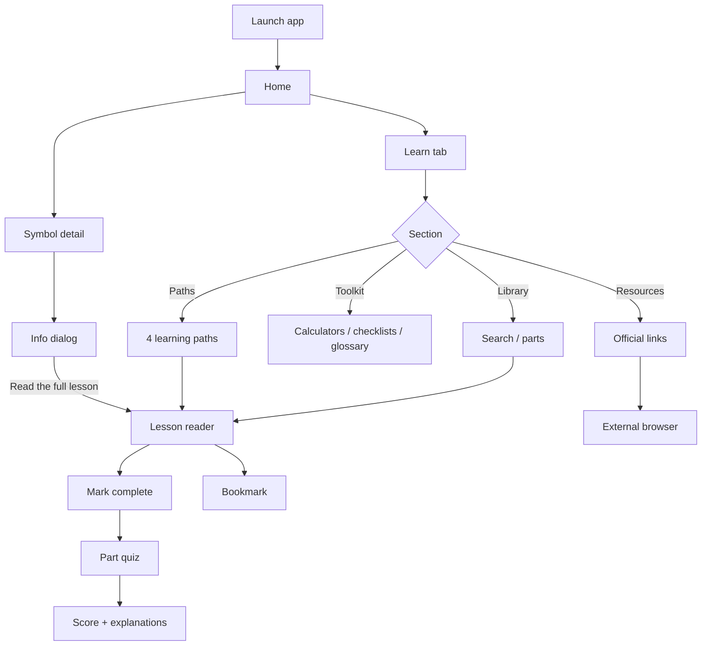
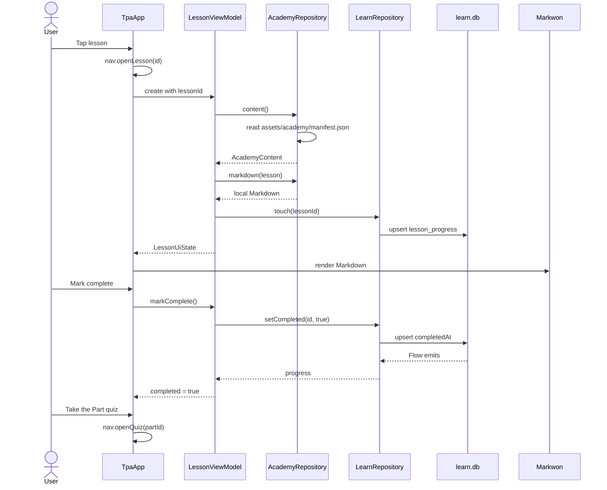

# v1.4.0 — Offline Investing Academy

**Scope:** Android app only. Server, pipeline and `data/` are untouched.
**Goal:** turn the curated `/home/srinidhi/Documents/AI-Invest` notes into an offline academy inside the app: 139 lessons, 11 parts, learning paths, progress, bookmarks, part quizzes, glossary, checklists, calculators and an official-resources directory.
**Release:** `versionCode 140`, `versionName "1.4.0"`, tag `v1.4.0`, APK attached by CI.

---

## 0. Read this first (fresh-agent context)

1. The source corpus is **147 Markdown files**, but only **139** are usable. Eight files are excluded (§2). Earlier planning notes said 141; that was wrong because `Part 2/merged.md` is an 87k-word concatenation and `Chapter 13— Financial Ratio Analysis (Part 1).md` is byte-identical to `Chapter 12`.
2. Do **not** re-read the 147 source files. Everything needed is in this plan and `design/book-spec.md`. Spot-read a source chapter only when a title or cleanup edge case is genuinely unclear.
3. Content is committed as Markdown + JSON under `content/academy/` and bundled into the APK through `assets.srcDir("../../content")`. No runtime download, no database seed from network.
4. The academy has **zero AI calls, zero new server endpoints, zero new data providers, zero background sync**. Progress is local Room (`learn.db`). This is the hard quota rule.
5. The existing three tabs and v1.3.0 chart/pivot behaviour must not change. `Learn` is a fourth tab.
6. Markdown rendering is Markwon 4.6.2 (`core`, `ext-tables`, `ext-strikethrough`). No Compose Markdown library, no WebView.
7. All lesson content is UTF-8 with `₹`, em dashes and tables. Never ASCII-fold it.
8. CI is the only build/test gate. Do not run Gradle locally. Push after each phase and let CI verify.
9. Do not spawn subagents, do not poll CI in a loop, do not generate images. Use `gh run list`/`gh run watch` once per phase.
10. If anything conflicts with this plan, stop and ask the user. Do not silently invent content or APIs.

---

## 1. Product definition

### 1.1 What the user gets

| Area | Behaviour |
|---|---|
| Learn tab | Offline library of 139 lessons grouped into 11 parts, with search |
| Learning paths | 4 ordered paths (beginner, fundamental, technical, long-term) with progress |
| Reader | Markwon-rendered lesson, minutes, part position, bookmark, mark complete, prev/next |
| Progress | Local completion + last-opened; resume card; part and overall percentages |
| Quiz | 5 questions per part (55 total), instant explanation, score, retake |
| Toolkit | SIP/compounding, CAGR, position size + R:R, pivot-point calculators |
| Checklists | Watchlist building, pre-investment, sell discipline, ticked locally |
| Glossary | 72 Indian-market terms in the app, searchable |
| Resources | 22 official/free sources opened in the user's browser |
| Contextual learning | Existing `Info` dialogs gain "Read the full lesson" where a lesson matches |

### 1.2 Non-goals

- No AI tutor, chatbot, summariser or LLM SDK.
- No server changes, new Vercel functions, cron jobs or database.
- No accounts, cloud sync, analytics, telemetry or push.
- No content downloads after install.
- No tax calculator (rules change too often).
- No PDF export, audio, translation, flashcards or certificates in this release.
- No redesign of Home/Wishlist/Charts.

### 1.3 Success criteria

- A new user can install the APK, enable airplane mode, and complete a full lesson, quiz and calculator without any network call.
- 139 lessons, 11 quizzes, 4 paths, 72 glossary terms, 3 checklists and 22 resources are present in the release APK.
- Existing v1.3.0 unit tests pass and all three old tabs behave exactly as before.
- APK growth is under 3 MB.

---

## 2. Corpus audit (verified)

### 2.1 Inventory

| Order | Part id | Source directory | Source files | Lessons | ID range |
|---:|---|---|---:|---:|---|
| 1 | `foundations` | `Part 1 - Foundations` | 3 | 3 | `foundations-01..03` |
| 2 | `fundamentals` | `Part 2 - Fundamental Analysis` | 52 | **50** | `fundamentals-01..50` |
| 3 | `technicals` | `Part 3 - Technical analysis` | 28 | 28 | `technicals-01..28` |
| 4 | `derivatives` | `Part 4 - Derivatives` | 3 | 3 | `derivatives-01..03` |
| 5 | `portfolio` | `Part 5 - Portfolio Management` | 4 | 4 | `portfolio-01..04` |
| 6 | `macro` | `Part 6 - Macroeconomics` | 6 | 6 | `macro-01..06` |
| 7 | `sectors` | `Part 7 - Indian Sectors` | 18 | **17** | `sectors-01..17` |
| 8 | `taxation` | `Part 8 - Taxation and regulations` | 5 | 5 | `taxation-01..05` |
| 9 | `styles` | `Part 9 - Investing Styles` | 12 | 12 | `styles-01..12` |
| 10 | `practical` | `Part 10 - Practical Investing` | 4 | **3** | `practical-01..03` |
| 11 | `tools` | `Part 11 - Tools & Data sources` | 8 | 8 | `tools-01..08` |
| — | — | `Part 10 - Taxation and regulations` (excluded) | 3 | 0 | — |
| — | — | `Index.md` (excluded) | 1 | 0 | — |
| | **Total** | | **147** | **139** | |

Verified corpus size after exclusions: **261,935 words**, **1,455 reading minutes** at 180 wpm (~24.2 hours). Largest lesson: `sectors-01` (Banking), 7,831 words. No images, no relative links, 104 files with tables, 90 with code fences.

### 2.2 Exclusions (exactly 8 files)

| # | File | Reason |
|---:|---|---|
| 1 | `Index.md` | Curriculum index, not a lesson |
| 2 | `Part 2 - Fundamental Analysis/merged.md` | 87k-word concatenation of chapters already present individually |
| 3 | `Part 2 - Fundamental Analysis/Chapter 13— Financial Ratio Analysis (Part 1).md` | Byte-identical to Chapter 12 (same md5 `c41cfdc6…`) |
| 4 | `Part 7 - Indian Sectors/Chapter 9 - Banking Sector (Repeat).md` | Condensed repeat of Chapter 1, same topic |
| 5 | `Part 10 - Practical Investing/Chapter 3 - Writing thesis.md` | 0 bytes |
| 6 | `Part 10 - Taxation and regulations/Chapter 1 - Capital gains.md` | Duplicate of Part 8 Chapter 1 |
| 7 | `Part 10 - Taxation and regulations/Chapter 2 - Dividends.md` | Duplicate of Part 8 Chapter 2 |
| 8 | `Part 10 - Taxation and regulations/Chapter 3 - Tax loss harvesting.md` | Duplicate of Part 8 Chapter 3 |

`Part 10 - Taxation and regulations/` as a directory is skipped entirely; Part 8 is authoritative.

### 2.3 Known source defects and treatment

| Defect | Treatment |
|---|---|
| Conversational preambles ("Perfect.", "Excellent.", "You're right.") | Dropped before the first numbered section |
| Duplicate chapter numbers (Part 2 headings lag filenames by 1) | Order by **filename** chapter number, not heading number |
| Part 3 filenames contain truncated titles ("hart Patterns") and chapter numbers offset by 15 | Take the title from the `# Chapter …` heading, strip the number, ignore filename text |
| Part 2 has no chapter 34 | Nothing to add; 50 lessons is correct |
| Part 2 ch12/ch13 have no H1, only an H2 `## Chapter 10 …` | Title extractor accepts `#{1,3}` |
| Part 2 ch52 heading typo "aluation" | Title override |
| Some chapters have long titles | Title overrides for the 3 derivatives lessons and Part 2 ch52 |
| Headings wrapped in `**` | Unwrap emphasis before title/heading use |
| Horizontal `---` separators | Removed outside code fences |
| Tables/code fences | Preserved; fence-aware cleanup |

### 2.4 Content disclaimers

Every lesson reader appends a fixed footer (not stored in each Markdown file):

> Educational content adapted from curated notes. Not investment, tax or legal advice. Tax rules and regulations change; verify with a qualified professional before acting.

`content/academy/NOTICE.md` repeats the disclaimer and states the source. It is bundled but not listed in the manifest.

---

## 3. Curriculum model

### 3.1 Parts, titles and subtitles

| Order | id | Title | Subtitle |
|---:|---|---|---|
| 1 | `foundations` | Foundations | Money, markets and how India invests |
| 2 | `fundamentals` | Fundamental Analysis | Read a business like an owner |
| 3 | `technicals` | Technical Analysis | Price, trend and risk |
| 4 | `derivatives` | Derivatives | Futures, options and positioning |
| 5 | `portfolio` | Portfolio Management | Build and rebalance a portfolio |
| 6 | `macro` | Macroeconomics | The economy behind the market |
| 7 | `sectors` | Indian Sectors | How each industry makes money |
| 8 | `taxation` | Taxation & Regulation | Taxes, SEBI and disclosures |
| 9 | `styles` | Investing Styles | Find a process that fits you |
| 10 | `practical` | Practical Investing | Watchlists, screeners and selling |
| 11 | `tools` | Tools & Data Sources | Primary sources and workflows |

### 3.2 Stable identifiers

- Lesson id: `<part id>-NN`, two digits, `01` based, assigned after numeric sorting inside the part.
- File name: `lessons/<part id>/<NN>-<slug>.md`.
- `NN` is the **position** in the part, not the source chapter number.
- Ids never change after release; adding a lesson later appends the next number.
- Slug: lowercase ASCII, non-alphanumerics → `-`, collapse repeats, trim `-`, max 60 chars at a word boundary.
- Title: extracted from source heading (see §4.3), cleaned, max 80 chars.
- Minutes: `max(3, round(words / 180))`.
- Summary: first usable paragraph, Markdown stripped, max 160 chars.
- Terms: ids auto-detected from `glossary.json`, max 8 per lesson.

### 3.3 Section ordering

Sort each source directory by the **numeric chapter number in the filename** (`Chapter 12` before `Chapter 100`; never lexicographic). For Part 1 accept lowercase `chapter 1`. Fall back to the heading number, then filename.

Known consequences:

- `technicals-01` is `Chapter 1 - Price Action Basics (Part 1)` although its heading says "Chapter 16".
- `fundamentals-09` is source Chapter 12 (Ratio Analysis Part 1).
- `fundamentals-10` is source Chapter 14 (Profitability Ratios).
- `sectors-09` is source Chapter 10 (Capital goods), because Chapter 9 is excluded.

---

## 4. Content build pipeline

### 4.1 Files

| Path | Purpose |
|---|---|
| `tools/academy/build_academy.py` | Deterministic stdlib-only generator |
| `tools/academy/overrides.json` | Skip list + title overrides |
| `tools/academy/README.md` | Build command and edit rules |
| `content/academy/` | Output consumed by the app |
| `content/academy/NOTICE.md` | Source + disclaimer |

### 4.2 Command

```bash
python3 tools/academy/build_academy.py \
  --source /home/srinidhi/Documents/AI-Invest \
  --out content/academy

# Developer check: fail if committed output differs from regeneration
python3 tools/academy/build_academy.py \
  --source /home/srinidhi/Documents/AI-Invest \
  --out content/academy --check
```

The generator writes only `manifest.json` and `lessons/**`. It must never overwrite hand-authored `paths.json`, `quizzes.json`, `resources.json`, `glossary.json`, `checklists.json`, `NOTICE.md`.

### 4.3 Algorithm (exact order)

1. Read UTF-8, remove BOM, normalise `\r\n`/`\r` to `\n`.
2. Reject a file if it is in `overrides.json.skip` or under `Part 10 - Taxation and regulations/`.
3. Derive order number from the filename with `Chapter\s*(\d+)` (case-insensitive), fall back to the first chapter heading.
4. Derive title:
   - Find the first line matching `^#{1,3}\s*(?:\*\*)?(?:Chapter|Part)\b` within the first 40 lines.
   - Strip `#`, `**`, `__`, and the leading `Chapter <number>` plus the following `—`, `–` or `-`.
   - Do not append the next subtitle heading. Part 3 titles stay "Chart Patterns (Part 1)", not the long sentence below it.
   - Apply `overrides.json.titles[relative_path]` last.
   - Fall back to a filename-derived title if no heading exists.
5. Clean the body, line by line, tracking `in_fence` toggled by lines starting with ``` or ~~~. Outside fences:
   - Remove `^---+\s*$`.
   - Within the first 40 lines, remove `^#{1,6}\s*(?:\*\*)?(?:Volume|Part|Chapter)\b.*$` and a following unnumbered subtitle heading.
   - Choose the body start: the first heading matching `^#{1,6}\s*(?:\*\*)?\d+\.\d+` if one exists; otherwise the first non-empty line after the last removed top heading.
   - Drop everything before the body start.
   - Demote every remaining heading by one `#` (cap at 6) and unwrap `**`/`__` around heading text.
   - Never modify lines inside fences.
6. Collapse 3+ blank lines to 2, strip trailing spaces, ensure one trailing newline.
7. Fail the build if body words < 80, title is blank, the body does not start with `## `, or the cleaned body still contains a top-level `Volume`/`Chapter` heading.
8. Compute minutes, summary, and `terms` (scan for glossary display names, word-boundary, case-insensitive, cap 8 sorted by term id).
9. Write the lesson file, add it to the part's lesson list.
10. Write `manifest.json` with parts sorted by `order`, lessons by position, JSON indent 2, UTF-8, `ensure_ascii=False`.
11. `--check` compares every generated file byte-for-byte with the committed output and exits non-zero on drift.

### 4.4 `overrides.json`

```json
{
  "skip": [
    "Index.md",
    "Part 2 - Fundamental Analysis/merged.md",
    "Part 2 - Fundamental Analysis/Chapter 13— Financial Ratio Analysis (Part 1).md",
    "Part 7 - Indian Sectors/Chapter 9 - Banking Sector (Repeat).md",
    "Part 10 - Practical Investing/Chapter 3 - Writing thesis.md"
  ],
  "skipDirs": [
    "Part 10 - Taxation and regulations"
  ],
  "titles": {
    "Part 2 - Fundamental Analysis/Chapter 52 - aluation (Part 21)The Complete Valuation Framework A Professional Investor's Checklist.md": "Valuation (Part 21): The Complete Framework",
    "Part 4 - Derivatives/Chapter 1 - Futures Contracts, Futures Pricing, Margin, Leverage, Open Interest, Hedging, Speculation, and Risks.md": "Futures, pricing and hedging",
    "Part 4 - Derivatives/Chapter 2 - Options Calls, Puts, Option Premium, Intrinsic Value, Time Value, Greeks, Option Chain, Open Interest, PCR, Max Pain, and Option Strategies.md": "Options and strategies",
    "Part 4 - Derivatives/Chapter 3 - Derivative Market DataOpen Interest Analysis, Option Chain Interpretation, Put-Call Ratio, Max Pain, Institutional Positioning, and FII-DII Derivatives Activity.md": "Derivative market data"
  }
}
```

### 4.5 Output tree

```
content/academy/
├── manifest.json
├── paths.json
├── quizzes.json
├── resources.json
├── glossary.json
├── checklists.json
├── NOTICE.md
└── lessons/
    ├── foundations/01-personal-finance-wealth-creation.md ... 03-...
    ├── fundamentals/01-understanding-businesses.md ... 50-...
    ├── technicals/01-price-action-basics-part-1.md ... 28-pivot-points.md
    ├── derivatives/01-futures-pricing-and-hedging.md ... 03-...
    ├── portfolio/01-... ... 04-...
    ├── macro/01-... ... 06-...
    ├── sectors/01-banking-sector.md ... 17-...
    ├── taxation/01-capital-gains.md ... 05-...
    ├── styles/01-value-investing.md ... 12-...
    ├── practical/01-watch-list-building.md ... 03-selling-framework.md
    └── tools/01-company-filings.md ... 08-...
```

---

## 5. Asset schemas

All files are `schema: 1`, UTF-8, no comments. Kotlin decoders use `ignoreUnknownKeys = true`.

### 5.1 `manifest.json`

```json
{
  "schema": 1,
  "version": "1.4.0",
  "generatedFrom": "AI-Invest",
  "parts": [
    {
      "id": "foundations",
      "order": 1,
      "title": "Foundations",
      "subtitle": "Money, markets and how India invests",
      "lessons": [
        {
          "id": "foundations-01",
          "title": "Personal Finance & Wealth Creation",
          "file": "lessons/foundations/01-personal-finance-wealth-creation.md",
          "minutes": 9,
          "summary": "Wealth is the ability of assets to fund a lifestyle without continuous labour.",
          "terms": ["compounding", "net-worth"]
        }
      ]
    }
  ]
}
```

Rules:

- Exactly 11 parts, exactly 139 lessons.
- `id` matches `^[a-z]+-\d{2}$`.
- `file` starts with `lessons/`, ends `.md`, contains the part id, no `..`.
- `terms` ids exist in `glossary.json`.
- Per-part counts: 3, 50, 28, 3, 4, 6, 17, 5, 12, 3, 8.
- Titles unique inside a part.
- No nulls; `terms` may be `[]`.

### 5.2 `paths.json`

```json
{
  "schema": 1,
  "paths": [
    {
      "id": "beginner",
      "title": "Start from zero",
      "level": "Beginner",
      "description": "Money basics, how markets work, one valuation lesson and your first watchlist.",
      "lessonIds": ["foundations-01", "foundations-02", "foundations-03"]
    }
  ]
}
```

Exact paths (do not reorder; ids must exist):

| id | Title | Level | Lesson ids |
|---|---|---|---|
| `beginner` | Start from zero | Beginner | `foundations-01`, `foundations-02`, `foundations-03`, `fundamentals-01`, `fundamentals-06`, `technicals-01`, `portfolio-01`, `macro-01`, `taxation-01`, `practical-01`, `practical-02`, `tools-08` |
| `fundamental` | Read a business | Intermediate | `fundamentals-01`, `fundamentals-02`, `fundamentals-03`, `fundamentals-04`, `fundamentals-05`, `fundamentals-06`, `fundamentals-09`, `fundamentals-10`, `fundamentals-27`, `fundamentals-30`, `fundamentals-36`, `fundamentals-37`, `fundamentals-48`, `sectors-01` |
| `technical` | Chart and risk | Intermediate | `technicals-01`, `technicals-04`, `technicals-08`, `technicals-16`, `technicals-17`, `technicals-22`, `technicals-23`, `technicals-24`, `technicals-26`, `technicals-27`, `technicals-28`, `portfolio-01`, `practical-02`, `practical-03` |
| `longterm` | Build a portfolio | Advanced | `foundations-01`, `portfolio-01`, `portfolio-02`, `portfolio-03`, `portfolio-04`, `fundamentals-27`, `fundamentals-36`, `fundamentals-48`, `sectors-01`, `taxation-01`, `taxation-02`, `taxation-03`, `styles-01`, `practical-03` |

Path UI shows `completed / lessonIds.size`; no separate persistence.

### 5.3 `quizzes.json`

```json
{
  "schema": 1,
  "quizzes": [
    {
      "partId": "foundations",
      "questions": [
        {
          "id": "foundations-q1",
          "lessonId": "foundations-01",
          "prompt": "Wealth is best described as…",
          "options": ["Cash in hand", "Assets that fund a lifestyle without continuous work", "Monthly salary", "A large bank balance"],
          "answer": 1,
          "explanation": "Wealth is assets plus cash flow minus liabilities, not a salary or a balance."
        }
      ]
    }
  ]
}
```

Rules:

- Exactly one quiz per part: 11 quizzes, exactly 5 questions each, 55 total.
- `answer` is 0..3; exactly 4 options; explanation 1–2 sentences.
- `lessonId` belongs to that part.
- No question may require outside knowledge; every answer must be in that part's lessons.
- Question ids `<partId>-q1..q5`.
- Order is fixed (no shuffle) so tests and explanations stay deterministic.

### 5.4 `resources.json`

```json
{
  "schema": 1,
  "resources": [
    {
      "id": "sebi-investor-education",
      "title": "SEBI Investor Education",
      "publisher": "SEBI",
      "category": "Regulator",
      "url": "https://investor.sebi.gov.in/",
      "description": "Official investor education, complaints and awareness material.",
      "lessonIds": ["foundations-03", "taxation-04"]
    }
  ]
}
```

Required 22 entries:

| id | Title | Publisher | URL | Category |
|---|---|---|---|---|
| `sebi-investor-education` | SEBI Investor Education | SEBI | `https://investor.sebi.gov.in/` | Regulator |
| `sebi` | Securities and Exchange Board of India | SEBI | `https://www.sebi.gov.in/` | Regulator |
| `sebi-scores` | SEBI SCORES | SEBI | `https://scores.sebi.gov.in/` | Regulator |
| `rbi` | Reserve Bank of India | RBI | `https://www.rbi.org.in/` | Regulator |
| `rbi-retail-direct` | RBI Retail Direct | RBI | `https://rbiretaildirect.org.in/` | Regulator |
| `nse` | NSE India | NSE | `https://www.nseindia.com/` | Exchange |
| `bse` | BSE India | BSE | `https://www.bseindia.com/` | Exchange |
| `nifty-indices` | Nifty Indices | NSE | `https://www.niftyindices.com/` | Exchange |
| `amfi` | Association of Mutual Funds in India | AMFI | `https://www.amfiindia.com/` | Mutual funds |
| `valueresearch` | Value Research | Value Research | `https://www.valueresearchonline.com/` | Mutual funds |
| `nsdl` | NSDL | NSDL | `https://nsdl.co.in/` | Depository |
| `cdsl` | CDSL | CDSL | `https://www.cdslindia.com/` | Depository |
| `incometax` | Income Tax Department | Government of India | `https://www.incometax.gov.in/` | Tax |
| `pfrda` | PFRDA | PFRDA | `https://www.pfrda.org.in/` | Retirement |
| `irdai` | IRDAI | IRDAI | `https://irdai.gov.in/` | Insurance |
| `mca` | Ministry of Corporate Affairs | MCA | `https://www.mca.gov.in/` | Filings |
| `nse-filings` | NSE corporate filings | NSE | `https://www.nseindia.com/companies-listing/corporate-filings-announcements` | Filings |
| `screener` | Screener | Screener | `https://www.screener.in/` | Screeners |
| `tickertape` | Tickertape | Tickertape | `https://www.tickertape.in/` | Screeners |
| `zerodha-varsity` | Varsity | Zerodha | `https://zerodha.com/varsity/` | Education |
| `nse-academy` | NSE Academy | NSE | `https://www.nseacademy.com/` | Education |
| `tradingview` | TradingView | TradingView | `https://www.tradingview.com/` | Charts |

Author verifies each URL once in a browser before commit. No CI network checks. Links open in the user's browser; the app itself makes no request.

### 5.5 `glossary.json`

```json
{
  "schema": 1,
  "terms": [
    {
      "id": "nse",
      "term": "NSE",
      "definition": "National Stock Exchange, India's largest equity exchange by turnover.",
      "lessonIds": ["foundations-03"]
    }
  ]
}
```

Required minimum set (72 terms). Definitions are 1–2 plain sentences. `id` is kebab-case.

- Market: NSE, BSE, SEBI, RBI, Demat account, T+1 settlement, Circuit limit, IPO, OFS, Rights issue, Buyback, Bulk deal, Block deal.
- Participants: FII, DII, Mutual fund, NAV, SIP, PMS, AIF, ETF, REIT, InvIT.
- Company: Market cap, Free float, Promoter holding, Pledged shares, Dividend, Bonus issue, Stock split, Book value, EPS, P/E, P/B, EV/EBITDA, ROE, ROCE, Debt-to-equity, Interest coverage, Current ratio, Free cash flow.
- Macro: Repo rate, CPI inflation, GDP, Fiscal deficit, Current account deficit, Rupee depreciation.
- Technical: Support, Resistance, Trendline, Moving average, RSI, MACD, ADX, ATR, Bollinger Bands, Volume, Delivery %, Open interest.
- Derivatives: Futures, Options, Call option, Put option, Premium, Strike price, Expiry.
- Risk: Stop-loss, Position size, Risk-reward.
- Tax: STCG, LTCG, Tax-loss harvesting.

Use ids: `nse`, `bse`, `sebi`, `rbi`, `demat`, `t-plus-one`, `circuit-limit`, `ipo`, `ofs`, `rights-issue`, `buyback`, `bulk-deal`, `block-deal`, `fii`, `dii`, `mutual-fund`, `nav`, `sip`, `pms`, `aif`, `etf`, `reit`, `invit`, `market-cap`, `free-float`, `promoter-holding`, `pledged-shares`, `dividend`, `bonus-issue`, `stock-split`, `book-value`, `eps`, `pe`, `pb`, `ev-ebitda`, `roe`, `roce`, `debt-equity`, `interest-coverage`, `current-ratio`, `free-cash-flow`, `repo-rate`, `cpi`, `gdp`, `fiscal-deficit`, `cad`, `rupee-depreciation`, `support`, `resistance`, `trendline`, `moving-average`, `rsi`, `macd`, `adx`, `atr`, `bollinger`, `volume`, `delivery-percent`, `open-interest`, `futures`, `options`, `call-option`, `put-option`, `premium`, `strike-price`, `expiry`, `stop-loss`, `position-size`, `risk-reward`, `stcg`, `ltcg`, `tax-loss-harvesting`.

### 5.6 `checklists.json`

```json
{
  "schema": 1,
  "checklists": [
    {
      "id": "watchlist",
      "title": "Watchlist building",
      "lessonId": "practical-01",
      "items": [
        { "id": "watchlist-01", "text": "Business model understood in one sentence." }
      ]
    }
  ]
}
```

Three checklists:

| id | Title | Lesson | Items |
|---|---|---|---:|
| `watchlist` | Watchlist building | `practical-01` | 10 |
| `pre-investment` | Before you buy | `fundamentals-01` | 12 |
| `sell-discipline` | Selling discipline | `practical-03` | 8 |

Item ids `<checklist id>-01..NN`. Checklist content is derived from the lessons, not new theory.

---

## 6. Quota guardrails (hard rules)

| Feature | Network | AI | Proof |
|---|---|---|---|
| Academy library | none | none | reads `assets/academy/*` only |
| Lesson reader | none | none | Markwon renders a local string |
| Progress/bookmarks/quiz | none | none | Room `learn.db` |
| Paths/glossary/checklists | none | none | local JSON |
| Calculators | none | none | pure Kotlin functions |
| Resources | user-initiated browser intent | none | `Intent.ACTION_VIEW`, no OkHttp |
| Existing quotes/charts | unchanged v1.3.0 path | none | no edits to network or server |

Enforcement:

- `com.tpa.app.data.learn` and `com.tpa.app.ui.learn` must not import `retrofit2`, `okhttp3`, `com.tpa.app.network` or any AI SDK.
- No new permission in `AndroidManifest.xml`.
- No WorkManager job, no `INTERNET` usage, no `WebView`.
- No new server route, no `server/` file change in this release.
- No analytics or crash SDK.
- Python test `test_academy_code_has_no_network` scans both packages for the strings above.
- Do the whole implementation in one agent. No subagents, no local Gradle builds, no repeated corpus reads.

---

## 7. Android data layer

### 7.1 Build changes (`android/app/build.gradle.kts`)

```kotlin
android {
    // ...
    sourceSets["main"].assets.srcDir("../../content")

    defaultConfig {
        versionCode = 140
        versionName = "1.4.0"
    }
}

dependencies {
    implementation("io.noties.markwon:core:4.6.2")
    implementation("io.noties.markwon:ext-tables:4.6.2")
    implementation("io.noties.markwon:ext-strikethrough:4.6.2")
}
```

No other dependency. Runtime asset paths start with `academy/` because `content/` is the assets root.

### 7.2 Models — `data/learn/AcademyModels.kt`

```kotlin
@Serializable data class AcademyManifest(
    val schema: Int,
    val version: String,
    val generatedFrom: String = "",
    val parts: List<AcademyPart>
)

@Serializable data class AcademyPart(
    val id: String,
    val order: Int,
    val title: String,
    val subtitle: String,
    val lessons: List<AcademyLesson>
)

@Serializable data class AcademyLesson(
    val id: String,
    val title: String,
    val file: String,
    val minutes: Int,
    val summary: String = "",
    val terms: List<String> = emptyList()
)

@Serializable data class PathsFile(val schema: Int, val paths: List<LearningPath>)

@Serializable data class LearningPath(
    val id: String,
    val title: String,
    val level: String,
    val description: String,
    val lessonIds: List<String>
)

@Serializable data class QuizBank(val schema: Int, val quizzes: List<PartQuiz>)

@Serializable data class PartQuiz(val partId: String, val questions: List<QuizQuestion>)

@Serializable data class QuizQuestion(
    val id: String,
    val lessonId: String,
    val prompt: String,
    val options: List<String>,
    val answer: Int,
    val explanation: String
)

@Serializable data class ResourcesFile(val schema: Int, val resources: List<ResourceLink>)

@Serializable data class ResourceLink(
    val id: String,
    val title: String,
    val publisher: String,
    val category: String,
    val url: String,
    val description: String,
    val lessonIds: List<String> = emptyList()
)

@Serializable data class GlossaryFile(val schema: Int, val terms: List<AcademyTerm>)

@Serializable data class AcademyTerm(
    val id: String,
    val term: String,
    val definition: String,
    val lessonIds: List<String> = emptyList()
)

@Serializable data class ChecklistsFile(val schema: Int, val checklists: List<Checklist>)

@Serializable data class Checklist(
    val id: String,
    val title: String,
    val lessonId: String,
    val items: List<ChecklistItem>
)

@Serializable data class ChecklistItem(val id: String, val text: String)
```

### 7.3 Repository — `data/learn/AcademyRepository.kt`

```kotlin
data class AcademyContent(
    val manifest: AcademyManifest,
    val paths: List<LearningPath>,
    val quizzes: List<PartQuiz>,
    val resources: List<ResourceLink>,
    val glossary: List<AcademyTerm>,
    val checklists: List<Checklist>
) {
    val lessons: List<AcademyLesson> get() = manifest.parts.flatMap { it.lessons }
    fun lesson(id: String): AcademyLesson? = lessons.firstOrNull { it.id == id }
    fun partOf(lessonId: String): AcademyPart? =
        manifest.parts.firstOrNull { p -> p.lessons.any { it.id == lessonId } }
    fun quiz(partId: String): PartQuiz? = quizzes.firstOrNull { it.partId == partId }
    fun checklistFor(lessonId: String): Checklist? =
        checklists.firstOrNull { it.lessonId == lessonId }
    fun next(lessonId: String): AcademyLesson? {
        val part = partOf(lessonId) ?: return null
        val index = part.lessons.indexOfFirst { it.id == lessonId }
        return part.lessons.getOrNull(index + 1)
    }
    fun previous(lessonId: String): AcademyLesson? {
        val part = partOf(lessonId) ?: return null
        val index = part.lessons.indexOfFirst { it.id == lessonId }
        return if (index > 0) part.lessons[index - 1] else null
    }
}

class AcademyRepository(private val context: Context) {
    suspend fun content(): AcademyContent = withContext(Dispatchers.IO) { load() }
    suspend fun markdown(lesson: AcademyLesson): String = withContext(Dispatchers.IO) {
        context.assets.open("academy/${lesson.file}")
            .bufferedReader(Charsets.UTF_8).use { it.readText() }
    }
}
```

`load()` caches one `AcademyContent?` in `@Volatile` state, reads the six JSON files with `Json { ignoreUnknownKeys = true }`, and throws a clear `IllegalStateException` if a file is missing or malformed. Never catch and silently return empty content.

### 7.4 Room — `data/learn/LearnEntities.kt`, `LearnDao.kt`, `LearnDb.kt`

```kotlin
@Entity(tableName = "lesson_progress")
data class LessonProgressEntity(
    @PrimaryKey val lessonId: String,
    val completedAt: Long? = null,
    val lastOpenedAt: Long = 0L
)

@Entity(tableName = "bookmarks")
data class BookmarkEntity(
    @PrimaryKey val lessonId: String,
    val createdAt: Long
)

@Entity(tableName = "quiz_attempts")
data class QuizAttemptEntity(
    @PrimaryKey(autoGenerate = true) val id: Long = 0,
    val partId: String,
    val score: Int,
    val total: Int,
    val takenAt: Long
)

@Entity(tableName = "checklist_state")
data class ChecklistStateEntity(
    @PrimaryKey val itemId: String,
    val checked: Boolean,
    val updatedAt: Long
)
```

```kotlin
@Dao
interface LearnDao {
    @Query("SELECT * FROM lesson_progress")
    fun progress(): Flow<List<LessonProgressEntity>>

    @Query("SELECT * FROM lesson_progress WHERE lessonId = :lessonId LIMIT 1")
    suspend fun progressFor(lessonId: String): LessonProgressEntity?

    @Upsert
    suspend fun upsertProgress(entry: LessonProgressEntity)

    @Query("SELECT * FROM bookmarks ORDER BY createdAt DESC")
    fun bookmarks(): Flow<List<BookmarkEntity>>

    @Query("SELECT EXISTS(SELECT 1 FROM bookmarks WHERE lessonId = :lessonId)")
    suspend fun hasBookmark(lessonId: String): Boolean

    @Insert(onConflict = OnConflictStrategy.IGNORE)
    suspend fun addBookmark(entry: BookmarkEntity)

    @Query("DELETE FROM bookmarks WHERE lessonId = :lessonId")
    suspend fun removeBookmark(lessonId: String)

    @Insert
    suspend fun addQuizAttempt(entry: QuizAttemptEntity)

    @Query("SELECT * FROM quiz_attempts ORDER BY takenAt DESC")
    fun quizAttempts(): Flow<List<QuizAttemptEntity>>

    @Query("SELECT * FROM checklist_state")
    fun checklistState(): Flow<List<ChecklistStateEntity>>

    @Upsert
    suspend fun upsertChecklist(entry: ChecklistStateEntity)
}
```

`LearnDb` is a **new** database, version 1, file `learn.db`, entity list above. Do not touch `WishlistDb` or `tpa.db`.

### 7.5 Progress repository — `data/learn/LearnRepository.kt`

Mirror `WishlistRepository` (manual `Room.databaseBuilder`, no DI framework):

```kotlin
class LearnRepository(context: Context) {
    private val db = Room.databaseBuilder(
        context.applicationContext, LearnDb::class.java, "learn.db"
    ).build()
    private val dao = db.dao()

    val progress: Flow<List<LessonProgressEntity>> = dao.progress()
    val bookmarks: Flow<List<BookmarkEntity>> = dao.bookmarks()
    val quizAttempts: Flow<List<QuizAttemptEntity>> = dao.quizAttempts()
    val checklistState: Flow<List<ChecklistStateEntity>> = dao.checklistState()

    suspend fun touch(lessonId: String)
    suspend fun setCompleted(lessonId: String, completed: Boolean)
    suspend fun toggleBookmark(lessonId: String)
    suspend fun recordQuiz(partId: String, score: Int, total: Int)
    suspend fun setChecklist(itemId: String, checked: Boolean)
}
```

`touch` and `setCompleted` read the existing row, copy it, and upsert, so an update never clears the other field. Timestamps use `System.currentTimeMillis()`.

### 7.6 Wiring — `TpaApplication.kt`

```kotlin
class AppContainer(context: Context) {
    val api: TpaApi = NetworkModule.createApi()
    val wishlist: WishlistRepository = WishlistRepository(context)
    val academy: AcademyRepository = AcademyRepository(context)
    val learn: LearnRepository = LearnRepository(context)
}
```

`LessonScreen` and `QuizScreen` receive `AppContainer`; they create their VMs with `remember(id) { ... }`, matching the existing `ChartViewModel` pattern.

---

## 8. Navigation

### 8.1 `MainTab` and `NavState`

```kotlin
enum class MainTab(val label: String) {
    Home("Home"),
    Wishlist("Wishlist"),
    Learn("Learn"),
    Charts("Charts")
}
```

```kotlin
data class NavState(
    val tab: MainTab = MainTab.Home,
    val detail: SymbolRoute? = null,
    val lesson: String? = null,
    val quizPart: String? = null
) {
    fun selectTab(next: MainTab): NavState = NavState(tab = next)

    fun openSymbol(symbol: String, tab: SymbolTab = SymbolTab.Chart): NavState {
        val clean = symbol.trim().uppercase()
        if (clean.isBlank()) return this
        return copy(detail = SymbolRoute(clean, tab))
    }

    fun selectSymbolTab(tab: SymbolTab): NavState =
        copy(detail = detail?.copy(tab = tab))

    fun openLesson(lessonId: String): NavState {
        val clean = lessonId.trim()
        if (clean.isBlank()) return this
        return copy(lesson = clean, quizPart = null)
    }

    fun openQuiz(partId: String): NavState {
        val clean = partId.trim()
        if (clean.isBlank()) return this
        return copy(quizPart = clean)
    }

    fun back(): NavState = when {
        quizPart != null -> copy(quizPart = null)
        lesson != null -> copy(lesson = null)
        detail != null -> copy(detail = null)
        else -> this
    }
}
```

Back order: quiz → lesson → symbol detail → tab. `selectTab` clears everything. Existing `NavStateTest` expectations remain valid.

### 8.2 Saver

`NavSaver` in `TpaApp.kt` saves five strings: `tab`, `detail.symbol`, `detail.tab`, `lesson`, `quizPart`. Restore tolerant of missing entries (defaults). Do not add a Navigation-Compose dependency.

### 8.3 Render order in `TpaApp`

```kotlin
when {
    nav.quizPart != null -> QuizScreen(
        container = container,
        partId = nav.quizPart!!,
        onBack = { nav = nav.back() }
    )
    nav.lesson != null -> LessonScreen(
        container = container,
        lessonId = nav.lesson!!,
        onBack = { nav = nav.back() },
        onOpenLesson = { nav = nav.openLesson(it) },
        onOpenQuiz = { nav = nav.openQuiz(it) }
    )
    nav.detail != null -> SymbolDetailScreen(/* unchanged */)
    else -> when (nav.tab) {
        MainTab.Home -> HomeScreen(/* unchanged */)
        MainTab.Wishlist -> WishlistScreen(/* unchanged */)
        MainTab.Learn -> LearnScreen(
            academy = container.academy,
            learn = container.learn,
            onOpenLesson = { nav = nav.openLesson(it) },
            onOpenQuiz = { nav = nav.openQuiz(it) }
        )
        MainTab.Charts -> ChartsTab(/* unchanged */)
    }
}
```

- `BackHandler(enabled = nav.detail != null || nav.lesson != null || nav.quizPart != null)`.
- `GlassBottomBar` is hidden while `lesson != null || quizPart != null`; it remains visible on symbol detail exactly as v1.3.0.
- Lesson overlay is available from any tab, so a chart explainer can open a lesson and return to the chart.

### 8.4 Composition local

`ui/navigation/LessonOpener.kt`:

```kotlin
val LocalLessonOpener = staticCompositionLocalOf<(String) -> Unit> { {} }
```

`TpaApp` provides it around the whole content. `InfoButton` uses it; no callback threading through Home/Symbol screens.

---

## 9. UI specification

Shared rules: glassmorphism via `Modifier.glassCard()` / `glassSurface()`, existing `AppBackground`, theme colors only, 24dp card corners, 16dp screen padding, no hardcoded hex colors.

### 9.1 `LearnScreen`

File: `ui/learn/LearnScreen.kt`.

Top to bottom:

1. Header: "Academy" (`headlineSmall`), subtitle `"139 lessons · ~24 hours · works offline"`.
2. Resume card (glass): "Continue" + lesson title + part + minutes; tap opens. If no incomplete lesson, show "Start the beginner path".
3. Segmented chips: `Library`, `Paths`, `Toolkit`, `Resources`; selected chip uses primary tint.
4. Section content.

**Library**
- Search field filters title + summary, case-insensitive, trimmed; empty query shows all.
- Overall progress: `LinearProgressIndicator` + "12 of 139 complete".
- Bookmark chip: toggles a bookmarked-only filter; count shown.
- Part cards: title, subtitle, "3 / 50", progress bar, expand/collapse chevron. Expanded rows: check icon (completed), title, minutes, bookmark icon if bookmarked.
- A completed lesson is dimmed but still tappable.
- Empty search: "No lesson matches \"…\"".

**Paths**
- Four cards: title, level chip, description, `completed / total`, progress bar, first incomplete lesson.
- Tapping a card expands its ordered lesson list using the same row.
- Primary button: "Start" / "Continue" opens the first incomplete lesson; "Done" when complete.

**Toolkit** and **Resources** are composables in their own files (§9.4, §9.5), rendered inside the same LazyColumn/scroll container.

State:

```kotlin
class AcademyViewModel(
    private val academy: AcademyRepository,
    private val learn: LearnRepository
) : ViewModel() {
    val state: StateFlow<AcademyUiState>
    fun retry()
}
```

`AcademyUiState` and nested `PartUi`, `PathUi`, `LessonUi` are defined in §9.6. Load content in `init` on `Dispatchers.IO`; combine with `learn.progress` and `learn.bookmarks`; `stateIn(..., SharingStarted.WhileSubscribed(5_000), AcademyUiState())`. Catch load errors into `error`.

### 9.2 `LessonScreen`

File: `ui/learn/LessonScreen.kt`.

- Top row: back `IconButton`, part title (small), bookmark `IconButton` (filled vs outline), no other chrome.
- Progress line: `"Lesson 9 of 50 · 7 min"` + thin progress bar.
- Body: `LessonMarkdown(markdown)` fills remaining space; Markwon output is the only scrollable element.
- Fixed footer above `navigationBarsPadding`:
  - Row: previous icon (enabled if available), primary button, next icon.
  - Primary label: `"Mark complete"` when incomplete, `"Completed ✓"` when complete. Tapping toggles.
  - When complete: `TextButton("Take the Part quiz")` opens `quizPartId`.
- On open: `learn.touch(lessonId)`.
- On complete: `learn.setCompleted(...)`; if next exists, primary becomes "Next lesson" behavior? Keep the button as completion toggle and use the **next arrow** for navigation. Do not auto-advance; users may want to re-read.
- Bookmark toggles instantly; icon reflects the Room flow.
- Key terms: VM appends a `## Key terms` Markdown section with `**Term** — definition` lines for `manifest.terms`, then the fixed disclaimer footer. This keeps one scroll container.
- Missing content/error: centered message + "Back".

VM:

```kotlin
class LessonViewModel(
    academy: AcademyRepository,
    learn: LearnRepository,
    lessonId: String
) : ViewModel() {
    val state: StateFlow<LessonUiState>
    fun markComplete()
    fun toggleBookmark()
}

data class LessonUiState(
    val loading: Boolean = true,
    val error: String? = null,
    val lessonId: String = "",
    val title: String = "",
    val partId: String = "",
    val partTitle: String = "",
    val markdown: String = "",
    val minutes: Int = 0,
    val indexInPart: Int = 0,
    val partSize: Int = 0,
    val completed: Boolean = false,
    val bookmarked: Boolean = false,
    val previousId: String? = null,
    val nextId: String? = null,
    val quizPartId: String? = null
)
```

Build the Markdown once in the VM after content loads; combine with progress/bookmark flows. Do not re-read the asset on every recomposition.

### 9.3 Markwon rendering

File: `ui/learn/MarkdownView.kt`.

```kotlin
@Composable
fun LessonMarkdown(markdown: String, modifier: Modifier = Modifier)
```

Implementation:

- `AndroidView` wrapping a `ScrollView` + `TextView`.
- Build `Markwon` once per color scheme with:
  - `TableEntryPlugin.create(context)`
  - `StrikethroughPlugin.create()`
  - custom `AbstractMarkwonPlugin` setting `linkColor`, `codeTextColor`, `codeBackgroundColor`, `blockQuoteColor`, heading multipliers `[1.6, 1.4, 1.25, 1.15, 1.05, 1.0]`.
- `TextView`: `setTextIsSelectable(true)`, `movementMethod = LinkMovementMethod.getInstance()`, `textSize = 16f` (sp), line spacing multiplier `1.35f`, padding `16.dp`, bottom padding `96.dp`, text color `onSurface`.
- Guard re-render with `if (tv.tag != markdown) { markwon.setMarkdown(tv, markdown); tv.tag = markdown }`.
- No images in content; no image loader dependency.
- Wide tables may wrap; acceptable for v1.4.0. Do not add horizontal-scroll complexity.

### 9.4 `QuizScreen`

File: `ui/learn/QuizScreen.kt` + pure `QuizEngine` in `QuizViewModel.kt`.

```kotlin
class QuizEngine(private val questions: List<QuizQuestion>) {
    var index: Int = 0
        private set
    private val answers = mutableListOf<Int>()

    val selected: Int? get() = answers.getOrNull(index)
    val answeredAll: Boolean get() = answers.size == questions.size
    val isLast: Boolean get() = index == questions.lastIndex
    val score: Int get() = questions.indices.count { answers.getOrNull(it) == questions[it].answer }

    fun choose(option: Int): Boolean {
        if (option !in 0..3 || selected != null) return false
        answers += option
        return true
    }

    fun next(): Boolean {
        if (selected == null || index >= questions.lastIndex) return false
        index++
        return true
    }

    fun retake() {
        index = 0
        answers.clear()
    }
}
```

UI:

- Header: back + part title + "Part quiz".
- Question counter `"Question 2 of 5"` + progress bar.
- Prompt, four option cards. After choosing: correct option green border, chosen wrong option red, other options dimmed. Explanation card appears. Choice is locked.
- Button `"Next"` until last, then `"See score"`.
- Result: `"4 / 5"`, short message (5 excellent, 4 strong, 3 getting there, ≤2 revisit), buttons `"Retake"` and `"Back"`.
- Record one `QuizAttemptEntity` when the result is first shown; do not record on retake until the new result. Use a `recorded` flag in the VM.

VM:

```kotlin
data class QuizUiState(
    val loading: Boolean = true,
    val error: String? = null,
    val partTitle: String = "",
    val question: QuizQuestion? = null,
    val index: Int = 0,
    val total: Int = 0,
    val selected: Int? = null,
    val answeredAll: Boolean = false,
    val showResult: Boolean = false,
    val score: Int = 0
)

class QuizViewModel(
    academy: AcademyRepository,
    learn: LearnRepository,
    partId: String
) : ViewModel() {
    val state: StateFlow<QuizUiState>
    fun choose(option: Int)
    fun next()          // advances; on the last answered question sets showResult = true
    fun retake()
}
```

All quizzes have exactly 5 questions (content test enforces it). Missing quiz → error card, never crash.

### 9.5 Toolkit and Resources

`ui/learn/tools/ToolkitScreen.kt`:

1. **Calculators** — four glass cards, each expandable. Inputs use `OutlinedTextField` with `KeyboardType.Decimal`; blank input → `—`; invalid (stop == entry, years ≤ 0, begin ≤ 0) → helper message, no crash. Results use `FinanceMath.formatInr`.
   - SIP: monthly amount (default 10,000), annual return % (12), years (10).
   - CAGR: initial (100), final (200), years (5).
   - Position: capital (100,000), risk % (1), entry (100), stop (95); optional target (120) shows R:R.
   - Pivots: high (120), low (100), close (110); shows PP, R1–R3, S1–S3.
2. **Checklists** — one card per checklist; checkbox rows; header shows `checked / total`; state from `learn.checklistState`, toggled via `learn.setChecklist`.
3. **Glossary** — search field; list of term + definition, filtered by term/definition; no pagination.

`ui/learn/ResourcesScreen.kt`:

- Group by `category`, preserve manifest order.
- Card: title, publisher, description, "Open" `TextButton`.
- `Intent(Intent.ACTION_VIEW, Uri.parse(url))`, `runCatching`; if it fails, show "No browser available".
- No in-app WebView.

### 9.6 State models

```kotlin
data class AcademyUiState(
    val loading: Boolean = true,
    val error: String? = null,
    val totalLessons: Int = 0,
    val completedLessons: Int = 0,
    val totalMinutes: Int = 0,
    val parts: List<PartUi> = emptyList(),
    val paths: List<PathUi> = emptyList(),
    val bookmarks: List<LessonUi> = emptyList(),
    val resume: LessonUi? = null
)

data class PartUi(
    val id: String,
    val title: String,
    val subtitle: String,
    val completed: Int,
    val total: Int,
    val lessons: List<LessonUi>
)

data class PathUi(
    val path: LearningPath,
    val completed: Int,
    val lessons: List<LessonUi>
)

data class LessonUi(
    val id: String,
    val title: String,
    val minutes: Int,
    val partId: String,
    val partTitle: String,
    val completed: Boolean,
    val bookmarked: Boolean
)
```

Resume rule: most recent `lastOpenedAt` among incomplete lessons; if none, first incomplete lesson in manifest order; if all complete, `null`.

### 9.7 Contextual lesson links in `Info.kt`

- `InfoTopic` gains `lessonId: String? = null`.
- `InfoButton` shows a `TextButton("Read the full lesson")` inside a topic when `lessonId != null`; tap closes the dialog and calls `LocalLessonOpener.current(lessonId)`.
- Add `fun lessonIds(): List<String> = topics.values.mapNotNull { it.lessonId }` to `Glossary` so a Kotlin test can validate every id.
- Map only high-confidence keys; leave app-specific keys (`search`, `quick`, `wishlist`, `bell`, `eod`, `range`, `interval`, `sector`, `verdict`, `components`) unmapped.

Mapping table:

| Glossary key | Lesson |
|---|---|
| `chart` | `technicals-01` |
| `trend` | `technicals-17` |
| `detection`, `confidence`, `target`, `overlay` | `technicals-16` |
| `rr`, `entry`, `stop`, `invalidation`, `position`, `verdict`, `components` | `technicals-27` |
| `rsi`, `macd`, `ema`, `adx`, `atr`, `bb`, `technicals` | `technicals-24` |
| `volratio`, `delivery` | `technicals-23` |
| `sr` | `technicals-22` |
| `candlechip` | `technicals-08` |
| `pivots` | `technicals-28` |
| `mcap` | `fundamentals-27` |
| `pe` | `fundamentals-36` |
| `ev` | `fundamentals-37` |
| `pb`, `bv` | `fundamentals-38` |
| `divyield` | `fundamentals-41` |
| `eps` | `fundamentals-16` |
| `margins`, `roa`, `roce`, `roic` | `fundamentals-10` |
| `shareholding` | `fundamentals-50` |
| `dcf` | `fundamentals-30` |
| `redflags` | `fundamentals-05` |
| `fundamentals` | `fundamentals-06` |

Positions verified against the 50-lesson Part 2 ordering; if the manifest disagrees, the content test fails and the mapping must be corrected, not the manifest.

---

## 10. Calculators — exact formulas and expected values

File: `ui/learn/tools/FinanceMath.kt`. Pure Kotlin, no Android imports.

```kotlin
object FinanceMath {
    fun sipFutureValue(monthly: Double, annualRatePct: Double, years: Int): Double
    fun lumpsumFutureValue(principal: Double, annualRatePct: Double, years: Int): Double
    fun cagr(begin: Double, end: Double, years: Double): Double?
    fun positionSize(capital: Double, riskPct: Double, entry: Double, stop: Double): Int
    fun riskReward(entry: Double, stop: Double, target: Double): Double?
    fun pivots(high: Double, low: Double, close: Double): PivotLevels
    fun formatInr(value: Double): String
}

data class PivotLevels(
    val pp: Double, val r1: Double, val r2: Double, val r3: Double,
    val s1: Double, val s2: Double, val s3: Double
)
```

Formulas:

- SIP: `i = annualRatePct / 1200`, `n = years * 12`; `monthly * (((1+i)^n - 1)/i) * (1+i)`; if `i == 0` → `monthly * n`.
- Lumpsum: `principal * (1 + annualRatePct/100)^years`.
- CAGR: `((end/begin)^(1/years) - 1) * 100`; return `null` if `begin <= 0`, `end < 0`, or `years <= 0`.
- Position size: `floor(capital * riskPct / 100 / abs(entry - stop))`; return `0` if `stop == entry`, `riskPct <= 0`, or `capital <= 0`.
- R:R: `abs(target - entry) / abs(entry - stop)`; `null` if `entry == stop`.
- Pivots: `PP=(H+L+C)/3`, `R1=2PP-L`, `S1=2PP-H`, `R2=PP+(H-L)`, `S2=PP-(H-L)`, `R3=H+2(PP-L)`, `S3=L-2(H-PP)`.

`formatInr`: Indian grouping (last 3 digits, then groups of 2), exactly 2 decimals, `₹`, negative `-₹`. Do **not** rely on `NumberFormat`/locale data; unit tests must be deterministic.

Expected values (assert with delta `0.01` unless integer):

| Case | Expected |
|---|---|
| SIP 10,000/month, 12%, 10 years | `₹23,23,390.76` |
| SIP 10,000/month, 0%, 10 years | `₹12,00,000.00` |
| Lumpsum 100,000, 12%, 10 years | `₹3,10,584.82` |
| CAGR 100 → 200, 5 years | `14.87` (%) |
| Position 100,000 capital, 1% risk, entry 100, stop 95 | `200` shares |
| R:R entry 100, stop 95, target 120 | `4.0` |
| Pivots H=120, L=100, C=110 | PP 110, R1 120, S1 100, R2 130, S2 90, R3 140, S3 80 |
| `formatInr(2323390.76)` | `₹23,23,390.76` |
| `formatInr(100000.0)` | `₹1,00,000.00` |

---

## 11. File-by-file checklist

### 11.1 New content/tooling

- [ ] `tools/academy/build_academy.py`
- [ ] `tools/academy/overrides.json`
- [ ] `tools/academy/README.md`
- [ ] `content/academy/manifest.json`
- [ ] `content/academy/paths.json`
- [ ] `content/academy/quizzes.json`
- [ ] `content/academy/resources.json`
- [ ] `content/academy/glossary.json`
- [ ] `content/academy/checklists.json`
- [ ] `content/academy/NOTICE.md`
- [ ] `content/academy/lessons/**` (139 files)
- [ ] `server/tests/test_academy_content.py`

### 11.2 New Android files

- [ ] `android/app/src/main/kotlin/com/tpa/app/data/learn/AcademyModels.kt`
- [ ] `android/app/src/main/kotlin/com/tpa/app/data/learn/AcademyRepository.kt`
- [ ] `android/app/src/main/kotlin/com/tpa/app/data/learn/LearnEntities.kt`
- [ ] `android/app/src/main/kotlin/com/tpa/app/data/learn/LearnDao.kt`
- [ ] `android/app/src/main/kotlin/com/tpa/app/data/learn/LearnDb.kt`
- [ ] `android/app/src/main/kotlin/com/tpa/app/data/learn/LearnRepository.kt`
- [ ] `android/app/src/main/kotlin/com/tpa/app/ui/navigation/LessonOpener.kt`
- [ ] `android/app/src/main/kotlin/com/tpa/app/ui/learn/AcademyViewModel.kt`
- [ ] `android/app/src/main/kotlin/com/tpa/app/ui/learn/LessonViewModel.kt`
- [ ] `android/app/src/main/kotlin/com/tpa/app/ui/learn/QuizViewModel.kt`
- [ ] `android/app/src/main/kotlin/com/tpa/app/ui/learn/QuizEngine.kt` (or same file as VM; keep pure class testable)
- [ ] `android/app/src/main/kotlin/com/tpa/app/ui/learn/LearnScreen.kt`
- [ ] `android/app/src/main/kotlin/com/tpa/app/ui/learn/LessonScreen.kt`
- [ ] `android/app/src/main/kotlin/com/tpa/app/ui/learn/QuizScreen.kt`
- [ ] `android/app/src/main/kotlin/com/tpa/app/ui/learn/MarkdownView.kt`
- [ ] `android/app/src/main/kotlin/com/tpa/app/ui/learn/LearnComponents.kt` (cards, rows, chips)
- [ ] `android/app/src/main/kotlin/com/tpa/app/ui/learn/tools/FinanceMath.kt`
- [ ] `android/app/src/main/kotlin/com/tpa/app/ui/learn/tools/ToolkitScreen.kt`
- [ ] `android/app/src/main/kotlin/com/tpa/app/ui/learn/ResourcesScreen.kt`
- [ ] `android/app/src/main/res/drawable/ic_learn.xml`
- [ ] `android/app/src/test/kotlin/com/tpa/app/ui/learn/FinanceMathTest.kt`
- [ ] `android/app/src/test/kotlin/com/tpa/app/ui/learn/QuizEngineTest.kt`
- [ ] `android/app/src/test/kotlin/com/tpa/app/ui/learn/AcademyContentTest.kt`
- [ ] `docs/diagrams/v1_4_0-flow.mmd`
- [ ] `docs/diagrams/v1_4_0-sequence.mmd`

### 11.3 Modified Android/CI files

- [ ] `android/app/build.gradle.kts` — assets source, version 140, Markwon deps
- [ ] `android/app/src/main/kotlin/com/tpa/app/TpaApplication.kt` — academy + learn in container
- [ ] `android/app/src/main/kotlin/com/tpa/app/ui/navigation/NavState.kt` — Learn tab, lesson/quiz routes
- [ ] `android/app/src/main/kotlin/com/tpa/app/ui/TpaApp.kt` — overlay order, hidden bar, saver
- [ ] `android/app/src/main/kotlin/com/tpa/app/ui/components/Info.kt` — lessonId + button
- [ ] `android/app/src/test/kotlin/com/tpa/app/ui/navigation/NavStateTest.kt` — new cases
- [ ] `.github/workflows/ci.yml` — APK asset verification
- [ ] `README.md` — one-line academy feature mention (optional but recommended)

### 11.4 `ic_learn.xml` (exact content)

`android/app/src/main/res/drawable/ic_learn.xml`:

```xml
<vector xmlns:android="http://schemas.android.com/apk/res/android"
    android:width="24dp" android:height="24dp"
    android:viewportWidth="24" android:viewportHeight="24">
  <path
      android:fillColor="#FF000000"
      android:pathData="M5,13.18v4L12,21l7,-3.82v-4L12,17l-7,-3.82zM12,3L1,9l11,6 9,-4.91V17h2V9L12,3z"/>
</vector>
```

The Learn tab renders it with `Icon(painterResource(R.drawable.ic_learn), tint = tint, ...)`, so the black fill is overridden by the active/inactive tint, exactly like `ic_chart.xml`.

---

## 12. Tests and CI

### 12.1 Python content tests — `server/tests/test_academy_content.py`

Use only `json`, `pathlib`, `re`, `pytest`. Academy root: `Path(__file__).resolve().parents[2] / "content/academy"`.

Required tests:

1. `test_manifest_shape` — schema 1, version `1.4.0`, 11 parts in order 1..11.
2. `test_lesson_counts` — exact per-part counts `{foundations:3, fundamentals:50, technicals:28, derivatives:3, portfolio:4, macro:6, sectors:17, taxation:5, styles:12, practical:3, tools:8}`, total 139.
3. `test_ids_unique_and_formatted` — `^[a-z]+-\d{2}$`, unique, contiguous per part.
4. `test_files_exist_and_match_manifest` — every `file` exists, is non-empty, name matches `lessons/<part>/NN-*.md`; no unlisted `.md` under `lessons/`.
5. `test_lesson_content_clean` — each file starts with `## `, contains no `^# (Volume|Chapter)`, no `Excellent.`/`Perfect.` preamble in the first 5 lines, no `](..`, no `![`, word count ≥ 80.
6. `test_minutes_and_summary` — `minutes >= 3`, summary non-empty ≤ 160 chars.
7. `test_terms_resolve` — every term id exists in `glossary.json`.
8. `test_paths` — 4 paths, ids unique, every lesson id valid, no duplicate within a path, no empty path.
9. `test_quizzes` — 11 quizzes, one per part, 5 questions each, 4 options, `answer` 0..3, explanation non-empty, question lesson belongs to part, ids unique.
10. `test_resources` — 22 entries, https URLs, unique ids, categories non-empty, every lesson id valid.
11. `test_glossary_and_checklists` — ≥72 terms, unique ids, definitions non-empty; 3 checklists, item ids unique, lesson ids valid.
12. `test_academy_code_has_no_network` — scan `android/app/src/main/kotlin/com/tpa/app/data/learn` and `.../ui/learn` for `retrofit2`, `okhttp3`, `com.tpa.app.network`, `openai`, `gemini`, `anthropic`; assert none.

### 12.2 Kotlin unit tests

- `FinanceMathTest` — all expected values in §10, including zero-rate SIP, invalid CAGR/position/R:R guards, Indian formatting.
- `QuizEngineTest` — cannot change an answer; score counts correct; next stops at last; retake resets; choosing invalid option returns false.
- `NavStateTest` additions:
  - `openLesson` sets lesson and clears quiz, keeps tab/detail.
  - `back` clears quiz first, then lesson, then detail.
  - `selectTab` clears lesson and quiz.
  - blank lesson/quiz ids are ignored (`assertSame`).
- `AcademyContentTest` (JVM, reads repo files):
  - locate `content/academy` at `../../content/academy` relative to `user.dir`, fallback `../content/academy`; `fail()` if absent.
  - manifest has 139 lessons and 11 parts.
  - every `Glossary.lessonIds()` resolves to a manifest lesson.
  - every quiz part id and path lesson id resolves.
  - every resource URL starts with `https://`.
  - every checklist lesson id resolves.

### 12.3 CI changes — `.github/workflows/ci.yml`

Add after `Assemble Release`:

```yaml
      - name: Verify academy assets in APK
        run: |
          APK=$(ls android/app/build/outputs/apk/release/*.apk)
          unzip -l "$APK" | grep -q "assets/academy/manifest.json"
          COUNT=$(unzip -l "$APK" | grep -c "assets/academy/lessons/.*\.md")
          test "$COUNT" -eq 139
```

Keep the APK upload step. No new job, no emulator, no network test. Python tests already run in `server-tests`; ensure `content/` is checked out (it is).

### 12.4 Manual QA (one pass, after green CI)

- Install release APK, airplane mode on, open Learn.
- Expand a part, open a lesson, mark complete, kill app, reopen: progress persisted.
- Bookmark a lesson, filter bookmarks, unbookmark.
- Open each Learn section; run one calculator per type.
- Take a quiz, check explanation and score, retake.
- Open 3 Info dialogs (`P/E`, `RSI 14`, `Pivot points`), tap "Read the full lesson", back returns to the same dialog context.
- Open a resource and confirm it leaves the app.
- Verify Home/Wishlist/Charts/detail/back still behave as v1.3.0.

---

## 13. Diagrams

Also write these to `docs/diagrams/v1_4_0-flow.mmd` and `docs/diagrams/v1_4_0-sequence.mmd`.

### 13.1 User flow



### 13.2 Sequence



---

## 14. Implementation order (one phase per commit/push)

### Phase 0 — Content

1. Write `tools/academy/build_academy.py`, `overrides.json`, `README.md`.
2. Run the build against `/home/srinidhi/Documents/AI-Invest`.
3. Verify: 139 files, 11 parts, 261,935 words ±1%, 1,455 minutes ±10, no preambles, no duplicate titles.
4. Author `paths.json`, `quizzes.json`, `resources.json`, `glossary.json`, `checklists.json`, `NOTICE.md`.
5. Add `server/tests/test_academy_content.py`; run it locally once (fast, no build).
6. Commit: `academy: add offline curriculum and content tests`; push; CI green.

Exit: Python tests pass; no Android change yet.

### Phase 1 — Data layer

1. Add Markwon deps, assets source, version 140.
2. Add `AcademyModels`, `AcademyRepository`, `LearnEntities`, `LearnDao`, `LearnDb`, `LearnRepository`.
3. Wire `AppContainer`.
4. Add `AcademyContentTest`, `FinanceMathTest`, `QuizEngineTest`.
5. Commit: `academy: add local content and progress data layer`; push; CI green.

Exit: compile + unit tests green; APK built but UI unchanged.

### Phase 2 — Navigation and library

1. Extend `MainTab`, `NavState`, `NavSaver`.
2. Add `LessonOpener`, `LearnScreen`, `LearnComponents`, `ic_learn`.
3. Add the Learn tab and bottom-bar entry; keep old tabs untouched.
4. Add `AcademyViewModel` and progress wiring.
5. Commit: `academy: add Learn tab and library`; push; CI green.

Exit: 4 tabs; searchable parts and lessons; progress percentages.

### Phase 3 — Reader and links

1. Add `MarkdownView`, `LessonScreen`, `LessonViewModel`.
2. Add quiz button placeholder (hidden until Phase 4 or disabled with "Coming soon").
3. Update `Info.kt`: `lessonId`, button, `Glossary.lessonIds()`.
4. Fill the mapping table in §9.7.
5. Add NavState tests.
6. Commit: `academy: add offline lesson reader and contextual links`; push; CI green.

Exit: read, complete, bookmark, prev/next, back; info links open the right lesson.

### Phase 4 — Paths and quizzes

1. Add path cards/expansion to `LearnScreen`.
2. Add `QuizEngine`, `QuizViewModel`, `QuizScreen`.
3. Wire `onOpenQuiz` from lesson footer and part cards.
4. Add quiz tests.
5. Commit: `academy: add learning paths and part quizzes`; push; CI green.

Exit: 4 paths, 11 quizzes, score and retake.

### Phase 5 — Toolkit and resources

1. Add `FinanceMath`, `ToolkitScreen`, `ResourcesScreen`.
2. Wire checklist Room state and glossary search.
3. Add calculator tests and exact formatting.
4. Commit: `academy: add calculators, checklists, glossary and resources`; push; CI green.

Exit: all toolkit sections work offline; links open externally.

### Phase 6 — Release

1. Polish glass styles, empty/error states, content descriptions, 48dp targets.
2. Write both Mermaid files; embed them here (already present).
3. Bump `README.md` if needed.
4. Update version to 140/1.4.0 (already in Phase 1; confirm).
5. Commit: `v1.4.0: offline investing academy`; push; CI green.
6. Tag and release (§15).

---

## 15. Release

1. Confirm CI on `main` is green and `release-apk` artifact exists.
2. `gh run list --workflow ci.yml --limit 3` → note run id.
3. `gh run download <run-id> -n release-apk -D /tmp/tpa-apk`.
4. `gh release create v1.4.0 /tmp/tpa-apk/app-release.apk#TPA.apk --title "v1.4.0 — Offline Investing Academy" --notes-file /tmp/tpa-notes.md`.
5. Notes must include:
   - 139 lessons across 11 parts, fully offline.
   - 4 learning paths, progress, bookmarks, 11 part quizzes.
   - 4 calculators, 3 checklists, 72 glossary terms, 22 official resources.
   - No new permissions, no runtime AI, no new network calls.
   - Existing chart/pivot features unchanged.
6. Verify the release page shows `TPA.apk`.

---

## 16. Risks and mitigations

| Risk | Mitigation |
|---|---|
| Content quality varies (conversational, duplicate, missing ch34) | Deterministic cleanup + explicit exclusions + Python content tests; document the 139 count |
| Tax/regulatory content ages | Fixed disclaimer; no tax calculator; resources link to official sites |
| Asset path not packaged | `assets.srcDir("../../content")` + CI unzip check for 139 `.md` files |
| Markwon/R8 issue | Release build is the CI gate; smoke-install the artifact; no reflection-dependent plugins |
| APK growth | No images, no fonts, no WebView; measure artifact; target < 3 MB growth |
| Room schema mistakes | New `learn.db` only; no migration; DAO unit-free but compile-checked |
| Progress lost on process death | Progress in Room; nav state saved with `NavSaver` |
| `Info` links point to wrong lesson | `AcademyContentTest` validates every `lessonId`; mapping table is authoritative |
| Source drift after build | Generated output committed; `--check` before commit; CI validates structure |
| Free-quota burn during implementation | One agent, no subagents, CI-only builds, no corpus re-reads, no images |
| Wide Markdown tables on phones | Accept wrapping in v1.4.0; defer horizontal scroll |

---

## 17. Acceptance criteria

- [ ] `content/academy/manifest.json` lists exactly 139 lessons in 11 parts.
- [ ] Every lesson file exists, is UTF-8 Markdown, starts with `## `, and has no source preamble or Volume/Chapter title.
- [ ] Python content tests pass in CI.
- [ ] Release APK contains `assets/academy/manifest.json` and 139 lesson files.
- [ ] Learn tab shows Library, Paths, Toolkit, Resources and works in airplane mode.
- [ ] Reader renders headings, lists, tables and code; mark complete and bookmark persist across restart.
- [ ] Prev/next stays inside the part and never crosses into another part.
- [ ] 4 paths resolve all lesson ids and show correct completion.
- [ ] 11 quizzes exist; each has 5 questions; answers lock; explanation shows; score is correct; retake resets.
- [ ] Calculators match every expected value in §10.
- [ ] 3 checklists persist ticks; 72 glossary terms searchable.
- [ ] 22 resources open via browser intent; no in-app request.
- [ ] `P/E`, `RSI 14` and `Pivot points` info dialogs open the mapped lessons.
- [ ] Existing `NavStateTest` cases pass; Home/Wishlist/Charts unchanged.
- [ ] `versionCode 140`, `versionName 1.4.0`, tag `v1.4.0`, `TPA.apk` attached.
- [ ] APK growth < 3 MB.

---

## 18. Deferred (do not build in v1.4.0)

- AI tutor, summaries or question generation (quota).
- Cloud sync, accounts, multi-device progress.
- Hindi/regional translations.
- Audio/TTS, PDF export, flashcards, spaced repetition.
- Interactive chart examples inside lessons.
- Per-lesson quizzes (v1.4.0 uses part quizzes).
- Downloadable/updated content from the server.
- Streaks, XP, certificates.
- Tax calculator.
- Horizontal scrolling for wide tables.
- In-app browser for resources.
