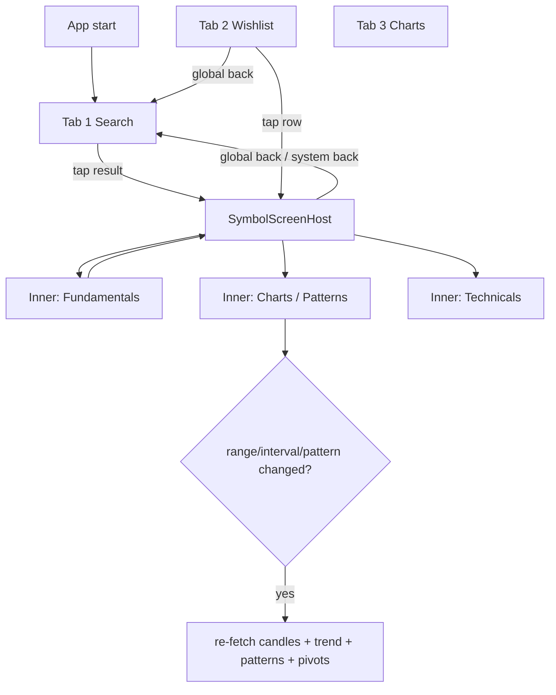

# T-41 Nav Restructure — Diagrams (plan §4.1 / §4.4 / AGENTS.md §6)

## Flowchart (user-facing, 3-tab bottom nav + stacked symbol)


## Sequence: global back from stacked detail
```mermaid
sequenceDiagram
    participant U as User
    participant MA as MainActivity / NavHost
    participant BH as BackHandler (symbol/{symbol})
    participant NB as BottomBar (Search/Wishlist/Charts)
    U->>MA: open Symbol detail (from Search / Wishlist)
    MA->>NB: highlight Search (root)
    U->>BH: press global / system back
    BH->>MA: nav.popBackStack("search", false)
    MA-->>NB: root visible; symbol stack cleared
    MA-->>U: back to Search tab
```

## Glassmorphism notes (AGENTS.md §6 / plan §4.3)
- Surface fill: `0xCCFFFFFF` (light) / `0xCC1E293B` (dark), 80 % opacity
- Blur: `Modifier.blur(12.dp)` + `graphicsLayer { alpha = 0.92f }`
- Border: `Color(0x33000000)` 1 dp subtle stroke
- Cards: translucent with soft shadow, no opaque backgrounds
