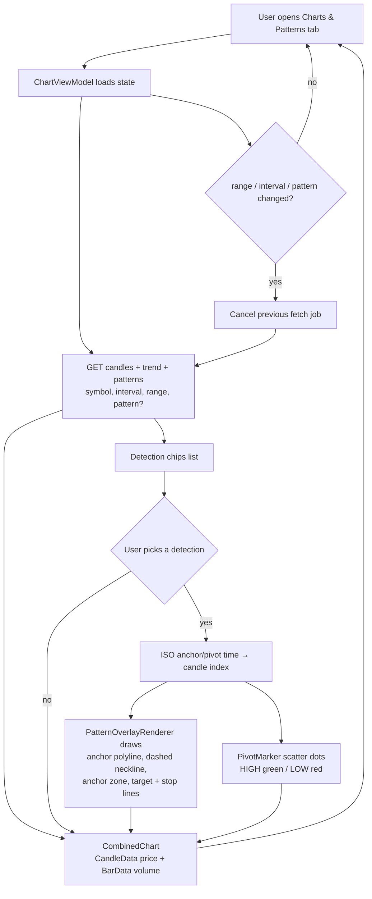
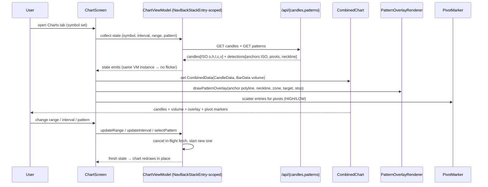

# T-47/T-48/T-49/T-50 — Chart Overhaul, Real Overlay, Pivot Markers, No Flicker

## Flowchart (user-facing)

## Sequence: chart load, overlay draw, re-trigger

## Implementation notes
- Chart host: `android/app/src/main/kotlin/com/tpa/app/ui/symbol/ChartScreen.kt` — one `CombinedChart` carrying price candles, volume bars and pivot scatter (`chart.extraData`).
- Overlay: `android/app/src/main/kotlin/com/tpa/app/ui/chart/PatternOverlayRenderer.kt`; pivots: `android/app/src/main/kotlin/com/tpa/app/ui/chart/PivotMarker.kt`; volume: `android/app/src/main/kotlin/com/tpa/app/ui/chart/VolumeBars.kt`.
- Anchor/pivot timestamps are ISO strings; `indexForTime` maps them to candle indices (exact match, then same-day fallback).
- Flicker elimination (T-50): view models are scoped to the `NavBackStackEntry`, so a recomposition or tab switch reuses the loaded state instead of refetching into an empty screen.
